# Introduction to Software Engineering
## Project Phase 3: Software Design Document

**Course**: CSC13002 – Introduction to Software Engineering  
**Department**: Software Engineering, Faculty of Information Technology  
**Institution**: Ho Chi Minh City University of Science (HCMUS), VNU-HCM  
**Project**: Vible – Online Teaching Platform  
**Team**: T06  
**Academic Year**: 2026–2027  

---

## Table of Contents
1. [Member Contribution Assessment](#1-member-contribution-assessment)
2. [Design Overview](#2-design-overview)
   - 2.1 [Design Goals and Constraints](#21-design-goals-and-constraints)
3. [Architectural Design](#3-architectural-design)
   - 3.1 [Architectural Style and Monorepo Structure](#31-architectural-style-and-monorepo-structure)
     - 3.1.1 [Edge-Layered Application Pattern](#311-edge-layered-application-pattern)
     - 3.1.2 [Monorepo Architecture and Codebase Decomposition](#312-monorepo-architecture-and-codebase-decomposition)
   - 3.2 [System Context Diagram (C4 Level 1)](#32-system-context-diagram-c4-level-1)
   - 3.3 [Container Diagram (C4 Level 2)](#33-container-diagram-c4-level-2)
   - 3.4 [Component Diagram (C4 Level 3)](#34-component-diagram-c4-level-3)
   - 3.5 [Deployment Diagram](#35-deployment-diagram)
   - 3.6 [Architecture Decision Records (ADRs)](#36-architecture-decision-records-adrs)
4. [Object-Oriented Design](#4-object-oriented-design)
   - 4.1 [Domain Model](#41-domain-model)
   - 4.2 [Class Diagram](#42-class-diagram)
   - 4.3 [Class Specifications](#43-class-specifications)
   - 4.4 [Sequence Diagrams](#44-sequence-diagrams)
   - 4.5 [State Machine Diagrams](#45-state-machine-diagrams)
   - 4.6 [Design Principles and Patterns](#46-design-principles-and-patterns)
5. [Data Design](#5-data-design)
   - 5.1 [Data Diagram (ERD)](#51-data-diagram-erd)
   - 5.2 [Data Specification](#52-data-specification)
   - 5.3 [Normalisation and Indexes](#53-normalisation-and-indexes)
6. [User Interface and User Experience Design](#6-user-interface-and-user-experience-design)
   - 6.1 [Screen List and Screen Flow](#61-screen-list-and-screen-flow)
   - 6.2 [Screen Specifications](#62-screen-specifications)
   - 6.3 [Accessibility Checklist](#63-accessibility-checklist)
7. [Traceability Update](#7-traceability-update)
8. [Changes to the Requirements Since PA2](#8-changes-to-the-requirements-since-pa2)
9. [AI Usage Log](#9-ai-usage-log)

---

# Objectives
This document focuses on the following engineering topics:
- Completing the Software Design document with the following sections:
  - Architectural design (C4 system context, container, component, deployment diagrams, and ADRs)
  - Object-oriented design (conceptual domain model, design-level class diagram, class specifications, sequence diagrams, state machine diagrams, design principles and patterns)
  - Data design (logical ERD, physical DBMS data specification, normalisation up to 3NF/BCNF, and indexing strategy)
  - User interface design (screen flow navigation, detailed screen specifications, accessibility checklist)
  - Traceability update (connecting requirements to architectural components, classes, database tables, and screens)
- Including an AI usage log for this phase complying with course GenAI policies
- Providing an actionable, unambiguous architectural and design blueprint for Phase 4 (Testing) and Phase 5 (Implementation).

---

# 1. Member Contribution Assessment

| ID | Name | Role(s) | Contribution (%) | Evidence |
| :--- | :--- | :--- | :--- | :--- |
| **24127445** | **Trương Hiển Long** | Developer | 100% | - Complete architectural design, C4 models, and monorepo structure (Section 3)<br>- Authored ADR-001 through ADR-005<br>- Formulated Object-Oriented domain models, class specs, sequence diagrams, and state machines (Section 4)<br>- Designed relational database schema, 3NF/BCNF normalisation, and query indexing strategy (Section 5)<br>- Designed UI screen flows, detailed screen specifications, and WCAG 2.1 AA accessibility checklist (Section 6)<br>- Maintained requirements traceability matrix and repository workspace setup (Section 7)<br>- GitHub: [hienlongg](https://github.com/hienlongg)|

*Total contribution: 100%*.

---

# 2. Design Overview

## 2.1 Design Goals and Constraints

### 2.1.1 Architecturally Significant Requirements (ASRs)
The requirements below are taken from the PA2 SRS (Sections 5.1–5.3) and are the ones that shape the architecture. They are listed in priority order: where two of them conflict, the higher one wins. This section states what is required; the design choices made in response are recorded in the ADRs (Section 3.6).

| # | ASR | Source | What the SRS requires | Where the design responds |
| :- | :--- | :--- | :--- | :--- |
| 1 | **Server-side access control** | FR-01C, NFR-02, BR-01, BR-02, BR-04, BR-08 | Each user has exactly one role (Teacher or Student). Authentication, role, course ownership, and enrollment are checked on the server for every protected operation. An unauthorized request discloses no protected course or submission data and causes no mutation; hiding UI controls does not count as enforcement. | Auth and role guards in the Nitro middleware, plus ownership and enrollment conditions inside the data-access queries (Section 3.4, ADR-003). |
| 2 | **Submission reliability** | NFR-06 | A submission is reported as successful only after both its file and its record are persistently stored. A failed or interrupted attempt is never shown as successful, and a previously accepted submission stays accessible. | File written to object storage first, record committed second, compensating delete on failure, one new row per attempt (ADR-004, Section 4.5.2). |
| 3 | **Upload validation** | NFR-08, BR-06 | Uploaded materials and submissions must be non-empty, at most 20 MiB, and of an allowed type. The limits are enforced on the server, and a rejected file is never published. | Uploads pass through the server instead of going directly to storage, so content can be inspected before it is stored (ADR-004). |
| 4 | **Transport and credential security** | NFR-07 | HTTPS for authentication and all protected data and file access. Passwords never appear in plaintext in persistent storage, logs, or API responses. | Password hashing, cookie attributes, CSRF protection, and token contents are decided in ADR-003. |
| 5 | **Core teaching workflow** | F01–F05 (Must), FR-03C, FR-05C, BR-07 | A student joins a course by invite code and gains access after the teacher confirms. Every assignment has a due date, and a submission made after it is flagged as late. | Enrollment and submission state machines (Section 4.5); relational schema with foreign keys and server-set timestamps (Section 5, ADR-002). |
| 6 | **Performance** | NFR-01 | Authenticated course-list, material-list, and assignment-list responses within 2 seconds at P95, with fewer than 1% unexpected server errors, at 50 concurrent users after a 1-minute warm-up. File transfer time is excluded. | Edge-hosted compute (ADR-001), token verification without a database lookup on reads (ADR-003), indexes on the list queries (Section 5.3.2). |
| 7 | **Usability, accessibility, and compatibility** | NFR-03, NFR-04, NFR-05 | At least 4 of 5 first-time students join a course, find its material, and submit a file within 5 minutes. The registration, login, join, material, and submission workflows are keyboard-operable with a visible focus indicator, labelled inputs, and errors that identify the affected input. Must-have scenarios pass on current Chrome, Edge, and Firefox at 360 px and 1366 px widths. | Screen flow and screen specifications (Sections 6.1–6.2), accessibility checklist (Section 6.3). |

**Design goals added by the team (not SRS requirements):**

- **No long cold start.** Free-tier container hosts suspend after inactivity and take 30–50 seconds to wake. NFR-01 allows a warm-up period, so this is not required by the SRS, but a classroom tool that stalls on first use is a poor experience. The compute tier is therefore chosen to have no container spin-down (ADR-001). The database can still add a shorter wake-up delay after it has been idle.
- **500 ms server response target.** The team aims for P95 under 500 ms on standard API requests, which is stricter than the 2 seconds in NFR-01. It is an internal target and has not been measured yet (see ADR-001); NFR-01 remains the acceptance criterion.

**Known trade-offs between these goals:**

- **Security over budget.** Strong password hashing may not fit in the 10 ms CPU limit of the free compute plan. If measurement confirms this, the hashing strength is kept and the plan is upgraded (ADR-003).
- **Upload validation over cost and speed.** Routing every upload through the server uses request quota and CPU time that a direct-to-storage upload would avoid. This is accepted so that ASR 3 can be enforced before a file is stored.
- **Fast reads, strict writes.** Reads are authenticated without a database lookup; every mutation still re-checks the session version in the database, so a revoked session cannot change data.

### 2.1.2 Constraints
Constraints are conditions the team did not choose. The technology stack (Nuxt 4, PostgreSQL with Drizzle ORM, Cloudflare R2, pnpm/Turborepo monorepo) is a set of decisions made within these constraints and is justified in ADR-001 to ADR-005, not listed here.

- **Budget**: $0 for infrastructure. Every hosted component must run on a free tier. The limits that matter for the design, as published by the providers at the time of writing:
  - Cloudflare Workers / Pages Free: 100,000 requests per day and 10 ms of CPU time per request.
  - Cloudflare R2 free tier: 10 GB of storage.
  - Neon free tier: 0.5 GB of database storage; compute suspends when idle.
- **Schedule**: fixed by the course. Design (PA3) runs Nov 11 – Nov 25, test planning (PA4) Nov 26 – Dec 2, and implementation, testing, and deployment (PA5) Dec 3 – Dec 16. All Must-have features (F01–F05) have to be built in the two-week PA5 window.
- **Team**: four students working part-time alongside other courses. The team's existing experience is in Vue and TypeScript, which limits how much new technology can be learned within the schedule.
- **Course rules**: deliverables follow the course templates, and all use of generative AI is disclosed (Section 9).
- **Runtime restrictions that follow from the budget**: the free edge compute tier chosen in ADR-001 runs code in V8 isolates. Native Node.js addons are not available, there is no local filesystem, and no state is kept in memory between requests. Libraries must be edge-compatible (Web Crypto, WASM, or pure JavaScript).

---

# 3. Architectural Design

## 3.1 Architectural Style and Monorepo Structure

### 3.1.1 Edge-Layered Application Pattern
*"Vible adopts a **Three-Tier Client–Server Architecture Style** at the macro deployment level (implemented via a modern Jamstack and Edge-computing runtime) combined with a **Layered Architecture Style** (Presentation $\rightarrow$ Controller $\rightarrow$ Service $\rightarrow$ Repository, each layer depending only on the layer below it) for internal module decomposition across both frontend and backend modules."*

> An architectural Excalidraw diagram is available at [`3.1.1-edge-layered-pattern.excalidraw`](./3.1.1-edge-layered-pattern.excalidraw) with an exported vector graphic at [`3.1.1-edge-layered-pattern.svg`](./3.1.1-edge-layered-pattern.svg).

```
+-------------------------------------------------------------------------------+
|                             CLIENT-SIDE PRESENTATION LAYER                    |
|       (Vue 3 Single-File Components, Nuxt UI, Tailwind CSS, Pinia Stores)     |
+-------------------------------------------------------------------------------+
                                      │ HTTPS / JSON & Multipart (TLS 1.3)
                                      ▼
+-------------------------------------------------------------------------------+
|                      NITRO SERVERLESS ENGINE (EDGE API GATEWAY)               |
|                                                                               |
|  [Route Controllers]  ──►  [Middleware Guards]  ──►  [Application Services]   |
|   /api/auth/*               authGuard (JWT)          AuthService              |
|   /api/courses/*            roleGuard (RBAC)         CourseService            |
|   /api/materials/*          uploadValidator          MaterialService          |
|   /api/assignments/*                                 AssignmentService        |
|   /api/submissions/*                                 SubmissionService        |
+-------------------------------------------------------------------------------+
         │                                              │
         │ Direct Storage Stream                        │ Drizzle ORM Queries
         ▼                                              ▼
+-----------------------------+               +---------------------------------+
|  CLOUDFLARE R2 BUCKET       |               |  MANAGED POSTGRESQL (NEON)      |
|  (Course Materials &        |               |  (Relational Data, Indexes,     |
|   Student Submission Files) |               |   Foreign Key Cascades)         |
+-----------------------------+               +---------------------------------+
```

### Justification Against Design Goals:
1. **Edge Deployment (Cloudflare Pages/Workers)**:
   - Delivers sub-millisecond static asset delivery and no container cold start on the compute tier (the Neon database can still add a wake-up delay after idle), supporting **NFR-01** and the team's cold-start design goal (Section 2.1.1); NFR-01 is still to be measured (see ADR-001).
2. **Layered Separation of Concerns (Presentation -> Controller -> Service -> Repository)**:
   - Isolates business rules (such as late submission checks and enrollment approval workflows) from transport frameworks, facilitating automated unit and integration testing in Phase 4.
3. **Dual-Store Architecture (PostgreSQL + Cloudflare R2)**:
   - Separates structured relational data from heavy binary documents. Keeps PostgreSQL lean and fast while taking advantage of R2's zero-egress fee model for educational downloads (supporting **NFR-06**, **NFR-08**, and **BR-06**).
4. **End-to-End TypeScript Contracts**:
   - DTOs and Zod validation schemas are shared across the client and Nitro server handlers, eliminating contract drift.

### 3.1.2 Monorepo Structure and Codebase Decomposition
This subsection shows how the layers of 3.1.1 are laid out in the codebase. The code lives in one repository organised as a **pnpm workspace** with **Turborepo** task orchestration (ADR-005). The repository organisation is a development-time choice; it does not change the runtime architecture of 3.1.1.

#### Workspace Directory Layout:
```
vible-online-teaching-platform/
├── apps/
│   ├── web/                   # @vible/web: Nuxt 4 application (Vue 3 frontend + Nitro API: controllers, guards, services)
│   └── reconciler/            # (planned, PA5) Separate scheduled Worker that removes orphaned R2 objects (ADR-004)
├── packages/
│   ├── shared/                # @vible/shared: Domain types, DTOs, Zod validation schemas, business-rule constants
│   ├── db/                    # @vible/db: Drizzle schema, repositories, migrations, seeding, Neon HTTP client
│   └── config/                # @vible/config: Shared TypeScript base config (ESLint and Prettier rules to be added)
├── docs/                      # Architectural designs, ADRs, requirements, and meeting records
├── pa/                        # Course project assignment deliverables (PA1 - PA5)
├── package.json               # Root workspace configuration & orchestration scripts
├── pnpm-workspace.yaml        # Workspace package glob declarations
└── turbo.json                 # Turborepo task dependencies and build caching pipeline
```

#### Mapping of Layers to Packages:

| Layer (3.1.1) | Location | Contents |
| :--- | :--- | :--- |
| Presentation | `apps/web` (pages, components, composables, Pinia stores) | Vue views, Nuxt UI components, client state, client-side form validation |
| Controller (with guards) | `apps/web/server/api`, `apps/web/server/middleware` | Route handlers, `csrfGuard`, `authGuard`, `roleGuard`, `uploadValidator` |
| Service | `apps/web/server/services` | `AuthService`, `CourseService`, `EnrollmentService`, `MaterialService`, `AssignmentService`, `SubmissionService` |
| Repository | `packages/db` (repositories), `apps/web/server` (R2 storage adapter) | Drizzle repositories behind the data-access interface the services call; R2 Worker-binding adapter |
| Cross-cutting contracts | `packages/shared` | DTOs, Zod schemas, constants used by every layer |

#### Package Responsibilities and Inter-Package Dependency Graph:

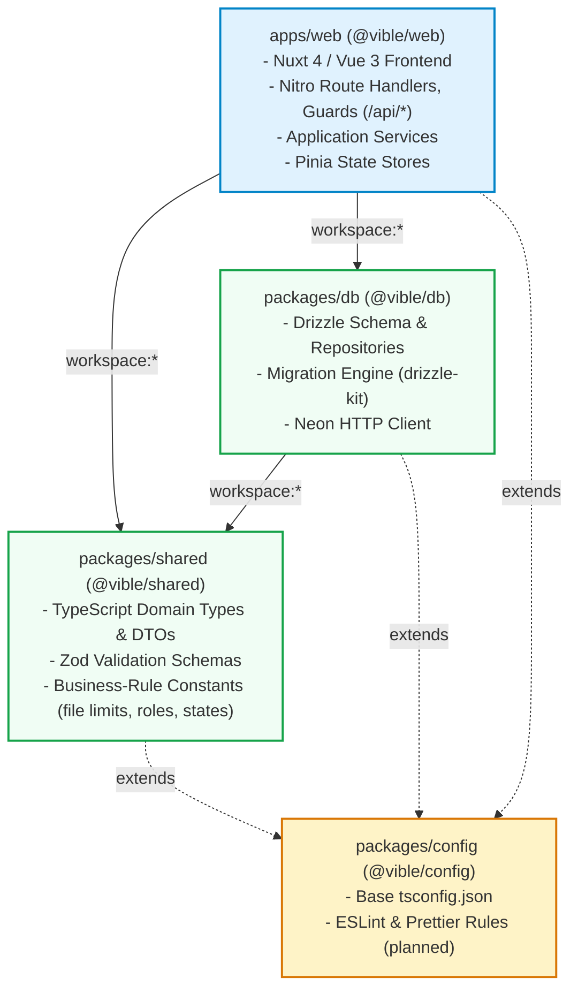

**Dependency rules.** `@vible/shared` depends on no other workspace package. `@vible/db` may depend only on `@vible/shared`. `@vible/web` may depend on both. Within `apps/web/server`, layers call only the layer below them (3.1.1). The dotted `extends` edges are planned: no package declares `@vible/config` as a dependency yet.

#### Why a Monorepo for This Project:
1. **Contract sharing without publishing**:
   - Zod schemas (e.g., `RegisterSchema`, `CreateAssignmentSchema`) and DTOs in `@vible/shared` are imported by both the frontend forms and the Nitro handlers, so the two sides cannot validate differently. With a polyrepo, each change would need a package release, which a four-person team on a two-week implementation window (Section 2.1.2) cannot afford.
2. **Database tooling kept in one package**:
   - `@vible/db` holds the schema, repositories, and migrations (`drizzle-kit generate`, `drizzle-kit migrate`), so SQL lives in one place and the Service layer depends on repositories instead of Drizzle calls. Nitro server code is not bundled into the browser, which keeps the database driver and its credentials out of client bundles; this protection comes from Nitro, not from the package split, since `apps/web` also lists the driver as a dependency.
3. **Incremental builds and tests (as the codebase grows)**:
   - `turbo.json` declares task dependencies and caches results by input hash. At present `@vible/shared` and `@vible/db` define only `typecheck`; the cache benefit for tests starts once those packages gain tests in PA5.
4. **One repository for code and documents**:
   - Code, ADRs, and tests change together, so a cross-cutting change (e.g., the late-submission setting, which touches the schema, shared constants, a service, and a screen) is reviewed in one pull request. A CI workflow that runs lint, test, and build is planned for PA5; none exists yet.

**Trade-off.** The workspace setup (filters, task graph, linked packages) costs time inside a short schedule, and Turborepo caching has little effect on a repository this small. The team accepts this because contract sharing (point 1) is the main benefit and the setup cost is paid once.

**Deployment note.** Cloudflare Pages builds from the repository root with `pnpm --filter @vible/web run build` and the output directory `apps/web/dist` (ADR-005).


---

## 3.2 System Context Diagram (C4 Level 1)

The System Context diagram illustrates how Vible fits into the broader operational environment, showing the primary human actors and external systems that collaborate with it.

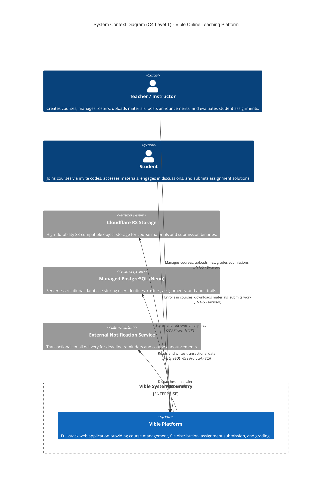

---

## 3.3 Container Diagram (C4 Level 2)

The Container diagram decomposes the Vible system into its runtime units of execution, detailing the technologies employed and communication protocols.

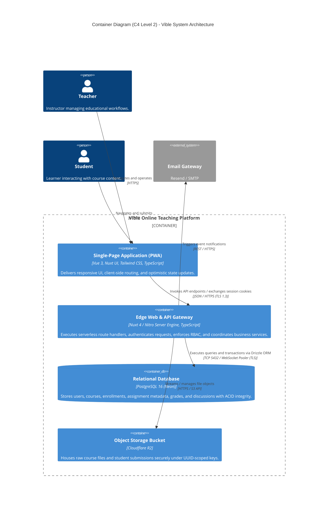

---

## 3.4 Component Diagram (C4 Level 3)

The Component diagram decomposes the primary container—**Nitro Server / Backend**—into its modular software components, highlighting separation of concerns and dependency direction.

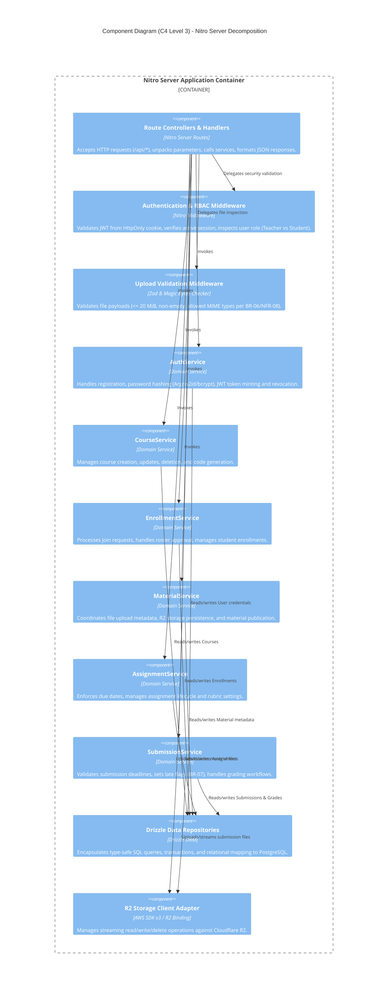

---

## 3.5 Deployment Diagram

The Deployment diagram illustrates the physical and cloud infrastructure topology where Vible runs, detailing communication protocols and network boundaries.

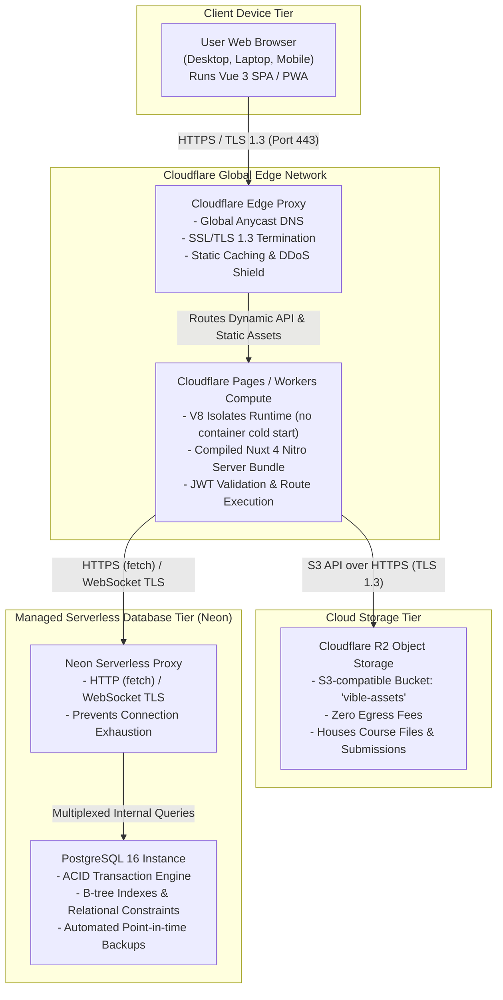

---

## 3.6 Architecture Decision Records (ADRs)

Below are the executive summaries and decision tables for the primary architectural decisions. The complete individual ADR documents are stored in `/docs/design/adr/`.

### ADR-001: Adoption of Nuxt 4 Full-Stack Framework with Nitro Engine on Cloudflare Pages
*(Detailed file: [ADR-001-nuxt-fullstack-edge-runtime.md](/docs/design/adr/ADR-001-nuxt-fullstack-edge-runtime.md))*

| ADR | ADR-001: Nuxt 4 Full-Stack Framework on Cloudflare Pages / Workers |
| :--- | :--- |
| **Status** | Accepted |
| **Context** | Need for a unified, responsive web application that meets NFR-01 (P95 within 2 seconds on the list endpoints; the team's internal target is 500 ms) and avoids long cold starts (a team design goal, Section 2.1.1) within a $0 infrastructure budget. Traditional container tiers (Render, Railway) experience 30–50s spin-down delays. |
| **Decision** | Adopt Nuxt 4 with Nitro server engine deployed to Cloudflare Pages / Workers V8 Isolates. Single codebase for Vue 3 frontend and serverless edge API endpoints. |
| **Alternatives Considered** | 1. Separate Vue 3 SPA + Node/Express on Render (rejected: cold-start latency).<br>2. Next.js on Vercel (rejected: Vercel 100 GB/month bandwidth cap and 1M invocations/month vs Cloudflare's unlimited bandwidth and ~3M invocations/month, non-commercial Hobby terms, team expertise in Vue).<br>3. SvelteKit (rejected: smaller UI component ecosystem). |
| **Consequences** | **Positive**: No container cold start on the compute tier (the Neon database can still wake up slowly after idle), unified TypeScript types, free tier with generous bandwidth and 100k requests/day.<br>**Negative**: Edge runtime cannot execute native Node C++ binary extensions; must use edge-compatible Web Crypto and WASM packages.<br>**Risks (not yet benchmarked)**: the 10 ms Free-plan CPU limit may be exceeded by password hashing and server-rendered pages (error 1102); first request after Neon idle is slower; NFR-01 not yet measured. Mitigations: measure on a deployed Worker, client-side rendering for heavy pages, lower-cost hashing, or Workers Paid. |

### ADR-002: Relational Data Persistence with PostgreSQL and Drizzle ORM
*(Detailed file: [ADR-002-postgresql-drizzle-orm.md](/docs/design/adr/ADR-002-postgresql-drizzle-orm.md))*

| ADR | ADR-002: PostgreSQL 16 Relational Persistence with Drizzle ORM |
| :--- | :--- |
| **Status** | Accepted |
| **Context** | The system models complex relational entities (Users, Courses, Rosters, Assignments, Submissions, Grades) with strict foreign keys and ACID constraints. The ORM must run at the Edge without heavy cold-start initialization. |
| **Decision** | Use PostgreSQL 16 hosted on Neon combined with Drizzle ORM and the serverless HTTP/WebSocket driver (`@neondatabase/serverless`). |
| **Alternatives Considered** | 1. Prisma ORM (rejected: Rust WASM query engine adds 50–150ms cold-start compilation overhead in V8 isolates vs Drizzle's ~40KB zero-dependency pure TypeScript builder).<br>2. MongoDB (rejected: lack of native relational foreign key integrity and 3NF compliance).<br>3. Cloudflare D1 (rejected: SQLite single-writer lock causes write contention on concurrent submissions/grading, lacks native PostgreSQL data types). |
| **Consequences** | **Positive**: Zero-runtime overhead, lightweight SQL-like syntax, full TypeScript compile-time type safety, robust relational ACID guarantees.<br>**Negative**: Explicit SQL migration scripts required; requires team understanding of relational SQL semantics. |

### ADR-003: Stateless Session and RBAC Using HS256 JWT in SameSite=Lax HttpOnly Cookies
*(Detailed file: [ADR-003-jwt-httponly-cookie-auth.md](/docs/design/adr/ADR-003-jwt-httponly-cookie-auth.md))*

| ADR | ADR-003: Stateless HS256 JWT Sessions in SameSite=Lax HttpOnly Cookies with Rotating Refresh Tokens |
| :--- | :--- |
| **Status** | Accepted (Revised) |
| **Context** | The platform enforces strict role differentiation between Teachers and Students (BR-01, NFR-02); roles are fixed at registration and there is no administrator role. Credentials must be protected from XSS/CSRF (NFR-07) on a stateless edge runtime limited to 10 ms CPU per request on the Workers Free plan. Links from email, LMS, and chat must not send logged-in users to the login screen, a stolen session must be detectable and revocable, and tokens should carry only what authorization needs. |
| **Decision** | Sign access tokens with symmetric **HS256** via the native Web Crypto API, using a 32-byte random secret; the verifier accepts only `HS256` and checks `exp`/`iss`. Store the access token in an `HttpOnly`, `Secure`, `SameSite=Lax` cookie `vible_session` (15 min), paired with an opaque 7-day refresh cookie `vible_refresh` (path `/api/auth`) whose SHA-256 hash is stored in `refresh_tokens`. Refresh tokens rotate on every use; reuse of a rotated token revokes all of the user's sessions and increments `users.token_version`, which every mutation checks inside its authorization query. Anti-CSRF middleware requires `X-Requested-With: XMLHttpRequest`, rejects any `Sec-Fetch-Site` other than `same-origin`, and requires an exact `Origin` match (falling back to `Referer`). Claims: `sub`, `role`, `v`, `iat`, `exp`, `iss`; no email. |
| **Alternatives Considered** | 1. Asymmetric RS256/Ed25519 (rejected: no other service verifies tokens, so public-key verification brings no benefit; key-pair management is extra work; RSA signing on every login/refresh costs far more than HMAC).<br>2. `SameSite=Strict` cookie policy (rejected: breaks deep links from email and LMS).<br>3. Stateful session store with Redis/KV (rejected: a network round trip on every request; KV is eventually consistent).<br>4. JWT in `localStorage` (rejected: readable by XSS, violating NFR-07).<br>5. Long-lived access token without refresh (rejected: long theft window, no reuse detection).<br>6. Profile data such as email in JWT (rejected: copies personal data into every request, goes stale).<br>7. Managed Auth like Clerk/Auth0 (rejected: MAU pricing conflicts with the $0 budget; harder local/CI testing). |
| **Consequences** | **Positive**: no database lookup to authenticate reads, deep links work even after the access token expires, layered CSRF protection, detectable and revocable token theft, minimal claims, no auth libraries.<br>**Negative**: a revoked session can still read for up to 15 minutes; each refresh costs three indexed queries; password hashing at NFR-07 strength may exceed the Free-plan CPU limit (to be measured; fallback is the Workers Paid plan); the client needs a 401 refresh-and-retry interceptor. |

### ADR-004: Server-Mediated Edge-Streaming Cloudflare R2 Object Storage for Materials and Submissions
*(Detailed file: [ADR-004-direct-r2-object-storage.md](/docs/design/adr/ADR-004-direct-r2-object-storage.md))*

| ADR | ADR-004: Cloudflare R2 Object Storage for Files |
| :--- | :--- |
| **Status** | Accepted (Revised) |
| **Context** | Educational materials and student submissions comprise binary files up to 20 MiB (BR-06). Storing files inside PostgreSQL bloats database size and backups. Uploads require server-side validation (NFR-08) without buffering full files in Worker memory, and a submission may only be reported successful once both file and record are stored (NFR-06). |
| **Decision** | Store binary files in a private Cloudflare R2 bucket. Clients send the raw file body with `Content-Length`; the server rejects empty/oversize/disallowed files from headers, sniffs magic bytes at the stream head (checking declared MIME type and extension), then streams the body into `R2_BUCKET.put()` through a `FixedLengthStream`. Metadata is committed to PostgreSQL after the R2 write; on DB failure the new object is deleted, and a separate nightly reconciliation Worker removes unreferenced objects. Keys are UUID-only (`courses/{courseId}/materials/{materialId}.bin`, `assignments/{assignmentId}/submissions/{studentId}/{submissionId}.bin`); each resubmission is a new row and object, with one `is_current` attempt per student per assignment. |
| **Alternatives Considered** | 1. Pre-signed direct R2 upload (rejected: the server cannot inspect file content before it is stored, weakening BR-06/NFR-08 enforcement).<br>2. PostgreSQL `BYTEA` (rejected: quickly exhausts DB storage limits and slows down queries).<br>3. AWS S3 (rejected: substantial ~$0.09/GB egress bandwidth fees for student downloads vs Cloudflare R2's $0 egress and native worker bindings).<br>4. Server local filesystem (rejected: serverless workers are ephemeral and stateless). |
| **Consequences** | **Positive**: Server-side BR-06/NFR-08 enforcement before storage, zero egress fees, bounded Worker memory, previous submission preserved until a new one is fully committed (NFR-06).<br>**Negative**: Every upload and download consumes a Worker request; upload CPU time must be measured against the 10 ms Free-plan limit; requires compensating deletes and a separately deployed reconciliation Worker. |

### ADR-005: Monorepo Architecture Using pnpm Workspaces and Turborepo
*(Detailed file: [ADR-005-monorepo-pnpm-workspaces.md](/docs/design/adr/ADR-005-monorepo-pnpm-workspaces.md))*

| ADR | ADR-005: Monorepo Architecture with pnpm Workspaces & Turborepo |
| :--- | :--- |
| **Status** | Accepted |
| **Context** | Multiple subsystems (Vue 3 frontend, Nitro edge server, Drizzle ORM schemas/migrations, and shared TypeScript DTOs/Zod schemas) require strict synchronization. A flat monolith leads to server dependency leakage into client builds, while a polyrepo introduces heavy multi-repo PR overhead and schema drift. |
| **Decision** | Adopt a monorepo architecture managed by **pnpm workspaces** (`apps/web`, `packages/shared`, `packages/db`, `packages/config`) orchestrated with **Turborepo** task pipelines. Internal dependencies use the `workspace:*` protocol. |
| **Alternatives Considered** | 1. Polyrepo with separate repositories (rejected: high overhead and contract drift).<br>2. Flat monolith repository (rejected: coupling, server secrets and Drizzle driver bundling risks).<br>3. npm Workspaces / Yarn (rejected: npm flat hoisting causes phantom dependencies; yarn PnP causes Vite friction; pnpm selected for strict isolation and speed).<br>4. Nx Monorepo (rejected: steep learning curve and unnecessary plugin weight). |
| **Consequences** | **Positive**: Zero-cost schema and DTO sharing, strict isolation of database drivers, fast incremental builds and tests via Turborepo caching, atomic cross-package commits.<br>**Negative**: Developers must understand workspace filtering commands (`pnpm --filter`); Cloudflare Pages CI build command must be configured with monorepo root context and build output directory `apps/web/dist` (required by the `cloudflare-pages` Nitro preset). |

---

# 4. Object-Oriented Design

## 4.1 Domain Model

The Domain Model captures the conceptual business entities, their attributes, and their semantic relationships within the Vible teaching and learning environment (without implementation methods).

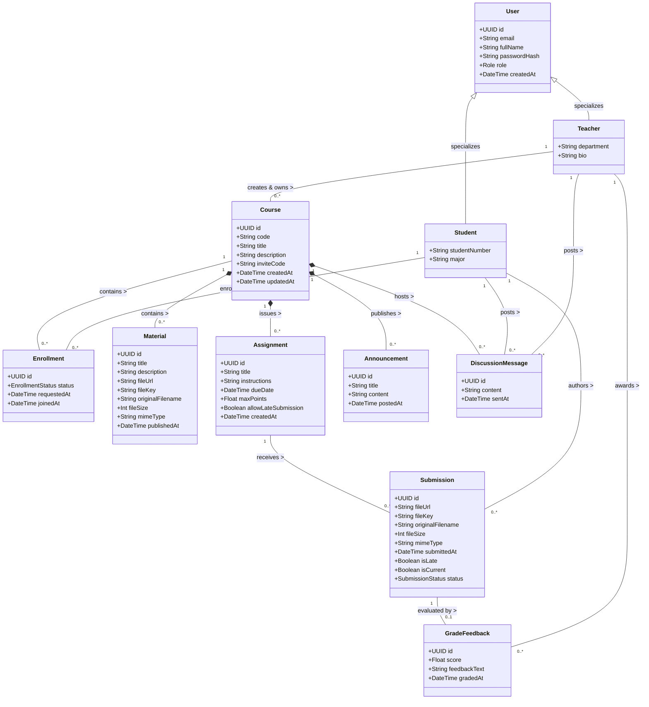

---

## 4.2 Class Diagram

The Design-Level Class Diagram organizes software elements into layered packages, complete with attribute types, visibility modifiers, and typed operation signatures.

```mermaid
classDiagram
    direction TB

    %% Presentation / Controller Package
    namespace PresentationControllers {
        class AuthController {
            +register(req: RegisterDTO): Promise~UserResponseDTO~
            +login(req: LoginDTO): Promise~AuthResultDTO~
            +logout(): Promise~void~
            +getMe(): Promise~UserProfileDTO~
        }
        class CourseController {
            +createCourse(dto: CreateCourseDTO): Promise~CourseDTO~
            +getCourses(): Promise~List~CourseDTO~~
            +getCourseDetails(courseId: UUID): Promise~CourseDetailDTO~
            +updateCourse(courseId: UUID, dto: UpdateCourseDTO): Promise~CourseDTO~
            +deleteCourse(courseId: UUID): Promise~void~
        }
        class RosterController {
            +requestJoin(dto: JoinCourseDTO): Promise~EnrollmentDTO~
            +getRoster(courseId: UUID): Promise~List~ParticipantDTO~~
            +approveStudent(courseId: UUID, studentId: UUID): Promise~EnrollmentDTO~
            +removeStudent(courseId: UUID, studentId: UUID): Promise~void~
        }
        class MaterialController {
            +uploadMaterial(courseId: UUID, upload: UploadStream): Promise~MaterialDTO~
            +getMaterials(courseId: UUID): Promise~List~MaterialDTO~~
            +deleteMaterial(materialId: UUID): Promise~void~
        }
        class AssignmentController {
            +createAssignment(courseId: UUID, dto: CreateAssignmentDTO): Promise~AssignmentDTO~
            +getAssignments(courseId: UUID): Promise~List~AssignmentDTO~~
            +getAssignmentDetails(assignmentId: UUID): Promise~AssignmentDetailDTO~
            +submitAssignment(assignmentId: UUID, upload: UploadStream): Promise~SubmissionDTO~
            +gradeSubmission(submissionId: UUID, dto: GradeDTO): Promise~GradeDTO~
        }
    }

    %% Domain Service Package
    namespace DomainServices {
        class AuthService {
            -userRepo: UserRepository
            -refreshTokenRepo: RefreshTokenRepository
            +registerUser(data: RegisterData): Promise~User~
            +authenticate(credentials: Credentials): Promise~AuthTokenBundle~
            +validateSessionToken(token: String): Promise~JWTPayload~
            +hashPassword(plain: String): Promise~String~
            +verifyPassword(plain: String, hash: String): Promise~Boolean~
        }
        class CourseService {
            -courseRepo: CourseRepository
            +create(teacherId: UUID, data: CourseData): Promise~Course~
            +update(courseId: UUID, teacherId: UUID, data: PartialCourseData): Promise~Course~
            +delete(courseId: UUID, teacherId: UUID): Promise~Boolean~
            +getTeacherCourses(teacherId: UUID): Promise~List~Course~~
            +getStudentCourses(studentId: UUID): Promise~List~Course~~
        }
        class EnrollmentService {
            -enrollRepo: EnrollmentRepository
            -courseRepo: CourseRepository
            +requestEnrollment(studentId: UUID, code: String): Promise~Enrollment~
            +approveEnrollment(teacherId: UUID, courseId: UUID, studentId: UUID): Promise~Enrollment~
            +rejectEnrollment(teacherId: UUID, courseId: UUID, studentId: UUID): Promise~Boolean~
            +removeStudentFromCourse(teacherId: UUID, courseId: UUID, studentId: UUID): Promise~Boolean~
            +verifyEnrollment(studentId: UUID, courseId: UUID): Promise~Boolean~
        }
        class MaterialService {
            -materialRepo: MaterialRepository
            -storageService: IStorageClient
            -validator: IFileValidator
            +publishMaterial(courseId: UUID, teacherId: UUID, file: FilePayload, meta: MaterialMeta): Promise~Material~
            +getCourseMaterials(courseId: UUID, userId: UUID): Promise~List~Material~~
            +removeMaterial(materialId: UUID, teacherId: UUID): Promise~Boolean~
        }
        class AssignmentService {
            -assignRepo: AssignmentRepository
            -courseRepo: CourseRepository
            +createAssignment(courseId: UUID, teacherId: UUID, data: AssignmentData): Promise~Assignment~
            +listCourseAssignments(courseId: UUID, userId: UUID): Promise~List~Assignment~~
            +getAssignment(assignmentId: UUID, userId: UUID): Promise~Assignment~
        }
        class SubmissionService {
            -submissionRepo: SubmissionRepository
            -assignRepo: AssignmentRepository
            -courseRepo: CourseRepository
            -enrollmentService: EnrollmentService
            -storageService: IStorageClient
            -validator: IFileValidator
            +submitWork(assignmentId: UUID, studentId: UUID, file: FilePayload): Promise~Submission~
            +listSubmissionsForAssignment(assignmentId: UUID, teacherId: UUID): Promise~List~Submission~~
            +getStudentSubmission(assignmentId: UUID, studentId: UUID): Promise~Submission~
            +gradeSubmission(submissionId: UUID, teacherId: UUID, score: Float, text: String): Promise~GradeFeedback~
        }
    }

    %% Repository / Data Access Package
    namespace DataAccessRepositories {
        class UserRepository {
            +findById(id: UUID): Promise~User~
            +findByEmail(email: String): Promise~User~
            +create(user: User): Promise~User~
        }
        class RefreshTokenRepository {
            +create(userId: UUID, tokenHash: String, expiresAt: DateTime): Promise~RefreshToken~
        }
        class CourseRepository {
            +findById(id: UUID): Promise~Course~
            +findByInviteCode(code: String): Promise~Course~
            +listByTeacherId(teacherId: UUID): Promise~List~Course~~
            +create(course: Course): Promise~Course~
            +update(id: UUID, data: Object): Promise~Course~
            +delete(id: UUID): Promise~Boolean~
        }
        class EnrollmentRepository {
            +findByStudentAndCourse(studentId: UUID, courseId: UUID): Promise~Enrollment~
            +listByCourse(courseId: UUID): Promise~List~Enrollment~~
            +listApprovedByStudent(studentId: UUID): Promise~List~Enrollment~~
            +create(enrollment: Enrollment): Promise~Enrollment~
            +updateStatus(id: UUID, status: EnrollmentStatus): Promise~Enrollment~
            +delete(id: UUID): Promise~Boolean~
        }
        class AssignmentRepository {
            +findById(id: UUID): Promise~Assignment~
            +listByCourse(courseId: UUID): Promise~List~Assignment~~
            +create(assignment: Assignment): Promise~Assignment~
        }
        class SubmissionRepository {
            +findById(id: UUID): Promise~Submission~
            +findByAssignmentAndStudent(assignmentId: UUID, studentId: UUID): Promise~Submission~
            +findGradeBySubmission(submissionId: UUID): Promise~GradeFeedback~
            +listByAssignment(assignmentId: UUID): Promise~List~Submission~~
            +create(submission: Submission): Promise~Submission~
            +upsertGrade(submissionId: UUID, grade: GradeFeedback): Promise~GradeFeedback~
        }
    }

    AuthController --> AuthService
    CourseController --> CourseService
    RosterController --> EnrollmentService
    MaterialController --> MaterialService
    AssignmentController --> AssignmentService
    AssignmentController --> SubmissionService

    AuthService --> UserRepository
    AuthService --> RefreshTokenRepository
    CourseService --> CourseRepository
    EnrollmentService --> EnrollmentRepository
    EnrollmentService --> CourseRepository
    AssignmentService --> AssignmentRepository
    SubmissionService --> SubmissionRepository
    SubmissionService --> AssignmentRepository
    SubmissionService --> CourseRepository
    SubmissionService --> EnrollmentService
```

---

## 4.3 Class Specifications

This subsection specifies the eight domain entities that the services and repositories of Section 4.2 create, load, and return. Two conventions apply to all of them:

- **Entities hold state and rules, not I/O.** Password hashing, token signing, storage access, and database calls belong to the services and repositories in Section 4.2. An entity operation only reads or changes the entity's own fields, so it can be unit-tested without a database, a storage bucket, or a Worker runtime.
- **Attributes are private.** They are read through getters and changed only through the listed operations, so each rule below is enforced in one place.

`DiscussionMessage` (F07, Should) is not specified here. It follows the same pattern as `Announcement`, except that any course member may post it.

### 4.3.1 Class `User`
- **Superclass**: None
- **Responsibility**: Represents one registered account and its single, fixed role (BR-01). It holds what authentication and authorization need: the password hash and the session version.

| # | Attribute | Type | Visibility | Constraint | Description |
| :- | :--- | :--- | :--- | :--- | :--- |
| 1 | `id` | `UUID` | Private | Primary key, not null | Unique account identifier; used as the `sub` claim of the access token (ADR-003). |
| 2 | `email` | `String` | Private | Unique, not null, valid email, stored lower-case | Login identifier (BR-01). Not placed in the access token (ADR-003). |
| 3 | `fullName` | `String` | Private | Not null, length [2..100] | Display name shown on rosters and submissions. |
| 4 | `passwordHash` | `String` | Private | Not null | Salted password hash produced by `AuthService.hashPassword()`. The plaintext password is never stored or logged (NFR-07). |
| 5 | `role` | `Role` | Private | Not null, set at registration, immutable | `TEACHER` or `STUDENT` (BR-01). There is no administrator role (ADR-003). |
| 6 | `tokenVersion` | `Int` | Private | Not null, default 1, only increases | Session version carried as the `v` claim. It is incremented when refresh-token reuse is detected, which makes every mutation from older sessions fail (ADR-003). |
| 7 | `createdAt` | `DateTime` | Private | Not null, server-set | Registration timestamp. |

| # | Operation | Parameters / return | Visibility | Description |
| :- | :--- | :--- | :--- | :--- |
| 1 | `isTeacher()` | `(): Boolean` | Public | Returns `true` if `role` is `TEACHER`. |
| 2 | `isStudent()` | `(): Boolean` | Public | Returns `true` if `role` is `STUDENT`. |
| 3 | `revokeSessions()` | `(): void` | Public | Increments `tokenVersion`. Called by `AuthService` when a rotated refresh token is reused (ADR-003). |
| 4 | `isSessionCurrent()` | `(tokenVersion: Int): Boolean` | Public | Returns `true` if the token's `v` claim equals `tokenVersion`. Mutations call it before writing (Section 2.1.1, "fast reads, strict writes"). |
| 5 | `toSafeDTO()` | `(): UserProfileDTO` | Public | Returns `id`, `fullName`, `email`, and `role`, never `passwordHash` or `tokenVersion` (NFR-07). |

---

### 4.3.2 Class `Course`
- **Superclass**: None
- **Responsibility**: Represents a course workspace owned by exactly one teacher (BR-02), and the invite code students use to request enrollment (BR-03).

| # | Attribute | Type | Visibility | Constraint | Description |
| :- | :--- | :--- | :--- | :--- | :--- |
| 1 | `id` | `UUID` | Private | Primary key, not null | Unique course identifier. |
| 2 | `teacherId` | `UUID` | Private | Not null, references a `User` with role `TEACHER`, immutable | Owning teacher (BR-02). |
| 3 | `title` | `String` | Private | Not null, trimmed, length [1..150] | Course name; mandatory (BR-02). |
| 4 | `description` | `String` | Private | Nullable | Optional course overview. |
| 5 | `inviteCode` | `String` | Private | Unique, not null, exactly 8 characters from an unambiguous alphanumeric set | Code or link students use to request enrollment (BR-03, FR-03C). |
| 6 | `createdAt` | `DateTime` | Private | Not null, server-set | Creation timestamp. |
| 7 | `updatedAt` | `DateTime` | Private | Not null, server-set | Last rename or invite-code change. |

| # | Operation | Parameters / return | Visibility | Description |
| :- | :--- | :--- | :--- | :--- |
| 1 | `isOwnedBy()` | `(userId: UUID): Boolean` | Public | Returns `true` if `userId` equals `teacherId`. Used for every owner-only operation (BR-02, BR-05, BR-08). |
| 2 | `rename()` | `(title: String, description: String?): void` | Public | Validates and updates `title` and `description`, and sets `updatedAt` (FR-02B). |
| 3 | `setInviteCode()` | `(code: String): void` | Public | Replaces `inviteCode`. `CourseService` generates the code and retries on collision, because only the database can check uniqueness. |

Deleting a course is a `CourseService` operation, not an entity operation. It requires the owner and a confirmation (BR-02, FR-02B).

---

### 4.3.3 Class `Enrollment`
- **Superclass**: None
- **Responsibility**: Records one student's membership request for one course and its approval state (BR-03). Only an `ENROLLED` membership grants access to course content (BR-04).

| # | Attribute | Type | Visibility | Constraint | Description |
| :- | :--- | :--- | :--- | :--- | :--- |
| 1 | `id` | `UUID` | Private | Primary key, not null | Unique enrollment identifier. |
| 2 | `courseId` | `UUID` | Private | Not null, immutable | Course being joined. |
| 3 | `studentId` | `UUID` | Private | Not null, references a `User` with role `STUDENT`, immutable | Requesting student. |
| 4 | `status` | `EnrollmentStatus` | Private | Not null, one of `PENDING`, `ENROLLED`, `REJECTED` | Approval state (BR-03). |
| 5 | `requestedAt` | `DateTime` | Private | Not null, server-set | Time of the latest request. |
| 6 | `decidedAt` | `DateTime` | Private | Nullable; set when `status` leaves `PENDING` | Time of the teacher's approval or rejection. |

At most one `Enrollment` exists per (`courseId`, `studentId`), which prevents duplicate pending requests and enrollments (BR-03). When a teacher removes a student (FR-03B), the `Enrollment` is deleted, which revokes access immediately (BR-04). A removed student can then submit a new request.

| # | Operation | Parameters / return | Visibility | Description |
| :- | :--- | :--- | :--- | :--- |
| 1 | `approve()` | `(now: DateTime): void` | Public | Requires `PENDING`. Sets `ENROLLED` and `decidedAt` (FR-03A). Otherwise throws `InvalidStateError`. |
| 2 | `reject()` | `(now: DateTime): void` | Public | Requires `PENDING`. Sets `REJECTED` and `decidedAt` (FR-03A). Otherwise throws `InvalidStateError`. |
| 3 | `reRequest()` | `(now: DateTime): void` | Public | Requires `REJECTED`. Sets `PENDING`, resets `requestedAt`, and clears `decidedAt`. Lets a rejected student ask again without a second row (BR-03). |
| 4 | `grantsAccess()` | `(): Boolean` | Public | Returns `true` only for `ENROLLED`. `PENDING` and `REJECTED` grant no access (BR-04). |

---

### 4.3.4 Class `Material`
- **Superclass**: None
- **Responsibility**: Holds the metadata of one published course file. The file itself is stored in the private R2 bucket and is reached only through the server (ADR-004). Only the course owner publishes or deletes materials; the owner and enrolled students may download them (BR-05).

| # | Attribute | Type | Visibility | Constraint | Description |
| :- | :--- | :--- | :--- | :--- | :--- |
| 1 | `id` | `UUID` | Private | Primary key, not null | Unique material identifier; also part of the storage key. |
| 2 | `courseId` | `UUID` | Private | Not null, immutable | Course the material belongs to. |
| 3 | `title` | `String` | Private | Not null, trimmed, length [1..150] | Title shown in the material list. |
| 4 | `description` | `String` | Private | Nullable | Optional notes. |
| 5 | `fileKey` | `String` | Private | Not null, unique, immutable, `courses/{courseId}/materials/{id}.bin` | R2 object key. It is built only from UUIDs, never from the user's file name (ADR-004). |
| 6 | `originalFilename` | `String` | Private | Not null, sanitized, length [1..255] | File name offered when the file is downloaded. |
| 7 | `fileSizeBytes` | `Int` | Private | Not null, range [1..20 971 520] | Size in bytes; non-empty and at most 20 MiB (BR-06, NFR-08). |
| 8 | `mimeType` | `String` | Private | Not null, in the permitted-type list | Type confirmed by magic-byte inspection (ADR-004). The permitted list is still pending (BR-06). |
| 9 | `publishedAt` | `DateTime` | Private | Not null, server-set | Publication timestamp; set after both the R2 write and the record commit succeed (ADR-004). |

There is no stored download URL. The bucket is private, and each download passes through a guarded endpoint that streams the object from `fileKey` (ADR-004).

| # | Operation | Parameters / return | Visibility | Description |
| :- | :--- | :--- | :--- | :--- |
| 1 | `storageKeyFor()` | `(courseId: UUID, materialId: UUID): String` | Public, static | Builds the `fileKey` so that `MaterialService` and the storage adapter use one format. |
| 2 | `isAccessibleBy()` | `(course: Course, userId: UUID, enrollment: Enrollment?): Boolean` | Public | Returns `true` if `course.isOwnedBy(userId)` or `enrollment.grantsAccess()` (BR-04, BR-05). |
| 3 | `contentDisposition()` | `(): String` | Public | Returns the `attachment; filename*=UTF-8''…` header value for `originalFilename`. Downloads are never rendered inline. |

---

### 4.3.5 Class `Assignment`
- **Superclass**: None
- **Responsibility**: Defines one assignment in a course, its mandatory deadline, and the teacher's late-submission setting (BR-07). It decides whether a submission or a removal is allowed at a given time.

| # | Attribute | Type | Visibility | Constraint | Description |
| :- | :--- | :--- | :--- | :--- | :--- |
| 1 | `id` | `UUID` | Private | Primary key, not null | Unique assignment identifier. |
| 2 | `courseId` | `UUID` | Private | Not null, immutable | Course the assignment belongs to. |
| 3 | `title` | `String` | Private | Not null, trimmed, length [1..150] | Assignment title. |
| 4 | `instructions` | `String` | Private | Nullable | Instructions shown to students. |
| 5 | `dueDate` | `DateTime` | Private | Not null, stored in UTC | Deadline (FR-05A, BR-07). |
| 6 | `allowLate` | `Boolean` | Private | Not null, default `false` | Late-submission setting; the teacher can change it at any time (FR-05D). The default is `false`, so late work is accepted only when the teacher allows it explicitly. |
| 7 | `maxScore` | `Float` | Private | Not null, > 0, at most 2 decimal places | Upper bound for grades (FR-06A). |
| 8 | `createdAt` | `DateTime` | Private | Not null, server-set | Creation timestamp. |

| # | Operation | Parameters / return | Visibility | Description |
| :- | :--- | :--- | :--- | :--- |
| 1 | `isPastDue()` | `(now: DateTime): Boolean` | Public | Returns `true` if `now` is strictly after `dueDate`; a submission at exactly `dueDate` is on time. `now` is always the server clock (ASR 5). |
| 2 | `canAcceptSubmission()` | `(now: DateTime): Boolean` | Public | Returns `!isPastDue(now) \|\| allowLate` (BR-07, FR-05B). |
| 3 | `canRemoveSubmission()` | `(now: DateTime): Boolean` | Public | Uses the same rule as `canAcceptSubmission()`. After the deadline, a student may remove a submission only if late submissions are enabled (BR-07, FR-05E). |
| 4 | `setLateSubmission()` | `(allowed: Boolean): void` | Public | Changes `allowLate` (FR-05D). Submissions already accepted keep their `isLate` value. |
| 5 | `isValidScore()` | `(score: Float): Boolean` | Public | Returns `true` if `0 <= score <= maxScore`. |

---

### 4.3.6 Class `Submission`
- **Superclass**: None
- **Responsibility**: Records one submission attempt by one student for one assignment. Each attempt is a new `Submission` with its own stored file, and at most one attempt per student per assignment is current (BR-09, ADR-004).

| # | Attribute | Type | Visibility | Constraint | Description |
| :- | :--- | :--- | :--- | :--- | :--- |
| 1 | `id` | `UUID` | Private | Primary key, not null | Unique attempt identifier; also part of the storage key. |
| 2 | `assignmentId` | `UUID` | Private | Not null, immutable | Assignment submitted to. |
| 3 | `studentId` | `UUID` | Private | Not null, immutable, enrolled student of the course | Submitting student (BR-04). |
| 4 | `fileKey` | `String` | Private | Not null, unique, immutable, `assignments/{assignmentId}/submissions/{studentId}/{id}.bin` | R2 object key; UUID-only (ADR-004). |
| 5 | `originalFilename` | `String` | Private | Not null, sanitized, length [1..255] | File name offered when the teacher downloads the file. |
| 6 | `fileSizeBytes` | `Int` | Private | Not null, range [1..20 971 520] | Size in bytes (BR-06, NFR-08). |
| 7 | `mimeType` | `String` | Private | Not null, in the permitted-type list | Type confirmed by magic-byte inspection (ADR-004). |
| 8 | `submittedAt` | `DateTime` | Private | Not null, server-set, immutable | Time the server accepted the upload. Never taken from the client (ASR 5). |
| 9 | `isLate` | `Boolean` | Private | Not null, set once at creation, immutable | `true` if `submittedAt` is after the deadline (FR-05C). |
| 10 | `isCurrent` | `Boolean` | Private | Not null, default `true`; at most one `true` per (`assignmentId`, `studentId`) | `true` for the student's current attempt. It becomes `false` when the student removes the attempt (BR-09). The record and its file are kept. |

The record is created only after the file has been written to R2. If the record cannot be committed, the file is deleted, so a stored `Submission` always has a file and an attempt is never reported as successful without both (NFR-06, ADR-004).

| # | Operation | Parameters / return | Visibility | Description |
| :- | :--- | :--- | :--- | :--- |
| 1 | `create()` | `(assignment: Assignment, studentId: UUID, file: StoredFileInfo, now: DateTime): Submission` | Public, static | Requires `assignment.canAcceptSubmission(now)`. Sets `submittedAt = now` and `isLate = assignment.isPastDue(now)`, and builds `fileKey`. `SubmissionService` must first confirm that the student has no current attempt (BR-09). |
| 2 | `remove()` | `(assignment: Assignment, now: DateTime): void` | Public | Requires `isCurrent` and `assignment.canRemoveSubmission(now)`. Sets `isCurrent = false` (FR-05E). The service checks that the caller is the submitting student. |
| 3 | `isOwnedBy()` | `(userId: UUID): Boolean` | Public | Returns `true` if `userId` equals `studentId` (BR-09: students remove only their own submissions). |
| 4 | `status()` | `(grade: GradeFeedback?): SubmissionStatus` | Public | Derives the status shown in 4.1. It returns `REMOVED` if `!isCurrent`, `GRADED` if a grade exists, and otherwise `SUBMITTED_LATE` or `SUBMITTED_ON_TIME`. The status is computed, not stored. |

---

### 4.3.7 Class `GradeFeedback`
- **Superclass**: None
- **Responsibility**: Holds the course teacher's score and written feedback for one submission attempt (BR-08, FR-06A).

| # | Attribute | Type | Visibility | Constraint | Description |
| :- | :--- | :--- | :--- | :--- | :--- |
| 1 | `id` | `UUID` | Private | Primary key, not null | Unique grade identifier. |
| 2 | `submissionId` | `UUID` | Private | Not null, unique, immutable | Graded attempt (0..1 grade per submission, 4.1). |
| 3 | `gradedById` | `UUID` | Private | Not null; must be the owner of the assignment's course | Teacher who graded (BR-08). |
| 4 | `score` | `Float` | Private | Not null, `0 <= score <= assignment.maxScore`, at most 2 decimal places | Awarded score. |
| 5 | `feedbackText` | `String` | Private | Nullable, length [0..5000] | Written feedback shown to the student. |
| 6 | `gradedAt` | `DateTime` | Private | Not null, server-set | Time of the latest grade or revision. |

| # | Operation | Parameters / return | Visibility | Description |
| :- | :--- | :--- | :--- | :--- |
| 1 | `create()` | `(submission: Submission, assignment: Assignment, teacherId: UUID, score: Float, text: String?, now: DateTime): GradeFeedback` | Public, static | Requires `submission.isCurrent` and `assignment.isValidScore(score)`. `SubmissionService` checks that `teacherId` owns the course (BR-08). |
| 2 | `revise()` | `(assignment: Assignment, score: Float, text: String?, now: DateTime): void` | Public | Requires `assignment.isValidScore(score)`. Replaces `score` and `feedbackText` and sets `gradedAt`. Only the latest grade is kept. |

---

### 4.3.8 Class `Announcement`
- **Superclass**: None
- **Responsibility**: Represents a message the course teacher posts to the course channel. Only enrolled students and the owner can read it (BR-04, BR-08, FR-07A).

| # | Attribute | Type | Visibility | Constraint | Description |
| :- | :--- | :--- | :--- | :--- | :--- |
| 1 | `id` | `UUID` | Private | Primary key, not null | Unique announcement identifier. |
| 2 | `courseId` | `UUID` | Private | Not null, immutable | Course channel. |
| 3 | `authorId` | `UUID` | Private | Not null, immutable; must be the course owner | Posting teacher (BR-08). |
| 4 | `title` | `String` | Private | Not null, trimmed, length [1..150] | Headline. |
| 5 | `content` | `String` | Private | Not null, length [1..10 000], rendered as plain text | Message body. |
| 6 | `postedAt` | `DateTime` | Private | Not null, server-set | Posting timestamp. |

| # | Operation | Parameters / return | Visibility | Description |
| :- | :--- | :--- | :--- | :--- |
| 1 | `create()` | `(course: Course, authorId: UUID, title: String, content: String, now: DateTime): Announcement` | Public, static | Requires `course.isOwnedBy(authorId)` (BR-08). |
| 2 | `isVisibleTo()` | `(course: Course, userId: UUID, enrollment: Enrollment?): Boolean` | Public | Returns `true` for the owner or an enrolled student (BR-04). |

Notifying students by email or in-app (FR-08A, FR-08B) is a Could-have feature and is not part of this class.

---

### 4.3.9 Enumerations

| Enumeration | Values | Used by |
| :--- | :--- | :--- |
| `Role` | `TEACHER`, `STUDENT` | `User.role` (BR-01) |
| `EnrollmentStatus` | `PENDING`, `ENROLLED`, `REJECTED` | `Enrollment.status` (BR-03) |
| `SubmissionStatus` | `SUBMITTED_ON_TIME`, `SUBMITTED_LATE`, `GRADED`, `REMOVED` | Derived by `Submission.status()`; not stored |

---

## 4.4 Sequence Diagrams

The sequence diagrams trace the dynamic collaborations realizing six key use cases (UC-02, UC-04, UC-06, UC-10, UC-13, UC-14), including alternative and exception flows (`alt` fragments). Message names are the operations declared in Section 4.2 (class diagram) and Section 4.3 (class specifications). Calls on entities (for example `assignment.canAcceptSubmission(now)`) are drawn as self-messages of the service that makes them.

Conventions that apply to every diagram:

- **Guard.** `Guard` stands for the Nitro middleware chain. It runs before the controller and performs the CSRF checks and the HS256 access-token verification (ADR-003, sections 3 and 1). It rejects with `401` (no valid session) or `403` (CSRF failure or wrong role), and on success passes `UserContext {userId, role, v}` to the controller.
- **Session version.** For mutations, the check `users.token_version = :v` is part of the authorization query that the mutation already runs (ADR-003, section 4.B). It is not drawn as a separate message. A mismatch returns `401`.
- **Time.** `now` is always the server clock (ASR 5).
- **Error codes.** File-upload failures use the ADR-004 mapping (`400`, `411`, `413`, `415`). A well-formed request that breaks a business rule returns `422` (invalid value), `409` (state conflict) or `403`/`404` (authorization or missing resource).
- **Mapping.** Services return entities; controllers map them to DTOs.

### 4.4.1 Sequence Diagram: UC-02 (User Login and Session Issuance)

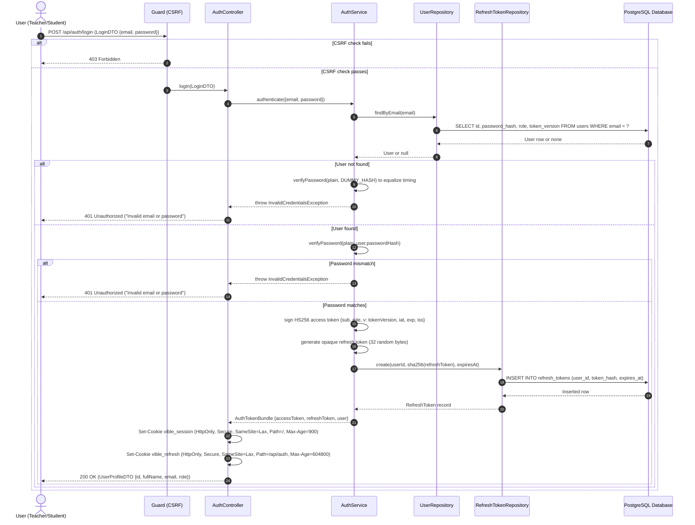

---

### 4.4.2 Sequence Diagram: UC-04 (Create Course and Assign Ownership)

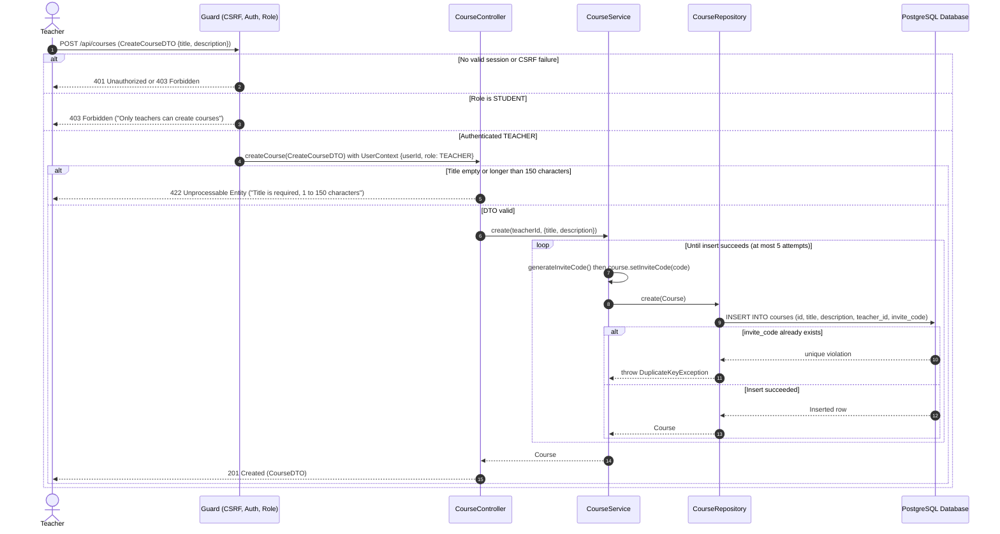

---

### 4.4.3 Sequence Diagrams: UC-06 (Join Course via Invite Code) and UC-10 (Teacher Approval)

**(a) UC-06: Student requests to join**

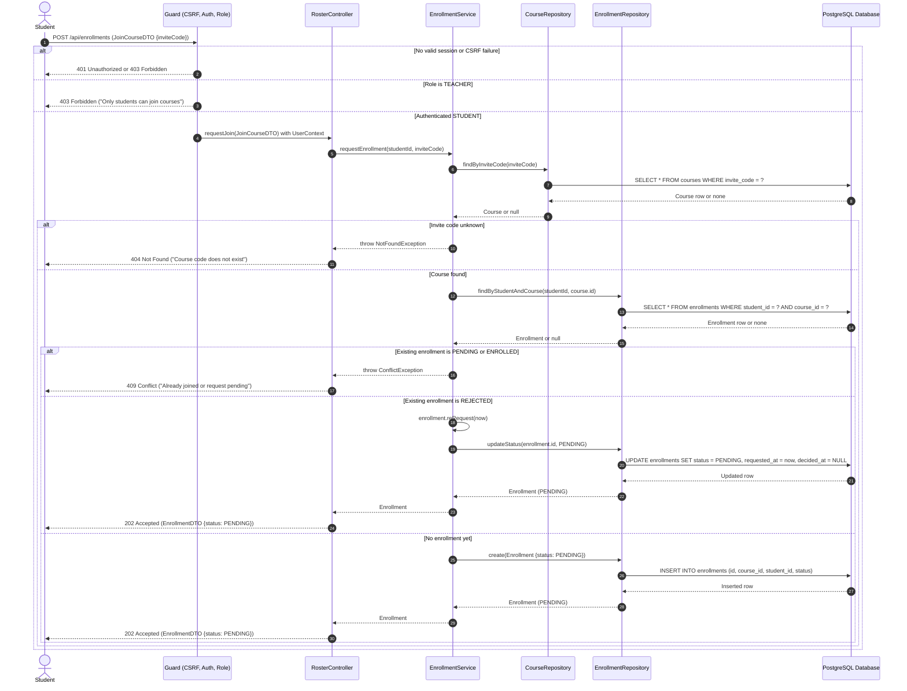

**(b) UC-10: Teacher approves a pending request**

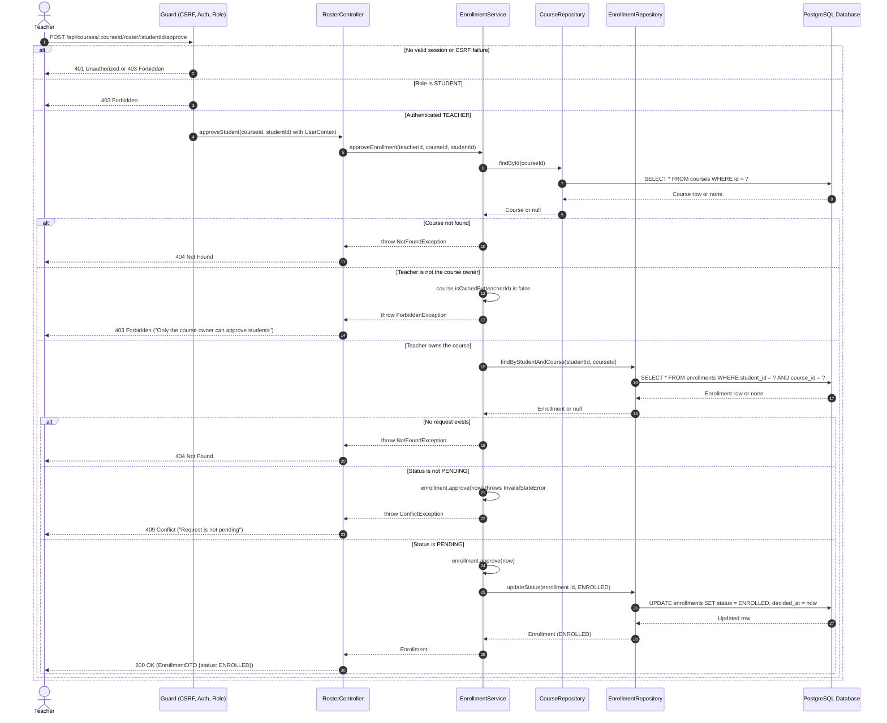

---

### 4.4.4 Sequence Diagram: UC-13 (Submit Assignment with Strict Due Date and File Validation)

The file is sent as the raw request body (`Content-Length`, `X-File-Name`, declared `Content-Type`) and streamed to R2, as decided in ADR-004. `IFileValidator` performs the header checks and the magic-byte check on the head of the stream before any byte is written to R2. A student who already has a current attempt must remove it first (BR-09, Section 4.3.6).

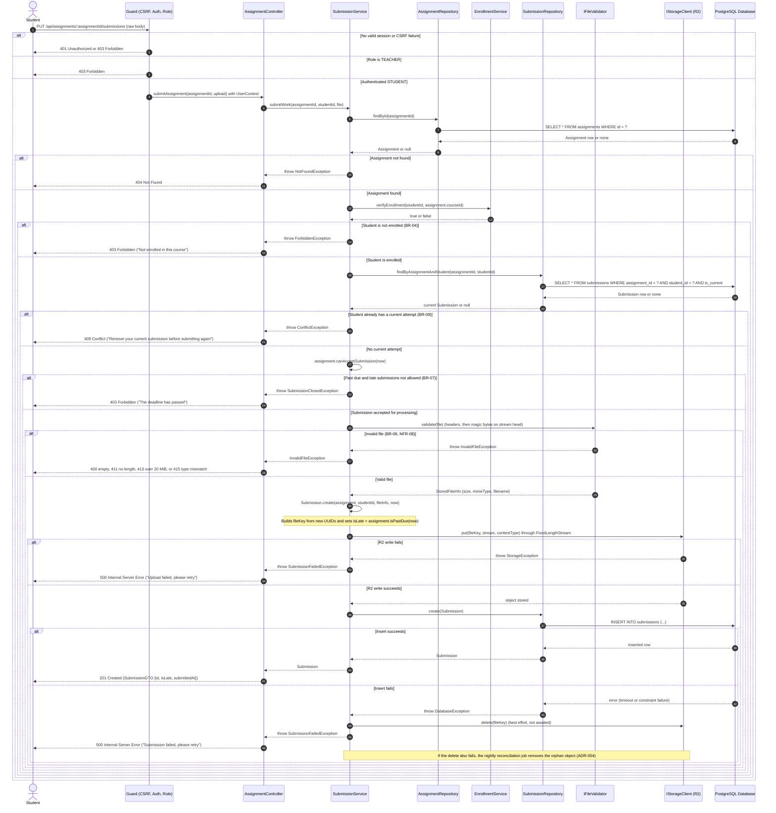

---

### 4.4.5 Sequence Diagram: UC-14 (Grade Submission and Provide Feedback)

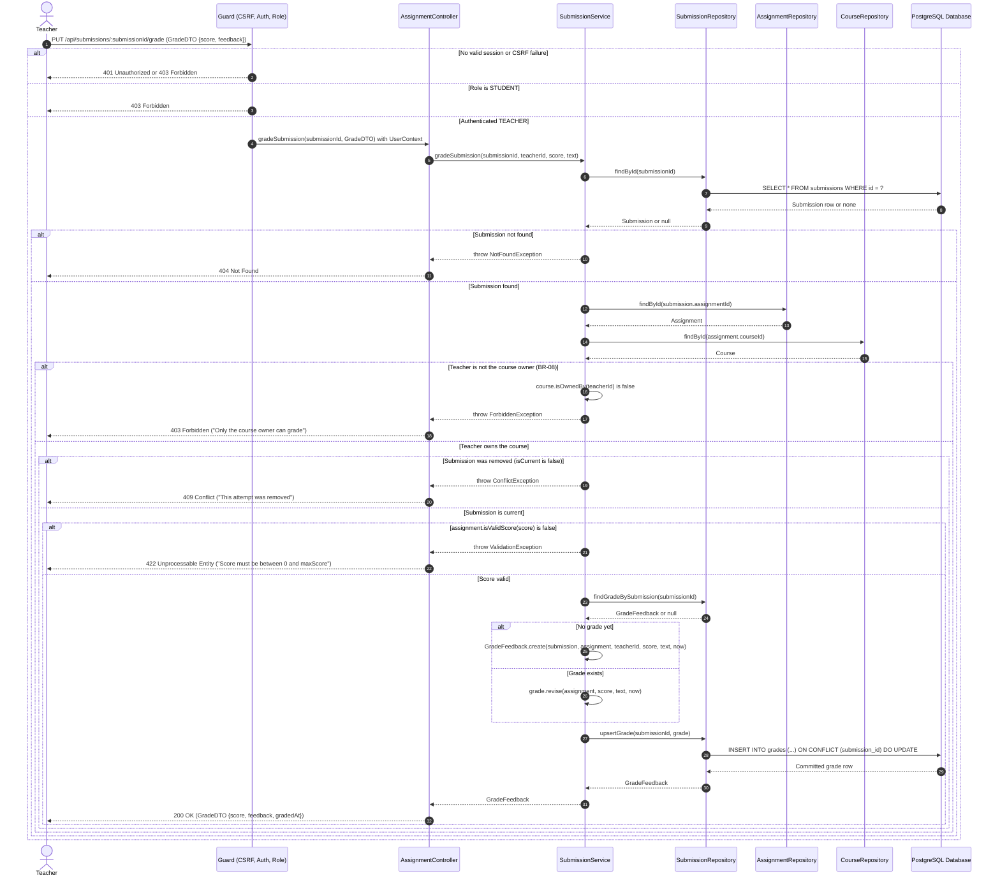

---

## 4.5 State Machine Diagrams

### 4.5.1 Enrollment Lifecycle State Machine

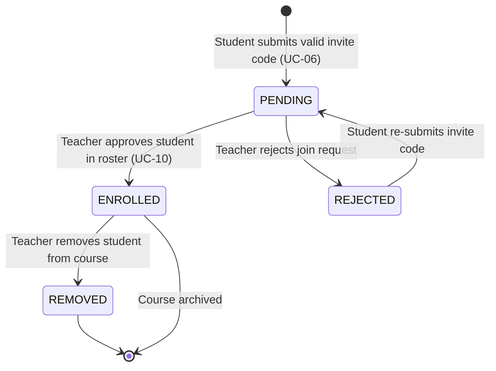

### 4.5.2 Assignment Submission Lifecycle State Machine

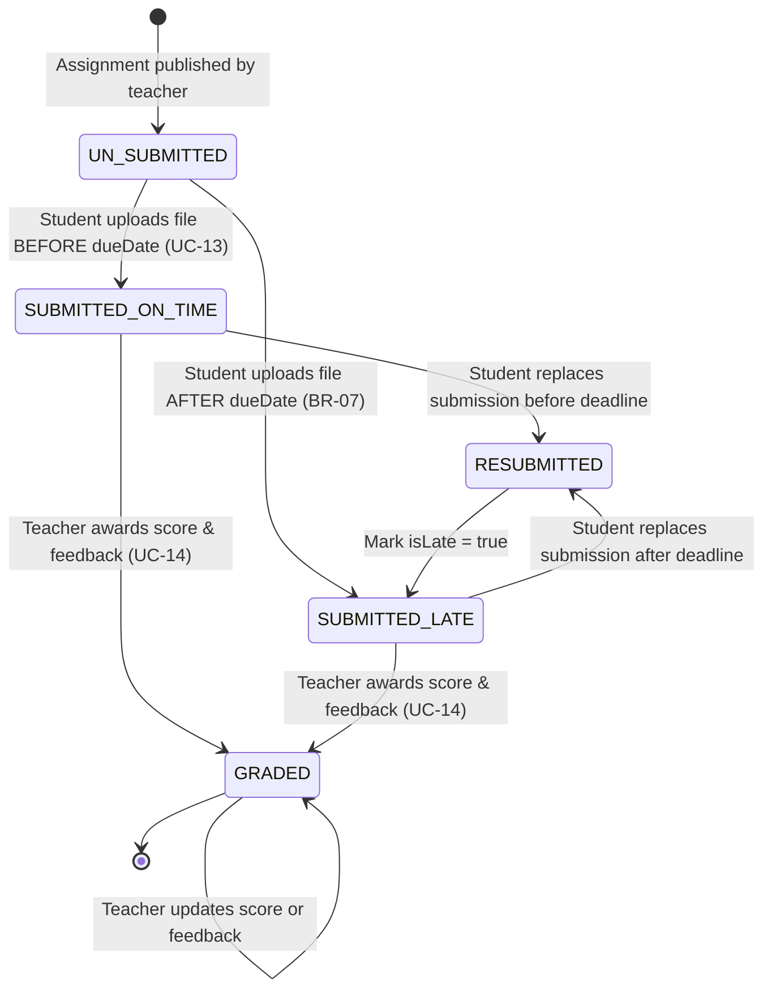

### 4.5.3 Assignment Entity Lifecycle State Machine

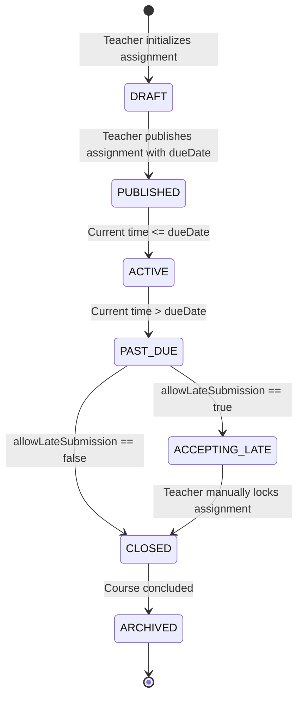

---

## 4.6 Design Principles and Patterns

The table lists only patterns that appear in the architecture (Section 3) or in the class design (Sections 4.2–4.3). Each row names the requirement or ADR it serves. Patterns that were considered and left out are listed after the table.

| Principle / Pattern | Where it is applied | Why | Serves |
| :--- | :--- | :--- | :--- |
| **Layered architecture with a dependency rule** | Presentation → Controller → Service → Repository (3.1.1). Each layer calls only the layer below it, and the packages follow the dependency rules in 3.1.2: `@vible/shared` depends on nothing, and `@vible/db` depends only on `@vible/shared`. | Business rules do not depend on HTTP, Vue, or Drizzle, so each layer can be tested and changed on its own. | Testability for PA4; ADR-005 |
| **Repository** | `UserRepository`, `CourseRepository`, `EnrollmentRepository`, `AssignmentRepository`, `SubmissionRepository` (4.2), kept in `@vible/db` (3.1.2). Services receive them through the constructor, typed by an interface (e.g. `ISubmissionRepository`) rather than by the concrete class. | All SQL lives in one package. Ownership and enrollment conditions are written into the queries themselves (ASR 1). Because services depend on interfaces, PA4 unit tests can pass in-memory fakes without a database. | ASR 1; ADR-002 |
| **Adapter** | The R2 storage adapter implements `IStorageClient` (`put`, `get`, `delete`) on top of the Worker `R2_BUCKET` binding (3.4, 3.1.2). | Services stream files without knowing the R2 API, and tests replace the adapter with an in-memory store. | ADR-004 |
| **Dependency Inversion, with per-request construction** | `MaterialService` and `SubmissionService` depend on the interfaces `IStorageClient` and `IFileValidator` (4.2), never on concrete classes. There is no DI container: Worker bindings and the database client are available only on the request event, so a small factory builds the services for each request. | The higher layers do not depend on the edge runtime. Nothing is kept in memory between requests, as the runtime requires (2.1.2). | Section 2.1.2 runtime constraints; ADR-001 |
| **Request guard pipeline** | Order: `csrfGuard` → `authGuard` → `roleGuard` → `uploadValidator` → route handler. `csrfGuard` and `authGuard` are global Nitro middleware in `server/middleware/`. `authGuard` skips only the public routes (`/api/auth/register`, `/login`, `/refresh`). `roleGuard` and `uploadValidator` are wrappers applied to individual route handlers, because global middleware runs on every request. Any guard can reject; otherwise the request continues to the next one. | Rejects forged, unauthenticated, wrong-role, and malformed requests before any service runs. The pipeline checks only authentication and role; who may act on a specific course or submission is checked in the service and repository queries. | ASR 1, ASR 3, ASR 4; NFR-02; ADR-003 |
| **Strategy** | `IFileValidator.inspect(head: Uint8Array, declaredType: String, filename: String)`, with one implementation per permitted type family. The implementation is chosen from the declared MIME type, and it must confirm that the magic bytes and the file extension agree with that type; any disagreement rejects the upload. Header checks (`Content-Length` > 0 and ≤ 20 MiB, declared type allowed) run earlier in `uploadValidator`. The magic-byte check runs in the service on the first bytes of the stream, just before the R2 write. | Adding a permitted type means adding one class, without changing the services (Open/Closed). The concrete classes are defined once the permitted-type list is baselined. ZIP-based formats such as DOCX and PPTX need a check beyond the ZIP signature. | ASR 3; BR-06; NFR-08; ADR-004 |
| **Compensating action** | Uploads write the R2 object first, then commit the database record. If the commit fails, the object is deleted, and the nightly reconciliation Worker removes any object that has no record. | A failed attempt is never reported as successful and leaves no orphaned file. A previously accepted submission is not affected. | ASR 2; NFR-06; ADR-004 |
| **Information Expert / rich domain model** | Business rules are methods on the entity that owns the data: `Assignment.canAcceptSubmission()` and `canRemoveSubmission()`, `Enrollment.approve()`, `Submission.create()`, `GradeFeedback.create()` (4.3). Entities do no I/O. | Each rule is implemented once and is unit-testable without a database, storage, or runtime. Services coordinate the work but do not duplicate the rules. | ASR 5; BR-03, BR-07, BR-09 |
| **Guarded state transitions** | Enrollment and submission states change only through entity methods that check a precondition and otherwise throw `InvalidStateError` (4.3.3, 4.3.6). Submission status is derived by `Submission.status()`, not stored. | With three or four states, methods with preconditions are enough; the GoF State pattern would add one class per state for no gain. A derived status cannot fall out of sync with the stored flags. | BR-03, BR-09; FR-03A, FR-05E |
| **DTOs with shared Zod schemas** | Request schemas such as `RegisterSchema`, `JoinCourseSchema`, and `CreateAssignmentSchema` live in `@vible/shared` and are used by both the client forms and the Nitro handlers. Responses are built by mapping methods such as `User.toSafeDTO()`. File uploads are a raw body and are checked by the upload pipeline above, not by Zod. | One schema gives a runtime check on the server and compile-time types (via `z.infer`) on both sides, so client and server cannot drift. Response DTOs never include `passwordHash` or `tokenVersion`. | NFR-07; ADR-005 |
| **Single Responsibility** | Entities hold rules; services coordinate repositories and storage; controllers translate HTTP into service calls and back; guards handle security only (3.1.1, 4.2, 4.3). | A change to a business rule, to the storage provider, or to the API shape affects one layer only. | ADR-005 (package boundaries) |

**Considered and not used:**
- **Factory for notification channels.** Notifications (FR-08A, FR-08B) are a Could-have feature and are not designed in this phase. If they are built, the channel abstraction will be designed then.
- **GoF State pattern.** Not used; see *Guarded state transitions*.
- **Unit of Work across PostgreSQL and R2.** A single transaction cannot span both stores; the *Compensating action* row is used instead.

---

# 5. Data Design

## 5.1 Data Diagram (ERD)

The Entity-Relationship Diagram defines the logical relational database schema, key constraints, and relational cardinalities implemented in PostgreSQL.

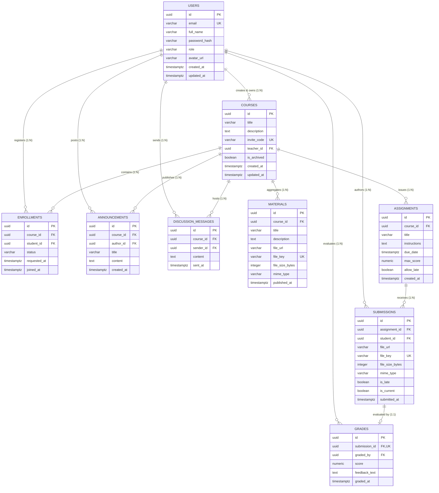

---

## 5.2 Data Specification

### 5.2.1 Table: `users`
Stores registered user credentials, profile information, and assigned roles.

| Table | Column | Data type | Constraints | Description |
| :--- | :--- | :--- | :--- | :--- |
| `users` | `id` | `UUID` | PK, NOT NULL, DEFAULT gen_random_uuid() | Unique identifier for the user. |
| `users` | `email` | `VARCHAR(255)` | UNIQUE, NOT NULL | User email address used for login. |
| `users` | `full_name` | `VARCHAR(100)` | NOT NULL | User's full display name. |
| `users` | `password_hash`| `VARCHAR(255)` | NOT NULL | Salted cryptographic password hash. |
| `users` | `role` | `VARCHAR(20)` | NOT NULL, CHECK (role IN ('TEACHER','STUDENT')) | User role enforcing RBAC (BR-01). |
| `users` | `token_version` | `INTEGER` | NOT NULL, DEFAULT 1 | Incremented atomically when reuse of a rotated refresh token is detected; every mutation checks it so revoked sessions cannot write (ADR-003). |
| `users` | `avatar_url` | `VARCHAR(512)` | NULL | Optional URL to user's profile picture. |
| `users` | `created_at` | `TIMESTAMPTZ` | NOT NULL, DEFAULT NOW() | Account registration timestamp. |
| `users` | `updated_at` | `TIMESTAMPTZ` | NOT NULL, DEFAULT NOW() | Last profile modification timestamp. |

---

### 5.2.2 Table: `courses`
Stores course information created and managed by instructors.

| Table | Column | Data type | Constraints | Description |
| :--- | :--- | :--- | :--- | :--- |
| `courses` | `id` | `UUID` | PK, NOT NULL, DEFAULT gen_random_uuid() | Unique identifier for the course. |
| `courses` | `title` | `VARCHAR(150)` | NOT NULL | Course title (e.g., "Web Development"). |
| `courses` | `description` | `TEXT` | NULL | Full description or course outline. |
| `courses` | `invite_code` | `VARCHAR(12)` | UNIQUE, NOT NULL | Alphanumeric invite code for joining. |
| `courses` | `teacher_id` | `UUID` | FK (users.id ON DELETE RESTRICT), NOT NULL | Owning teacher ID (BR-02). |
| `courses` | `is_archived` | `BOOLEAN` | NOT NULL, DEFAULT FALSE | Flag indicating if course is archived. |
| `courses` | `created_at` | `TIMESTAMPTZ` | NOT NULL, DEFAULT NOW() | Timestamp when course was created. |
| `courses` | `updated_at` | `TIMESTAMPTZ` | NOT NULL, DEFAULT NOW() | Timestamp of last course update. |

---

### 5.2.3 Table: `enrollments`
Tracks student memberships and roster approval statuses for each course.

| Table | Column | Data type | Constraints | Description |
| :--- | :--- | :--- | :--- | :--- |
| `enrollments` | `id` | `UUID` | PK, NOT NULL, DEFAULT gen_random_uuid() | Unique enrollment identifier. |
| `enrollments` | `course_id` | `UUID` | FK (courses.id ON DELETE CASCADE), NOT NULL | Course reference. |
| `enrollments` | `student_id` | `UUID` | FK (users.id ON DELETE CASCADE), NOT NULL | Enrolled student reference. |
| `enrollments` | `status` | `VARCHAR(20)` | NOT NULL, CHECK (status IN ('PENDING','ENROLLED','REJECTED')) | Approval status (BR-03, FR-03C). |
| `enrollments` | `requested_at`| `TIMESTAMPTZ` | NOT NULL, DEFAULT NOW() | When student submitted invite code. |
| `enrollments` | `joined_at` | `TIMESTAMPTZ` | NULL | When teacher approved enrollment. |
| *Composite* | `(course_id, student_id)` | *Composite* | UNIQUE | Prevents duplicate student entries (BR-03). |

---

### 5.2.4 Table: `materials`
Houses metadata and cloud storage keys for course study materials published by teachers.

| Table | Column | Data type | Constraints | Description |
| :--- | :--- | :--- | :--- | :--- |
| `materials` | `id` | `UUID` | PK, NOT NULL, DEFAULT gen_random_uuid() | Unique material identifier. |
| `materials` | `course_id` | `UUID` | FK (courses.id ON DELETE CASCADE), NOT NULL | Course where material is published. |
| `materials` | `title` | `VARCHAR(150)` | NOT NULL | Material title. |
| `materials` | `description` | `TEXT` | NULL | Optional description or notes. |
| `materials` | `file_url` | `VARCHAR(512)` | NOT NULL | Public/CDN download URL. |
| `materials` | `file_key` | `VARCHAR(255)` | UNIQUE, NOT NULL | Cloudflare R2 object key (`courses/{courseId}/materials/{materialId}.bin`). |
| `materials` | `original_filename`| `VARCHAR(255)` | NOT NULL | Original sanitized human-readable filename for downloads. |
| `materials` | `file_size_bytes`| `INTEGER` | NOT NULL, CHECK (file_size_bytes > 0 AND file_size_bytes <= 20971520) | File size (max 20 MiB per BR-06). |
| `materials` | `mime_type` | `VARCHAR(100)` | NOT NULL | Validated MIME type (PDF, ZIP, etc.). |
| `materials` | `published_at`| `TIMESTAMPTZ` | NOT NULL, DEFAULT NOW() | Material publication timestamp. |

---

### 5.2.5 Table: `assignments`
Stores assignment requirements, instructions, and due dates created by teachers.

| Table | Column | Data type | Constraints | Description |
| :--- | :--- | :--- | :--- | :--- |
| `assignments` | `id` | `UUID` | PK, NOT NULL, DEFAULT gen_random_uuid() | Unique assignment identifier. |
| `assignments` | `course_id` | `UUID` | FK (courses.id ON DELETE CASCADE), NOT NULL | Course under which assignment is issued. |
| `assignments` | `title` | `VARCHAR(150)` | NOT NULL | Assignment title. |
| `assignments` | `instructions`| `TEXT` | NULL | Full markdown instructions and rubric. |
| `assignments` | `due_date` | `TIMESTAMPTZ` | NOT NULL | Submission deadline timestamp (BR-07). |
| `assignments` | `max_score` | `NUMERIC(5,2)` | NOT NULL, CHECK (max_score > 0) | Maximum achievable points. |
| `assignments` | `allow_late` | `BOOLEAN` | NOT NULL, DEFAULT TRUE | If late submissions are accepted. |
| `assignments` | `created_at` | `TIMESTAMPTZ` | NOT NULL, DEFAULT NOW() | Timestamp of assignment creation. |

---

### 5.2.6 Table: `submissions`
Tracks student solution file uploads and logs late submission timestamps.

| Table | Column | Data type | Constraints | Description |
| :--- | :--- | :--- | :--- | :--- |
| `submissions` | `id` | `UUID` | PK, NOT NULL, DEFAULT gen_random_uuid() | Unique submission identifier. |
| `submissions` | `assignment_id`| `UUID` | FK (assignments.id ON DELETE CASCADE), NOT NULL | Related assignment. |
| `submissions` | `student_id` | `UUID` | FK (users.id ON DELETE CASCADE), NOT NULL | Submitting student. |
| `submissions` | `file_url` | `VARCHAR(512)` | NOT NULL | R2 download URL. |
| `submissions` | `file_key` | `VARCHAR(255)` | UNIQUE, NOT NULL | Cloudflare R2 object key (`assignments/{assignmentId}/submissions/{studentId}/{submissionId}.bin`). |
| `submissions` | `original_filename`| `VARCHAR(255)` | NOT NULL | Original sanitized human-readable filename for downloads. |
| `submissions` | `file_size_bytes`| `INTEGER` | NOT NULL, CHECK (file_size_bytes > 0 AND file_size_bytes <= 20971520) | File size (max 20 MiB per BR-06). |
| `submissions` | `mime_type` | `VARCHAR(100)` | NOT NULL | Validated MIME type. |
| `submissions` | `is_late` | `BOOLEAN` | NOT NULL, DEFAULT FALSE | Late flag: true if submittedAt > dueDate. |
| `submissions` | `submitted_at`| `TIMESTAMPTZ` | NOT NULL, DEFAULT NOW() | Exact submission timestamp. |
| `submissions` | `is_current` | `BOOLEAN` | NOT NULL, DEFAULT TRUE | `true` for the student's latest accepted attempt; earlier attempts are kept with `false` (ADR-004). |
| *Composite* | `(assignment_id, student_id) WHERE is_current` | *Composite* | UNIQUE (partial) | Exactly 1 current submission per student per assignment; earlier attempts are retained. |

---

### 5.2.7 Table: `grades`
Contains teacher evaluations, scores, and feedback for student submissions.

| Table | Column | Data type | Constraints | Description |
| :--- | :--- | :--- | :--- | :--- |
| `grades` | `id` | `UUID` | PK, NOT NULL, DEFAULT gen_random_uuid() | Unique grade identifier. |
| `grades` | `submission_id`| `UUID` | FK (submissions.id ON DELETE CASCADE), UNIQUE, NOT NULL | 1:1 link to submission evaluated. |
| `grades` | `graded_by` | `UUID` | FK (users.id ON DELETE RESTRICT), NOT NULL | Teacher who evaluated the work (BR-08). |
| `grades` | `score` | `NUMERIC(5,2)` | NOT NULL, CHECK (score >= 0) | Numeric points awarded. |
| `grades` | `feedback_text`| `TEXT` | NULL | Qualitative written comments. |
| `grades` | `graded_at` | `TIMESTAMPTZ` | NOT NULL, DEFAULT NOW() | Timestamp of grade entry/update. |

---

### 5.2.8 Table: `announcements`
Stores teacher announcements broadcast to course members.

| Table | Column | Data type | Constraints | Description |
| :--- | :--- | :--- | :--- | :--- |
| `announcements` | `id` | `UUID` | PK, NOT NULL, DEFAULT gen_random_uuid() | Unique announcement identifier. |
| `announcements` | `course_id` | `UUID` | FK (courses.id ON DELETE CASCADE), NOT NULL | Target course. |
| `announcements` | `author_id` | `UUID` | FK (users.id ON DELETE CASCADE), NOT NULL | Teacher author (BR-08). |
| `announcements` | `title` | `VARCHAR(150)` | NOT NULL | Announcement title. |
| `announcements` | `content` | `TEXT` | NOT NULL | Full announcement message body. |
| `announcements` | `created_at` | `TIMESTAMPTZ` | NOT NULL, DEFAULT NOW() | Broadcast timestamp. |

---

### 5.2.9 Table: `discussion_messages`
Stores interactive forum and Q&A messages exchanged within a course.

| Table | Column | Data type | Constraints | Description |
| :--- | :--- | :--- | :--- | :--- |
| `discussion_messages` | `id` | `UUID` | PK, NOT NULL, DEFAULT gen_random_uuid() | Unique message identifier. |
| `discussion_messages` | `course_id` | `UUID` | FK (courses.id ON DELETE CASCADE), NOT NULL | Course discussion channel. |
| `discussion_messages` | `sender_id` | `UUID` | FK (users.id ON DELETE CASCADE), NOT NULL | User (student or teacher) posting. |
| `discussion_messages` | `content` | `TEXT` | NOT NULL | Text message body. |
| `discussion_messages` | `sent_at` | `TIMESTAMPTZ` | NOT NULL, DEFAULT NOW() | Message timestamp. |

---

### 5.2.10 Table: `refresh_tokens`
Stores long-lived rotating refresh session tokens for silent access token renewal (ADR-003).

| Table | Column | Data type | Constraints | Description |
| :--- | :--- | :--- | :--- | :--- |
| `refresh_tokens` | `id` | `UUID` | PK, NOT NULL, DEFAULT gen_random_uuid() | Unique refresh token identifier (`jti`). |
| `refresh_tokens` | `user_id` | `UUID` | FK (users.id ON DELETE CASCADE), NOT NULL | Owning user account. |
| `refresh_tokens` | `token_hash` | `VARCHAR(255)` | UNIQUE, NOT NULL | Cryptographic SHA-256 hash of the rotating refresh token. |
| `refresh_tokens` | `expires_at` | `TIMESTAMPTZ` | NOT NULL | Expiration timestamp (7 days from issuance). |
| `refresh_tokens` | `revoked_at` | `TIMESTAMPTZ` | NULL | Timestamp when explicitly invalidated or rotated. |
| `refresh_tokens` | `created_at` | `TIMESTAMPTZ` | NOT NULL, DEFAULT NOW() | Token minting timestamp. |

---

## 5.3 Normalisation and Indexes

### 5.3.1 Normalisation Analysis
The relational schema satisfies **Third Normal Form (3NF)** and **Boyce-Codd Normal Form (BCNF)** across all tables:

1. **First Normal Form (1NF)**:
   - All columns store purely atomic values (e.g., no nested arrays or delimited strings in email, role, or title fields).
   - Each table defines a guaranteed unique primary key (`id` generated via `UUIDv4`).
2. **Second Normal Form (2NF)**:
   - Meets 1NF.
   - For all composite candidate keys (e.g., `(course_id, student_id)` in `enrollments` or `(assignment_id, student_id)` in `submissions`), every non-key attribute depends entirely on the whole key rather than any proper subset.
3. **Third Normal Form (3NF)**:
   - Meets 2NF.
   - There are no transitive functional dependencies ($X \rightarrow Y \rightarrow Z$).
   - For instance, in `submissions`, instructor feedback and score are not stored inline; rather, they are factored out into a dedicated `grades` table. This prevents transitive dependency on student submission attributes and avoids sparse NULL values for ungraded work.
4. **Boyce-Codd Normal Form (BCNF)**:
   - For every non-trivial functional dependency $X \rightarrow Y$, the determinant $X$ is a superkey (either the synthetic `UUID` or candidate unique keys such as `email` in `users` and `invite_code` in `courses`).

### 5.3.2 Query Indexing Strategy
To keep the list endpoints within NFR-01 (P95 within 2 seconds) and close to the team's internal 500 ms target under serverless edge conditions, explicit indexes are created for all frequent query access paths:

| Index Name | Table | Indexed Column(s) | Index Type | Query Justification |
| :--- | :--- | :--- | :--- | :--- |
| `idx_users_email` | `users` | `email` | B-tree, UNIQUE | Instant lookup during login credential verification (`UC-02`). |
| `idx_courses_teacher_id` | `courses` | `teacher_id` | B-tree | Fast filtering of courses owned by a specific teacher (`UC-03`, `UC-04`). |
| `idx_courses_invite_code` | `courses` | `invite_code` | B-tree, UNIQUE | Sub-millisecond lookup when a student joins via invite code (`UC-06`). |
| `idx_enrollments_student` | `enrollments` | `student_id, status` | B-tree | Fast retrieval of all courses where student has `ENROLLED` status (`UC-03`). |
| `idx_enrollments_course` | `enrollments` | `course_id, status` | B-tree | Accelerates roster inspection and pending applicant listings (`UC-08`, `UC-10`). |
| `idx_materials_course` | `materials` | `course_id, published_at DESC`| B-tree | Efficient chronological retrieval of course learning resources (`UC-07`). |
| `idx_assignments_course` | `assignments` | `course_id, due_date ASC` | B-tree | Lists course assignments ordered chronologically by upcoming due dates (`UC-11`). |
| `idx_submissions_assign_student` | `submissions` | `assignment_id, student_id` WHERE `is_current` | B-tree, UNIQUE (partial) | Instant lookup of a student's current submission for an assignment (`UC-13`). |
| `idx_submissions_assign` | `submissions` | `assignment_id, submitted_at` | B-tree | Enables teacher to view all submitted files sorted by submission time (`UC-14`). |
| `idx_grades_submission` | `grades` | `submission_id` | B-tree, UNIQUE | 1:1 join lookup between student submission and its evaluation (`UC-14`). |
| `idx_announcements_course` | `announcements` | `course_id, created_at DESC`| B-tree | Reverse-chronological feed of course announcements (`UC-19`). |
| `idx_discussions_course` | `discussion_messages`| `course_id, sent_at ASC` | B-tree | Fast chronological rendering of course discussion forum threads (`UC-16`). |
| `idx_refresh_tokens_user` | `refresh_tokens` | `user_id` | B-tree | Fast retrieval and batch revocation of user refresh tokens (`UC-02`, ADR-003). |
| `idx_refresh_tokens_hash` | `refresh_tokens` | `token_hash` | B-tree, UNIQUE | Sub-millisecond lookup during token renewal (`/api/auth/refresh`, ADR-003). |

---

# 6. User Interface and User Experience Design

## 6.1 Screen List and Screen Flow

### 6.1.1 Screen Flow Diagram

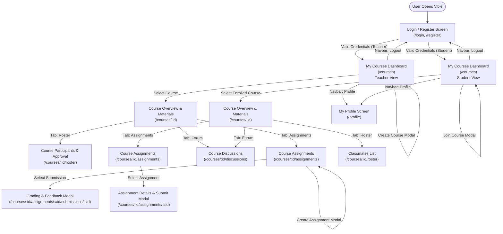

### 6.1.2 Screen List

| # | Screen | Route / View | Description | Related Use Cases |
| :--- | :--- | :--- | :--- | :--- |
| 1 | **Login & Registration** | `/login`, `/register` | Authentication portal for account creation and credential verification. | UC-01, UC-02 |
| 2 | **My Courses Dashboard** | `/courses` | Hub displaying user's courses, "Create Course" (Teacher), or "Join Course" (Student). | UC-03, UC-04, UC-06 |
| 3 | **Course Overview & Materials** | `/courses/:id` | Main course workspace: materials download/upload and announcements feed. | UC-05, UC-07, UC-15, UC-19 |
| 4 | **Course Participants & Roster** | `/courses/:id/roster` | Displays course roster; allows teacher to approve/remove students and share invite codes. | UC-08, UC-09, UC-10 |
| 5 | **Course Assignments Hub** | `/courses/:id/assignments` | Lists upcoming and past coursework tasks with due dates and submission statuses. | UC-11, UC-12, UC-13 |
| 6 | **Submission & Grading Modal** | `/courses/:id/assignments/:aid` | Modal for students to upload submissions and for teachers to review and award grades. | UC-13, UC-14 |
| 7 | **Course Discussions** | `/courses/:id/discussions` | In-course Q&A message board for teachers and students. | UC-16 |
| 8 | **My Profile** | `/profile` | Displays user details, role badge, and password change utility. | UC-17 |

---

## 6.2 Screen Specifications

### 6.2.1 Screen 1: Login & Registration (`/login`, `/register`)

```
+-------------------------------------------------------------------------------+
|                                    VIBLE                                      |
|                             Welcome to Vible LMS                              |
|                                                                               |
|   +-----------------------------------------------------------------------+   |
|   |   [ Tab: Log In ]                         [ Tab: Register ]           |   |
|   |                                                                       |   |
|   |   Email Address:                                                      |   |
|   |   [ student@hcmus.edu.vn                                            ] |   |
|   |                                                                       |   |
|   |   Password:                                                           |   |
|   |   [ ********************                                            ] |   |
|   |                                                                       |   |
|   |   Role Selection (Register only):                                     |   |
|   |   (o) Student      ( ) Teacher                                        |   |
|   |                                                                       |   |
|   |   [                LOG IN / REGISTER SUBMIT BUTTON                 ]  |   |
|   |                                                                       |   |
|   |   * Error alert banner appears here dynamically on failure            |   |
|   +-----------------------------------------------------------------------+   |
+-------------------------------------------------------------------------------+
```

| # | Control | Type | Description / Validation | Event Handling |
| :- | :--- | :--- | :--- | :--- |
| 1 | Tab Switcher | `UButton` Toggle | Switches view between Login and Register form modes. | Updates `isRegisterMode` state; resets form errors. |
| 2 | Email Input | `UInput` (Email) | Required. Must match standard email regex format. | `onBlur`: checks format; shows inline red message if invalid. |
| 3 | Password Input | `UInput` (Password)| Required. Min 8 characters, >= 1 letter, >= 1 digit. | `onInput`: verifies complexity meter. |
| 4 | Role Selector | `URadioGroup` | Required in register mode. Options: `STUDENT` or `TEACHER`. | Binds selected role to payload. |
| 5 | Submit Button | `UButton` (Primary)| Submits credentials; displays loading spinner while active. | `onClick`: validates client fields, dispatches `/api/auth/login`. |
| 6 | Alert Toast | `UAlert` | Displays backend error (e.g. "Invalid credentials"). | Auto-dismisses after 5 seconds or via close icon. |

---

### 6.2.2 Screen 2: My Courses Dashboard (`/courses`)

```
+-------------------------------------------------------------------------------+
|  VIBLE LMS      [My Courses]   [Profile]            [Teacher Mode]  [Logout]  |
+-------------------------------------------------------------------------------+
|  My Courses                                   [+ Create New Course Button]    |
|                                                                               |
|  +---------------------------+   +---------------------------+                |
|  | Software Engineering      |   | Database Systems          |                |
|  | Code: SE-2026-T06         |   | Code: DB-2026-01          |                |
|  | 45 Students Enrolled      |   | 60 Students Enrolled      |                |
|  | 3 Active Assignments      |   | 1 Active Assignment       |                |
|  | [Open Course Workspace]   |   | [Open Course Workspace]   |                |
|  +---------------------------+   +---------------------------+                |
|                                                                               |
|  * (Student View shows "[+ Join Course with Code]" button instead)           |
+-------------------------------------------------------------------------------+
```

| # | Control | Type | Description / Validation | Event Handling |
| :- | :--- | :--- | :--- | :--- |
| 1 | Action CTA Button | `UButton` | Teacher: "Create New Course"; Student: "Join Course with Code". | Opens respective modal (`CreateCourseModal` or `JoinCourseModal`). |
| 2 | Course Card Grid | `UCard` Component | Displays course title, code, student count, and assignment indicators. | `onClick`: navigates user to `/courses/:id`. |
| 3 | Create Course Modal | `UModal` Form | Input: `Course Title` (3..120 chars), `Description` (optional). | `onSubmit`: calls `/api/courses`, appends card optimistically. |
| 4 | Join Course Modal | `UModal` Form | Input: `Invite Code` (6..12 alphanumeric chars). | `onSubmit`: calls `/api/roster/join`, shows "Pending Approval" toast. |

---

### 6.2.3 Screen 3: Course Overview & Materials (`/courses/:id`)

```
+-------------------------------------------------------------------------------+
|  VIBLE LMS > Software Engineering (SE-2026)         [Roster] [Assignments]   |
+-------------------------------------------------------------------------------+
|  Course Announcement Banner:                                                  |
|  "Welcome to Software Engineering! Please review the syllabus below."         |
|  ---------------------------------------------------------------------------  |
|  Learning Materials                           [+ Upload Material (Teacher)]   |
|                                                                               |
|  [PDF] Week 01 - Software Development Lifecycles.pdf (4.2 MB)    [Download]   |
|        Published on Nov 02, 2026 by Truong Hien Long                          |
|                                                                               |
|  [PDF] Week 02 - Requirements Engineering & SRS.pdf (3.1 MB)     [Download]   |
|        Published on Nov 09, 2026 by Truong Hien Long                          |
|                                                                               |
|  [ZIP] Lab 01 - Nuxt 4 Starter Template.zip (12.8 MB)            [Download]   |
|        Published on Nov 10, 2026 by Truong Hien Long                          |
+-------------------------------------------------------------------------------+
```

| # | Control | Type | Description / Validation | Event Handling |
| :- | :--- | :--- | :--- | :--- |
| 1 | Upload Material CTA | `UButton` | Visible only to Teacher. Opens upload dialog. | Triggers `MaterialUploadModal`. |
| 2 | File Upload Input | `UInput` (File) | Enforces `<= 20 MiB`, non-empty, allowed MIME types (PDF, ZIP, DOCX).| Inspects `file.size` before upload; flags error if > 20 MiB. |
| 3 | Material Item Row | `UCard` / List Item| Displays title, size, author, publish date, and download button. | `onClick`: opens pre-signed R2 URL in new tab. |
| 4 | Delete Material Icon| `UButton` (Ghost) | Visible only to Teacher. Displays red confirmation prompt. | `onClick`: issues `DELETE /api/materials/:id`. |

---

### 6.2.4 Screen 4: Course Participants & Roster (`/courses/:id/roster`)

```
+-------------------------------------------------------------------------------+
|  Software Engineering > Participants & Roster          Invite Code: [SE-9X2A] |
+-------------------------------------------------------------------------------+
|  Pending Join Requests (2):                                                   |
|  - Nguyen Van B (24127002) [nvb@hcmus.edu.vn]               [Approve] [Reject] |
|  - Tran Thi C (24127003) [ttc@hcmus.edu.vn]                 [Approve] [Reject] |
|  ---------------------------------------------------------------------------  |
|  Enrolled Students (45):                                                      |
|  #   Student Name          Student ID    Email                  Action        |
|  1   Truong Hien Long      24127445      long@hcmus.edu.vn     [Remove]      |
|  2   Nguyen Van A          24127001      nva@hcmus.edu.vn      [Remove]      |
+-------------------------------------------------------------------------------+
```

| # | Control | Type | Description / Validation | Event Handling |
| :- | :--- | :--- | :--- | :--- |
| 1 | Invite Code Pill | `UBadge` + `UButton`| Displays alphanumeric code with 1-click clipboard copy. | `onClick`: copies link to clipboard, shows tooltip "Copied!". |
| 2 | Approve Button | `UButton` (Success)| Approves a pending student join request. | `onClick`: calls `/api/roster/approve`, moves student to enrolled list. |
| 3 | Reject Button | `UButton` (Danger) | Rejects a pending join request. | `onClick`: calls `/api/roster/reject`, removes applicant row. |
| 4 | Remove Student | `UButton` (Danger) | Removes an enrolled student from the course roster. | `onClick`: prompts confirmation, calls `/api/roster/remove`. |

---

### 6.2.5 Screen 5: Course Assignments & Submission (`/courses/:id/assignments`)

```
+-------------------------------------------------------------------------------+
|  Software Engineering > Assignments Hub        [+ Create Assignment (Teacher)]|
+-------------------------------------------------------------------------------+
|  [Assignment 1: Software Design Document (PA3)]                               |
|  Due Date: Nov 15, 2026, 23:59 (In 5 days)     Max Score: 100.0 pts           |
|  Status: [SUBMITTED - ON TIME]                Grade: Pending Evaluation       |
|                                                                               |
|  Your Submitted File: PA3_Design_Team06.pdf (8.4 MB)                          |
|  Submitted At: Nov 10, 2026, 20:15                                            |
|                                                                               |
|  [                     RESUBMIT WORK BUTTON                         ]         |
|                                                                               |
|  * (Student who has not submitted sees "[ Submit Assignment ]" dropzone)     |
+-------------------------------------------------------------------------------+
```

| # | Control | Type | Description / Validation | Event Handling |
| :- | :--- | :--- | :--- | :--- |
| 1 | Create Assignment CTA| `UButton` | Teacher only. Opens assignment creation modal. | Opens `CreateAssignmentModal`. |
| 2 | File Dropzone | Drag & Drop Area | Accepts single file <= 20 MiB (BR-06). Rejects oversize files. | `onDrop`: validates file size and extension; stages file. |
| 3 | Submit Work Button | `UButton` (Primary)| Uploads solution file and commits record. | `onClick`: streams to R2 via API; updates status badge. |
| 4 | Status Badge | `UBadge` | Displays: `NOT SUBMITTED`, `SUBMITTED`, `LATE`, or `GRADED`. | Dynamically styled (green for on-time, orange for late). |

---

### 6.2.6 Screen 6: Submission Grading & Feedback (`/courses/:id/assignments/:aid/submissions/:sid`)

```
+-------------------------------------------------------------------------------+
|  Grading: Assignment 1 (PA3) > Student: Truong Hien Long (24127445)          |
+-------------------------------------------------------------------------------+
|  Submitted File: [PA3_Design_Team06.pdf] (8.4 MB)              [View / Download]|
|  Submitted At: Nov 10, 2026, 20:15   Status: [On Time]                       |
|  ---------------------------------------------------------------------------  |
|  Score:                                                                       |
|  [ 95.0     ] / 100.0 points                                                  |
|                                                                               |
|  Teacher Feedback Comments:                                                   |
|  [ Excellent architecture diagrams and comprehensive ADR records.       ]     |
|  [ Data design thoroughly satisfies 3NF normalization.                  ]     |
|                                                                               |
|  [                    SAVE & PUBLISH GRADE BUTTON                   ]         |
+-------------------------------------------------------------------------------+
```

| # | Control | Type | Description / Validation | Event Handling |
| :- | :--- | :--- | :--- | :--- |
| 1 | Download Submission | `UButton` | Downloads the student's submitted file directly from R2. | `onClick`: opens signed URL. |
| 2 | Score Input | `UInput` (Number) | Required. Must satisfy `0.0 <= score <= maxScore`. | `onChange`: validates range; shows red error if > maxScore. |
| 3 | Feedback Textarea | `UTextarea` | Qualitative instructor comments for student. | Binds input text to payload. |
| 4 | Save Grade CTA | `UButton` (Success)| Commits evaluation to `grades` table. | `onClick`: calls `POST /api/submissions/:sid/grade`. |

---

## 6.3 Accessibility Checklist

The user interface design of Vible satisfies **WCAG 2.1 Level AA** accessibility standards through the following measures:

- [x] **Text Contrast >= 4.5:1; Colour is Not the Only Indicator**:
  - All text typography satisfies WCAG AA minimum contrast ratios (e.g., `#111827` on `#FFFFFF` gives 16:1 contrast; secondary text `#4B5563` gives 7:1 contrast).
  - Status indicators (e.g., assignment late flags) combine distinct color fills with descriptive text badges (`[LATE]`) and SVG iconography so color-blind users can distinguish states.
- [x] **Full Keyboard Navigability & Visible Focus Indicators**:
  - All interactive elements (`<button>`, `<a>`, `<input>`, `<select>`, modal close triggers) are natively focusable via `Tab` and `Shift+Tab`.
  - Visible high-contrast focus rings (`outline: 2px solid #2563EB; outline-offset: 2px`) are preserved across all components using Tailwind focus utilities.
- [x] **Accessible Form Fields, Labels, and Explanatory Error Messages**:
  - Every form input is explicitly linked to an accessible `<label>` element via matching `id` and `for` attributes.
  - In-line validation failures provide descriptive, actionable explanations (e.g., "File size exceeds 20 MiB limit. Please compress your PDF before uploading.") rather than ambiguous generic errors.
- [x] **Responsive Layout on Mobile and Desktop**:
  - Developed using mobile-first CSS media queries (`sm:`, `md:`, `lg:`).
  - Course grids reflow from 3 columns on desktop down to a single column on mobile devices (320px–480px width) without horizontal scrollbar clipping.

---

# 7. Traceability Update

The Requirements Traceability Matrix (RTM) from PA2 is extended below to link each software requirement to its realizing architectural container, component, class, database table, and UI screen.

> [!NOTE]
> Architectural components and classes are organized within our monorepo workspace structure:
> - **`apps/web (@vible/web)`**: Vue 3 presentation views, composables, Pinia stores, and Nitro edge route controllers.
> - **`packages/shared (@vible/shared)`**: Cross-cutting TypeScript DTOs, Zod validation schemas, business constants (`BR-01`..`BR-08`), and role definitions.
> - **`packages/db (@vible/db)`**: Drizzle ORM schemas, database repositories, migrations, and PostgreSQL connection poolers.
> - **`packages/config (@vible/config)`**: Shared ESLint, Prettier, and TypeScript configurations.

| Req. ID | Related UC | Realizing Screen | Architecture Component | OO Design Classes | Database Table | Test Cases (PA4) |
| :--- | :--- | :--- | :--- | :--- | :--- | :--- |
| **FR-01A** | UC-01 | Login & Register (`/register`) | `auth_service`, `data_access` | `AuthController`, `AuthService`, `UserRepository`, `User` | `users` | TC-AUTH-01, TC-AUTH-02 |
| **FR-01B** | UC-02 | Login & Register (`/login`) | `auth_service`, `auth_guard` | `AuthController`, `AuthService`, `UserRepository`, `User` | `users` | TC-AUTH-03, TC-AUTH-04 |
| **FR-01C** | All UCs | All Screens | `auth_guard`, `role_guard` | `AuthGuard`, `RoleGuardMiddleware`, `User` | `users.role` | TC-RBAC-01, TC-RBAC-02 |
| **FR-02A** | UC-03, UC-04 | My Courses (`/courses`) | `course_service`, `data_access` | `CourseController`, `CourseService`, `CourseRepository`, `Course` | `courses` | TC-CRS-01, TC-CRS-02 |
| **FR-02B** | UC-03, UC-04 | My Courses (`/courses`) | `course_service`, `data_access` | `CourseController`, `CourseService`, `CourseRepository`, `Course` | `courses` | TC-CRS-03, TC-CRS-04 |
| **FR-03A** | UC-08, UC-09, UC-10| Roster (`/courses/:id/roster`) | `enroll_service`, `data_access` | `RosterController`, `EnrollmentService`, `Course` | `courses.invite_code` | TC-RST-01, TC-RST-02 |
| **FR-03B** | UC-08, UC-10 | Roster (`/courses/:id/roster`) | `enroll_service`, `data_access` | `RosterController`, `EnrollmentService`, `EnrollmentRepository` | `enrollments` | TC-RST-03, TC-RST-04 |
| **FR-03C** | UC-06 | Join Modal (`/courses`) | `enroll_service`, `data_access` | `RosterController`, `EnrollmentService`, `Enrollment` | `enrollments` | TC-RST-05, TC-RST-06 |
| **FR-04A** | UC-05 | Course Hub (`/courses/:id`) | `material_service`, `storage_adapter` | `MaterialController`, `MaterialService`, `MaterialRepository`, `Material` | `materials` | TC-MAT-01, TC-MAT-02 |
| **FR-04B** | UC-07 | Course Hub (`/courses/:id`) | `material_service`, `storage_adapter` | `MaterialController`, `MaterialService`, `Material` | `materials` | TC-MAT-03, TC-MAT-04 |
| **FR-05A** | UC-11, UC-12 | Assignments (`/courses/:id/assignments`) | `assign_service`, `data_access` | `AssignmentController`, `AssignmentService`, `Assignment` | `assignments` | TC-ASN-01, TC-ASN-02 |
| **FR-05B** | UC-11, UC-13 | Assignments (`/courses/:id/assignments`) | `submission_service`, `storage_adapter`| `AssignmentController`, `SubmissionService`, `Submission` | `submissions` | TC-SUB-01, TC-SUB-02 |
| **FR-05C** | UC-13 | Assignments (`/courses/:id/assignments`) | `submission_service`, `data_access` | `SubmissionService`, `Submission` | `submissions.is_late` | TC-SUB-03, TC-SUB-04 |
| **FR-06A** | UC-14 | Grading Modal | `submission_service`, `data_access` | `AssignmentController`, `SubmissionService`, `GradeFeedback` | `grades` | TC-GRD-01, TC-GRD-02 |
| **FR-07A** | UC-15, UC-19 | Course Hub (`/courses/:id`) | `course_service`, `data_access` | `CourseController`, `Announcement` | `announcements` | TC-ANN-01, TC-ANN-02 |
| **FR-07B** | UC-16 | Forum (`/courses/:id/discussions`) | `course_service`, `data_access` | `CourseController`, `DiscussionMessage` | `discussion_messages` | TC-FOR-01, TC-FOR-02 |
| **FR-08A** | UC-18 | Notifications | `notification_service` | `NotificationService`, `NotificationFactory` | `notifications` | TC-NOT-01 |
| **FR-09A** | UC-17 | Profile (`/profile`) | `auth_service`, `data_access` | `AuthController`, `AuthService`, `User` | `users` | TC-PRF-01 |

---

# 8. Changes to the Requirements Since PA2

| # | Change | Reason | Affected Items |
| :- | :--- | :--- | :--- |
| 1 | **Explicit Teacher Approval State for Course Enrollments (`PENDING` -> `ENROLLED`)** | In PA2, the invite code join flow briefly implied automatic roster entry, but SRS Section 5.4 (Acceptance Criteria for F03) explicitly mandated teacher confirmation before granting access. We updated the model to explicitly incorporate `EnrollmentStatus` with `PENDING`, `ENROLLED`, and `REJECTED` states. | FR-03C, UC-06, UC-10, `enrollments` table |
| 2 | **Separation of `grades` into a Dedicated Relational Table** | In early drafts, grade score and feedback were embedded as nullable columns directly inside `submissions`. To satisfy 3NF normalization and avoid sparse columns, `grades` was split into an isolated 1:1 table with instructor auditing (`graded_by`). | FR-06A, UC-14, Class `GradeFeedback`, `grades` table |
| 3 | **Cloudflare R2 Direct-Stream Object Architecture** | Moving from an abstract file upload concept to a concrete Edge-streaming mechanism to satisfy BR-06 (max 20 MiB) and NFR-08 without running into Cloudflare V8 Isolate memory caps. | FR-04A, FR-05B, NFR-06, NFR-08, ADR-004 |
| 4 | **Formalization of Late Submission Flag (`is_late`) and Timestamp Audit** | Strengthened BR-07 enforcement: the database schema automatically records `submitted_at` via `TIMESTAMPTZ` and sets `is_late = true` if `submitted_at > due_date`, ensuring non-repudiable audit logs for teachers. | FR-05C, UC-13, BR-07, `submissions` table |
| 5 | **Monorepo Architecture Adoption via pnpm Workspaces** | Decomposed the project into modular workspace packages (`apps/web`, `packages/shared`, `packages/db`, `packages/config`) to ensure single-source-of-truth type and schema sharing between client and Nitro edge server without server driver leakage. | All FRs, System Architecture, Section 3.1.2, ADR-005 |

---

# 9. AI Usage Log

In accordance with HCMUS Course GenAI Policy, all significant uses of Generative AI tools during the Software Design phase are disclosed below:

| # | Member | Tool | Task / Purpose | How the Output was Verified and Changed |
| :- | :--- | :--- | :--- | :--- |
| 1 | **Trương Hiển Long** | Gemini | Draft C4 Container and Component diagram structure (Section 3.2–3.4) and architectural style trade-off analysis. | Refined the component boundaries within the Nitro server engine to match route handler, service, and repository layers. Corrected middleware responsibilities for RBAC. |
| 2 | **Trương Hiển Long** | Gemini | Formulate Architecture Decision Records (ADR-001 and ADR-003) for Edge Runtime and HttpOnly JWT authentication. | Checked against the documented Cloudflare Workers limits (10 ms CPU cap on the Free plan); no benchmark was run, so the CPU and latency risks are recorded in ADR-001 as open items. Also checked against NFR-07 security requirements. Removed Node-specific dependencies in favor of Web Crypto API and standard edge-compatible libraries. |
| 3 | **Trương Hiển Long** | Gemini | Review Requirements Traceability Matrix (RTM) update in Section 7 to ensure all PA2 functional requirements map to concrete components and classes. | Checked mappings against SRS FR-01 through FR-09; verified that invite-code approval flow and late-submission flags are traced to both backend services and frontend view screens. |
| 4 | **Trương Hiển Long** | Gemini | Generate initial relational database schema tables and column constraints for Section 5 (Data Design) in PostgreSQL syntax. | Verified foreign key CASCADE rules against BR-02 and BR-04; adjusted `enrollments` table to support `status` (`PENDING`, `ENROLLED`, `REJECTED`) to match teacher approval workflow. |
| 5 | **Trương Hiển Long** | Gemini | Verify 3NF and BCNF normalization proofs and brainstorm database indexing strategy for Section 5.3. | Checked functional dependencies for `submissions` and `grades`. Extracted `grades` into a dedicated table to prevent transitive dependency and avoid NULL columns for ungraded submissions. Added composite unique index on `(assignment_id, student_id)`. |
| 6 | **Trương Hiển Long** | Gemini | Draft ADR-002 comparing Drizzle ORM, Prisma, and MongoDB for Edge PostgreSQL persistence. | Validated benchmark differences on Cloudflare V8 Isolates; emphasized zero-dependency TypeScript query generation and bundle size differences. |
| 7 | **Trương Hiển Long** | Gemini | Generate design-level class specifications and Mermaid class diagrams for Section 4 (Object-Oriented Design). | Reviewed method signatures and return types against Drizzle repository patterns and Nitro route handlers. Ensured domain model separates conceptual entities from implementation-level classes. |
| 8 | **Trương Hiển Long** | Gemini | Draft sequence diagrams for UC-02, UC-04, UC-06, UC-13, and UC-14 including alt fragments for late submissions and validation errors. | Corrected participant names to match Class Diagram controllers and services; confirmed that message signatures correspond exactly to operations declared in Class Specifications (Section 4.3). |
| 9 | **Trương Hiển Long** | Gemini | Formulate ADR-004 on direct Cloudflare R2 object storage integration and draft state machine diagrams for Enrollment and Submission lifecycles. | Refined submission state transitions to include `DRAFT`, `SUBMITTED_ON_TIME`, `SUBMITTED_LATE`, `GRADED`, and `RESUBMITTED` states according to BR-07 and NFR-06. |
| 10 | **Trương Hiển Long** | Gemini | Draft screen flow diagram and navigation routing structure for Section 6 (UI/UX Design). | Cross-checked screen flow against Figma wireframe prototypes; adjusted routing to ensure student views cannot access teacher course management panels or grading controls. |
| 11 | **Trương Hiển Long** | Gemini | Specify UI controls, events, and validation rules for 6 core screens (Login, Dashboard, Course View, Roster, Assignment Submission, Grading). | Verified form field error states against SRS BR-06 (file limit 20 MiB, allowed extensions) and WCAG 2.1 AA accessibility guidelines (contrast ratios, focus rings, ARIA labels). |
| 12 | **Trương Hiển Long** | Gemini | Synthesize Section 6.3 Accessibility Checklist and review mobile responsiveness rules against Tailwind CSS breakpoints (`sm`, `md`, `lg`). | Tested viewport resizing and keyboard navigation tab orders; ensured colour is not the sole indicator for assignment submission status (added badge icons and text labels). |
| 13 | **Trương Hiển Long** | Gemini | Evaluate Monorepo tooling (pnpm workspaces vs Turborepo vs Nx) and draft ADR-005. | Verified Cloudflare Pages build compatibility (`pnpm --filter @vible/web build`) and root workspace task pipeline caching in Turborepo. |
| 14 | **Trương Hiển Long** | Gemini | Decompose domain contracts into `@vible/shared` and isolate database schemas into `@vible/db`. | Verified compile-time Zod schema validation reuse across Vue 3 forms and Nitro edge API route handlers. |
