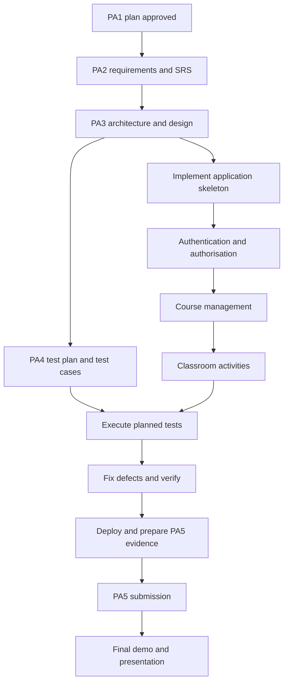

# Part 4 – Project Plan
**Project:** Vible – Online Teaching Platform  
**Team:** T06 – VibeCodeToByteCode  
**Status:** PA1 draft; proposed estimates and assumptions are explicitly labelled.

> **Planning note:** PA0 identifies the three Must-have features as Authentication & Authorisation, Course Management, and Classroom Activities. Roster Management, Grading & Feedback, and Announcements & Discussions are marked “No” under Must-have. The plan below preserves those priorities. The PA schedule uses the course's relative week deadlines; exact calendar dates should be added if the instructor provides them.

## 4.1 Process and Phase Gates

The project follows the **waterfall model**, with each PA submission serving as a phase gate and baseline. Once a PA is submitted, changes are recorded in the next PA rather than silently changing the earlier baseline. Test planning follows the course's V-model approach.

| PA / milestone | Phase | Due | Proposed exit criteria |
|---|---|---|---|
| PA1 | Initiation & planning | End of Week 3 | Vision and scope agreed; Must/Should/Could/Won't priorities documented; WBS contains at least three levels; work packages have owners, estimates and due dates; schedule, critical path, roles, risks, tool setup and AI usage log documented. |
| PA2 | Requirements | End of Week 5 | SRS reviewed by the team; functional requirements numbered and prioritised; measurable non-functional requirements and domain rules documented; use-case model/specifications, mockups, acceptance criteria and traceability prepared. |
| PA3 | Design | End of Week 7 | Architecture and design are consistent with PA2; C4 context/container and other required design models completed; data and UI designs reviewed; architecture decisions recorded; requirement changes listed. |
| PA4 | Test planning | End of Week 8 | Test plan, test cases and test data prepared; applicable EP/BVA/decision-table techniques documented; Must-have requirements traced to tests; test environment, entry/exit criteria and defect process agreed. |
| PA5 | Implementation, testing & deployment | End of Week 10 | Must-have features implemented; unit and automated tests run; system-test results and defects recorded; CI and deployment evidence available; setup instructions and implementation/test report completed. |
| Final | Presentation & demo | Week 11 | Presentation covers the project coherently; live demo demonstrates key scenarios; all members prepare to explain their contributions and design decisions. |

**Phase-gate working rule:** The team lead checks completeness and consistency before each submission. Each document and pull request is peer-reviewed by at least one other member. A submitted PA becomes the baseline for the next phase.

## 4.2 Work Breakdown Structure (WBS)

The WBS is decomposed into phases, deliverables and assignable work packages. Each lowest-level package should be created as a GitHub Projects task with one accountable owner, a due date and a completion definition.

| WBS ID | Work package / deliverable | Owner (proposed from PA0 roles) | Dependency |
|---|---|---|---|
| **1.0** | **Project initiation and planning** | | |
| 1.1.1 | Confirm project scope and priorities | BA – Lê Đoàn Nhật Huy | PA0 |
| 1.1.2 | Complete PA1 project plan and review | Team lead – Huỳnh Trung Ngạn | 1.1.1 |
| 1.2.1 | Configure repository, protected main and README | Developer – Trương Hiển Long | PA0 |
| 1.2.2 | Configure board, task ownership and communication | Team lead – Huỳnh Trung Ngạn | PA0 |
| **2.0** | **Requirements (PA2)** | | |
| 2.1.1 | Elicit teacher/student needs and clarify open questions | BA – Lê Đoàn Nhật Huy | 1.1 |
| 2.1.2 | Specify functional and non-functional requirements | BA – Lê Đoàn Nhật Huy | 2.1.1 |
| 2.2.1 | Prepare use cases, flows and acceptance criteria | BA – Lê Đoàn Nhật Huy | 2.1.2 |
| 2.2.2 | Prepare UI mockups and review against use cases | Designer – Trần Hoàng Minh Khang | 2.1.1 |
| 2.3.1 | Build traceability matrix and review SRS | Tester/BA – Lê Đoàn Nhật Huy | 2.2.1, 2.2.2 |
| **3.0** | **Software design (PA3)** | | |
| 3.1.1 | Draft C4 context/container and architecture | Designer – Trần Hoàng Minh Khang | PA2 baseline |
| 3.1.2 | Record architecture decisions (ADRs) | Designer – Trần Hoàng Minh Khang | 3.1.1 |
| 3.2.1 | Design data model and constraints | Designer – Trần Hoàng Minh Khang | PA2 baseline |
| 3.2.2 | Design key screens and navigation | Designer – Trần Hoàng Minh Khang | 2.2.2 |
| 3.3.1 | Review design consistency and traceability | BA + Designer | 3.1, 3.2 |
| **4.0** | **Test planning (PA4)** | | |
| 4.1.1 | Define test scope, levels, environment and exit criteria | Tester – Lê Đoàn Nhật Huy | PA3 baseline |
| 4.1.2 | Design test cases and test data for Must-have features | Tester – Lê Đoàn Nhật Huy | 4.1.1 |
| 4.2.1 | Trace requirements to test cases and review test plan | Tester + BA | 4.1.2 |
| **5.0** | **Implementation, testing and deployment (PA5)** | | |
| 5.1.1 | Set up application skeleton and configuration | Developer – Trương Hiển Long | PA3 baseline |
| 5.1.2 | Implement authentication and authorisation | Developer – Trương Hiển Long | 5.1.1 |
| 5.2.1 | Implement course management | Developer – Trương Hiển Long | 5.1.1, 5.1.2 |
| 5.2.2 | Implement classroom activities/assignments | Developer – Trương Hiển Long | 5.2.1 |
| 5.3.1 | Run unit, integration and system tests; fix defects | Tester + Developer | 5.1–5.2 |
| 5.3.2 | Configure CI and deploy; verify setup instructions | Developer + Team lead | 5.3.1 |
| 5.4.1 | Prepare PA5 report and demo scenario | Team lead + Tester | 5.3.2 |
| **6.0** | **Final presentation and demo** | | |
| 6.1.1 | Prepare slides, speaking parts and demo rehearsal | All members; lead coordinates | PA5 |
| 6.1.2 | Deliver final presentation and demo | All members | 6.1.1 |

**WBS clarification:** The IDs use phase and work-package numbering; the third-level identifiers (for example, 2.1.1) are the task-board units. Owners above are proposed from the PA0 role assignments. For shared packages, the first listed role/member should be the accountable task owner and other contributors should be recorded on the board.

## 4.3 Estimation

**Method:** Proposed estimates use expert judgement by work-package size, assuming a small student team familiarising itself with the chosen stack. They are planning estimates, not measured actual effort. Estimates should be revised after requirements/design reviews and compared with actual hours in weekly status reports.

| WBS ID | Work package | Owner | Effort (person-hours) | Method / assumptions |
|---|---|---|---:|---|
| 1.1.1 | Confirm scope and priorities | BA | 4 | Expert judgement; PA0 is the starting point |
| 1.1.2 | PA1 plan and review | Team lead | 8 | Includes coordination and peer review |
| 1.2.1 | Repository setup and README | Developer | 3 | GitHub repository already identified in PA0 |
| 1.2.2 | Board and communication setup | Team lead | 3 | Existing Discord and GitHub Projects are used |
| 2.1.1 | Elicit and clarify requirements | BA | 8 | Teacher/student workflows and open questions |
| 2.1.2 | Specify functional/NFR requirements | BA | 12 | Must-have flows prioritised |
| 2.2.1 | Use cases and acceptance criteria | BA | 10 | Includes main, alternative and exception flows |
| 2.2.2 | UI mockups | Designer | 8 | Main Must-have scenarios |
| 2.3.1 | Traceability and SRS review | Tester/BA | 5 | One team review cycle assumed |
| 3.1.1 | Architecture diagrams | Designer | 8 | Initial architecture scope |
| 3.1.2 | Architecture decision records | Designer | 4 | Proposed minimum of three ADRs, aligned with rubric |
| 3.2.1 | Data model | Designer | 8 | Core users, courses and classroom activities |
| 3.2.2 | Screen/navigation design | Designer | 6 | Based on PA2 mockups |
| 3.3.1 | Design consistency review | BA + Designer | 4 | Includes traceability review |
| 4.1.1 | Test plan and environment | Tester | 6 | Includes test levels and entry/exit criteria |
| 4.1.2 | Test cases and data | Tester | 10 | Must-have features first |
| 4.2.1 | Traceability and test review | Tester + BA | 4 | Review and corrections |
| 5.1.1 | Application skeleton/configuration | Developer | 8 | Vue/Nuxt direction from PA0; final stack is still to be confirmed |
| 5.1.2 | Authentication/authorisation | Developer | 20 | Assumes a basic role model and no complex institutional SSO |
| 5.2.1 | Course management | Developer | 22 | Basic create/view/update/delete workflows as confirmed in PA2 |
| 5.2.2 | Classroom activities | Developer | 24 | Basic coursework/assignment workflows; rich upload/storage may be reduced if needed |
| 5.3.1 | Test execution and defect fixing | Tester + Developer | 20 | Unit, integration and system testing |
| 5.3.2 | CI and deployment | Developer + Lead | 8 | One deployment target; no high-availability setup |
| 5.4.1 | PA5 report and demo scenario | Lead + Tester | 6 | Evidence and report preparation |
| 6.1.1 | Presentation and rehearsal | All members | 8 | Shared preparation effort |
| 6.1.2 | Final delivery | All members | 4 | Team presentation/demo preparation and delivery |
| | **Total estimated effort** | | **231 person-hours** | Planning estimate; revise as actuals become available |

**Estimate assumptions**
- The team has four members, each targeting at least 15 hours per week as stated in PA0.
- The project’s implementation window is three weeks, so the Must-have scope must remain small and testable.
- Vue with Nuxt is the current direction in PA0; the database and final deployment/storage/authentication providers remain undecided.
- The estimate excludes optional feature expansion and institution-level administration, live video, and private real-time chat.
- Effort is not duration: work can overlap only when dependencies and available people allow it.

## 4.4 Schedule

The table follows the course's published relative deadlines. Tasks should be added to GitHub Projects with specific dates once the course calendar is confirmed. The internal completion target is **two days before each PA deadline**, per the team contract; the weekly status report is due **Sunday at 23:59**.

| Week | Planned work | Milestone / dependency |
|---|---|---|
| Week 2 | Confirm PA0 baseline; initialise repository/board; begin PA1 | PA0 approval required before PA1 work proceeds |
| Week 3 | Complete scope, WBS, estimates, schedule, roles, risks and tool setup | **PA1 due: end of Week 3** |
| Week 4 | Elicit requirements; draft FR/NFRs, use cases and mockups | PA1 baseline |
| Week 5 | Complete SRS, acceptance criteria, traceability and review | **PA2 due: end of Week 5** |
| Week 6 | Architecture, data model, UI design and ADRs | PA2 baseline |
| Week 7 | Complete and review design models | **PA3 due: end of Week 7** |
| Week 8 | Test plan, test cases, data, traceability and review | **PA4 due: end of Week 8** |
| Weeks 8–9 | Implement Must-have features; integrate incrementally; run unit/integration tests | PA3 design and PA4 test plan are inputs; three-week implementation phase spans the end of Week 8 through Week 10 |
| Week 10 | System testing, defect fixes, CI/deployment evidence, report | **PA5 due: end of Week 10** |
| Week 11 | Prepare and deliver final presentation and live demo | **Final presentation/demo** |

### Proposed dependency chain and critical path

**Proposed critical path:** PA1 baseline → PA2 requirements baseline → PA3 design baseline → implementation skeleton → authentication/authorisation → course management → classroom activities → test execution and defect fixing → deployment/evidence → PA5 → final demo.

This is a **provisional** critical path based on logical dependencies, not a calculated date-based critical path. The task board should be used to confirm durations, resource constraints and float once exact dates are entered. Test planning can proceed in parallel with some implementation preparation, but test execution depends on working features.

### Milestones

- **M1:** PA1 submitted — end of Week 3
- **M2:** PA2 SRS submitted — end of Week 5
- **M3:** PA3 design submitted — end of Week 7
- **M4:** PA4 test plan submitted — end of Week 8
- **M5:** PA5 implementation/testing/deployment submitted — end of Week 10
- **M6:** Final presentation and demo — Week 11

## 4.5 Roles and Responsibilities

The primary and backup assignments below are taken from PA0. The role assignments do not prevent other members from contributing to tasks; each task-board item must still have one accountable owner.

| Role | Main | Backup | Responsibilities |
|---|---|---|---|
| Team lead / Project manager | Huỳnh Trung Ngạn | Trương Hiển Long | Plan and assign tasks, track progress, coordinate reviews, act as contact point, collect weekly status reports and AI logs |
| Business analyst | Lê Đoàn Nhật Huy | Trần Hoàng Minh Khang | Elicit and document requirements, organise reviews, maintain requirement/acceptance criteria traceability |
| Designer / Architect | Trần Hoàng Minh Khang | Huỳnh Trung Ngạn | Architecture, class/data/UI design, design decisions and consistency reviews |
| Developer | Trương Hiển Long | Huỳnh Trung Ngạn; Lê Đoàn Nhật Huy | Implement features, write unit tests, review pull requests, support integration and deployment |
| Tester | Lê Đoàn Nhật Huy | Trần Hoàng Minh Khang | Test plan/cases, test data, system testing, defect reports and test traceability |

**Team operating commitments from PA0**
- Internal team meeting: Saturday, 20:15, online.
- Weekly status meeting with the TA: Monday, 20:15, online.
- Weekly status report deadline: Sunday, 23:59, committed to `/docs/management/weekly/`.
- Each member should finish their assigned PA work two days before the PA deadline.
- Every work package is a task-board item with owner and due date; every pull request/document section receives at least one peer review before merge; direct pushes to protected `main` are forbidden.

## 4.6 Human Resources and Cost Estimate

The following is a **planning estimate**, not a confirmed expense or salary quote. Student effort is costed at an assumed junior-developer rate to make the estimate explicit, even if the team does not pay itself.

### Labour estimate

| Item | Calculation | Estimated cost |
|---|---|---:|
| Project effort | 231 person-hours | — |
| Assumed junior-developer rate | 100,000 VND/person-hour | — |
| Labour-equivalent cost | 231 × 100,000 VND | 23,100,000 VND |

### Tools and operating costs

| Item | Planning assumption | Estimated cost |
|---|---|---:|
| GitHub, GitHub Projects, Discord | Use existing/free tiers where sufficient | 0 VND |
| Development tools | Use existing/free student tools | 0 VND |
| Hosting/deployment | Free tier or student allowance; contingency if paid hosting is required | 1,000,000 VND |
| Domain / other project costs | Optional; only purchase if needed for demo | 500,000 VND |
| **Estimated non-labour total** | | **1,500,000 VND** |
| **Total estimated project cost** | Labour-equivalent + non-labour | **24,600,000 VND** |

**Cost caveats:** The hourly rate and tool/hosting amounts are assumptions for planning and must be confirmed by the team. If the project uses free hosting and no custom domain, the cash cost could be lower; the labour-equivalent cost is not necessarily money the team will spend. Any paid storage, authentication provider, SMS/email service or other third-party service must be priced after the technical choices are confirmed.

## Decisions to confirm before submission

1. Confirm the final database choice (PA0 lists PostgreSQL, MongoDB or Firebase as possibilities).
2. Confirm authentication, file-storage and deployment providers; these were open questions in PA0.
3. Confirm whether assignments require file uploads in the Must-have scope; PA0 identifies rich uploads/storage as a project risk.
4. Add exact calendar dates to task-board tasks when the official week calendar is available.
5. Replace planning estimates with team-agreed estimates and track actual hours in weekly reports.
6. Verify that each lowest-level WBS item has an owner, due date and task-board link.
