# Introduction to Software Engineering
## Project Phase 3: Software Design Document

**Course**: CSC13002 – Introduction to Software Engineering  
**Department**: Software Engineering, Faculty of Information Technology  
**Institution**: Ho Chi Minh City University of Science (HCMUS), VNU-HCM  
**Project**: Vible – Online Teaching Platform  
**Team**: T06  
**Academic Year**: 2026–2027  

---

## Table of Contents
1. [Member Contribution Assessment](#1-member-contribution-assessment)
2. [Design Overview](#2-design-overview)
   - 2.1 [Design Goals and Constraints](#21-design-goals-and-constraints)
3. [Architectural Design](#3-architectural-design)
   - 3.1 [Architectural Style and Monorepo Structure](#31-architectural-style-and-monorepo-structure)
     - 3.1.1 [Edge-Layered Application Pattern](#311-edge-layered-application-pattern)
     - 3.1.2 [Monorepo Architecture and Codebase Decomposition](#312-monorepo-architecture-and-codebase-decomposition)
   - 3.2 [System Context Diagram (C4 Level 1)](#32-system-context-diagram-c4-level-1)
   - 3.3 [Container Diagram (C4 Level 2)](#33-container-diagram-c4-level-2)
   - 3.4 [Component Diagram (C4 Level 3)](#34-component-diagram-c4-level-3)
   - 3.5 [Deployment Diagram](#35-deployment-diagram)
   - 3.6 [Architecture Decision Records (ADRs)](#36-architecture-decision-records-adrs)
4. [Object-Oriented Design](#4-object-oriented-design)
   - 4.1 [Domain Model](#41-domain-model)
   - 4.2 [Class Diagram](#42-class-diagram)
   - 4.3 [Class Specifications](#43-class-specifications)
   - 4.4 [Sequence Diagrams](#44-sequence-diagrams)
   - 4.5 [State Machine Diagrams](#45-state-machine-diagrams)
   - 4.6 [Design Principles and Patterns](#46-design-principles-and-patterns)
5. [Data Design](#5-data-design)
   - 5.1 [Data Diagram (ERD)](#51-data-diagram-erd)
   - 5.2 [Data Specification](#52-data-specification)
   - 5.3 [Normalisation and Indexes](#53-normalisation-and-indexes)
6. [User Interface and User Experience Design](#6-user-interface-and-user-experience-design)
   - 6.1 [Screen List and Screen Flow](#61-screen-list-and-screen-flow)
   - 6.2 [Screen Specifications](#62-screen-specifications)
   - 6.3 [Accessibility Checklist](#63-accessibility-checklist)
7. [Traceability Update](#7-traceability-update)
8. [Changes to the Requirements Since PA2](#8-changes-to-the-requirements-since-pa2)
9. [AI Usage Log](#9-ai-usage-log)

---

# Objectives
This document focuses on the following engineering topics:
- Completing the Software Design document with the following sections:
  - Architectural design (C4 system context, container, component, deployment diagrams, and ADRs)
  - Object-oriented design (conceptual domain model, design-level class diagram, class specifications, sequence diagrams, state machine diagrams, design principles and patterns)
  - Data design (logical ERD, physical DBMS data specification, normalisation up to 3NF/BCNF, and indexing strategy)
  - User interface design (screen flow navigation, detailed screen specifications, accessibility checklist)
  - Traceability update (connecting requirements to architectural components, classes, database tables, and screens)
- Including an AI usage log for this phase complying with course GenAI policies
- Providing an actionable, unambiguous architectural and design blueprint for Phase 4 (Testing) and Phase 5 (Implementation).

---

# 1. Member Contribution Assessment

| ID | Name | Role(s) | Contribution (%) | Evidence |
| :--- | :--- | :--- | :--- | :--- |
| **24127445** | **Trương Hiển Long** | Project Lead, Software Architect, Fullstack Lead | 100% | - Complete architectural design, C4 models, and monorepo structure (Section 3)<br>- Authored ADR-001 through ADR-005<br>- Formulated Object-Oriented domain models, class specs, sequence diagrams, and state machines (Section 4)<br>- Designed relational database schema, 3NF/BCNF normalisation, and query indexing strategy (Section 5)<br>- Designed UI screen flows, detailed screen specifications, and WCAG 2.1 AA accessibility checklist (Section 6)<br>- Maintained requirements traceability matrix and repository workspace setup (Section 7)<br>- GitHub: [hienlongg](https://github.com/hienlongg)|

*Total contribution: 100%*.

---

# 2. Design Overview

## 2.1 Design Goals and Constraints

### 2.1.1 Architecturally Significant Requirements (ASRs)
The architecture and design of Vible are directly driven by high-priority functional requirements (F01–F05) and critical non-functional requirements (NFRs) established in the SRS:

1. **Role-Based Access Control & Strict Boundary Enforcement (FR-01C, NFR-02)**:
   - Users are strictly divided into `Teacher` and `Student` roles (BR-01).
   - Only the course teacher has administrative rights over their courses, materials, rosters, assignment deadlines, and grading (BR-02, BR-04, BR-08).
   - Enrolled students have read-only access to published course materials and write permissions solely to submit their own assignment work (BR-03, BR-05).
   - The design enforces access boundaries both at the Edge routing middleware layer and at the database query/transaction level.

2. **Ultra-Low Latency and High Responsiveness (NFR-01)**:
   - 95% of standard read/write API requests must complete in under 500 ms under normal educational workloads.
   - The UI must render immediately as a responsive Single-Page Application (SPA) / Progressive Web App (PWA).

3. **Data Integrity and Transactional Reliability (NFR-03, NFR-06)**:
   - All critical domain operations—including user registration, course creation, roster state updates, assignment submissions, and grading—must satisfy ACID transactional guarantees.
   - For file uploads (materials and assignment submissions), an operation is acknowledged as successful only after both the binary file is persisted in cloud object storage and the relational database record is committed (dual-store verification with immediate compensating rollback on failure).

4. **Edge Availability and Zero Cold-Start UX (NFR-04)**:
   - The application must remain highly available without suffering from the 30–50 second cold-start delays typical of free-tier container hosting services.

5. **Transport and Credential Security (NFR-07)**:
   - End-to-end transport encryption via TLS 1.3/HTTPS.
   - Passwords must be hashed using industry-standard salted hashing algorithms (Argon2id or bcrypt with cost factor >= 12).
   - Session identifiers must never be exposed to client-side JavaScript (mitigating XSS attacks) and must use `HttpOnly`, `Secure`, and `SameSite=Lax` cookies paired with custom anti-CSRF request headers. Minimal claims are enforced (user UUID, role, token version, and timing fields only; no email or other profile data).

6. **Server-Side File Validation & Storage Isolation (NFR-08, BR-06)**:
   - The system must enforce strict file validation on the server: non-empty payloads, maximum file size of 20 MiB, and verification of allowed MIME types using magic-byte sniffing to prevent arbitrary executable execution.

### 2.1.2 Constraints
- **Repository and Monorepo Architecture Constraint**:
  - The project is structured as a **unified Monorepo** managed with **pnpm Workspaces** and **Turborepo** task orchestration. All client presentation views, serverless Edge API handlers, shared TypeScript DTOs/schemas, and relational database migrations reside within a single version-controlled repository to eliminate contract drift and simplify dependency updates.
- **Technology Stack Constraints**:
  - Full-stack unified TypeScript architecture using **Nuxt 4** (Vue 3 frontend + Nitro serverless engine).
  - Database persistence using **PostgreSQL 16** via **Drizzle ORM** for lightweight, edge-compatible SQL execution.
  - Object storage via S3-compatible **Cloudflare R2** with zero egress bandwidth charges.
  - Runtime constraint: Cloudflare Pages / Workers run on V8 Isolates; native C++ Node.js binary addons are forbidden, requiring edge-compatible or WASM implementations.
- **Budget Constraints**:
  - $0 infrastructure budget. All components must operate reliably within the perpetual free tiers of Cloudflare, Neon/Supabase, and GitHub Actions.
- **Schedule Constraints**:
  - Software design, testing plans, and full implementation must be completed according to the HCMUS CSC13002 academic timeline.

---

# 3. Architectural Design

## 3.1 Architectural Style and Monorepo Structure

### 3.1.1 Edge-Layered Application Pattern
Vible adopts a **Modern Full-Stack Jamstack / Edge-Layered Architecture** with a **Clean Layered Architecture** applied internally across both frontend and backend modules:

```
+-------------------------------------------------------------------------------+
|                             CLIENT-SIDE PRESENTATION LAYER                    |
|       (Vue 3 Single-File Components, Nuxt UI, Tailwind CSS, Pinia Stores)    |
+-------------------------------------------------------------------------------+
                                      │ HTTPS / JSON & Multipart (TLS 1.3)
                                      ▼
+-------------------------------------------------------------------------------+
|                      NITRO SERVERLESS ENGINE (EDGE API GATEWAY)               |
|                                                                               |
|  [Route Controllers]  ──►  [Middleware Guards]  ──►  [Application Services]   |
|   /api/auth/*               authGuard (JWT)          AuthService              |
|   /api/courses/*            roleGuard (RBAC)         CourseService            |
|   /api/materials/*          uploadValidator          MaterialService          |
|   /api/assignments/*                                 AssignmentService        |
|   /api/submissions/*                                 SubmissionService        |
+-------------------------------------------------------------------------------+
         │                                              │
         │ Direct Storage Stream                        │ Drizzle ORM Queries
         ▼                                              ▼
+-----------------------------+               +---------------------------------+
|  CLOUDFLARE R2 BUCKET       |               |  MANAGED POSTGRESQL (NEON)      |
|  (Course Materials &        |               |  (Relational Data, Indexes,     |
|   Student Submission Files) |               |   Foreign Key Cascades)         |
+-----------------------------+               +---------------------------------+
```

### Justification Against Design Goals:
1. **Edge Deployment (Cloudflare Pages/Workers)**:
   - Delivers sub-millisecond static asset delivery and no container cold start on the compute tier (the Neon database can still add a wake-up delay after idle), supporting **NFR-01** and **NFR-04**; both targets are still to be measured (see ADR-001).
2. **Layered Separation of Concerns (Presentation -> Controller -> Service -> Repository)**:
   - Isolates business rules (such as late submission checks and enrollment approval workflows) from transport frameworks, facilitating automated unit and integration testing in Phase 4.
3. **Dual-Store Architecture (PostgreSQL + Cloudflare R2)**:
   - Separates structured relational data from heavy binary documents. Keeps PostgreSQL lean and fast while taking advantage of R2's zero-egress fee model for educational downloads (satisfying **NFR-03**, **NFR-06**, and **BR-06**).
4. **End-to-End TypeScript Contracts**:
   - DTOs and Zod validation schemas are shared across the client and Nitro server handlers, eliminating contract drift.

### 3.1.2 Monorepo Architecture and Codebase Decomposition
To organize the system's components cleanly and prevent tight coupling or code duplication, Vible utilizes a **Monorepo Architecture** governed by **pnpm Workspaces** with **Turborepo** build pipeline orchestration.

#### Workspace Directory Layout:
```
vible-online-teaching-platform/
├── apps/
│   └── web/                   # @vible/web: Nuxt 4 full-stack application (Vue 3 frontend + Nitro edge API)
├── packages/
│   ├── shared/                # @vible/shared: Domain types, DTOs, Zod validation schemas, business constants
│   ├── db/                    # @vible/db: Drizzle ORM schema, migrations, connection pooler, seeding
│   ├── ui/                    # @vible/ui: Shared component primitives & Tailwind design tokens (optional)
│   └── config/                # @vible/config: Shared ESLint, Prettier, and TypeScript base configurations
├── docs/                      # Architectural designs, ADRs, requirements, and meeting records
├── pa/                        # Course project assignment deliverables (PA1 - PA5)
├── package.json               # Root monorepo workspace configuration & orchestration scripts
├── pnpm-workspace.yaml        # Workspace package glob declarations
└── turbo.json                 # Turborepo task dependencies and build caching pipeline
```

#### Package Responsibilities and Inter-Package Dependency Graph:

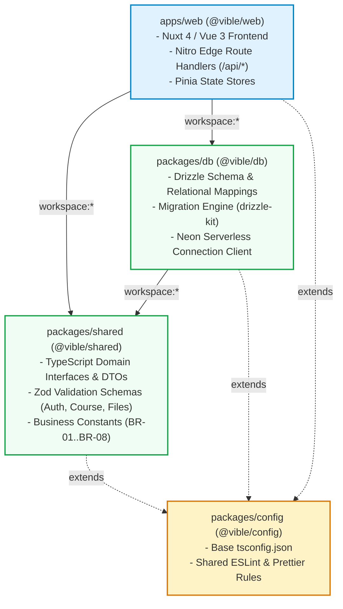

#### Architectural Advantages of the Monorepo Approach:
1. **Zero-Overhead Contract Sharing**:
   - Zod validation schemas (e.g., `RegisterSchema`, `CreateAssignmentSchema`, `FileUploadMetadataSchema`) and TypeScript DTOs defined in `@vible/shared` are imported directly by both frontend forms for instant validation and Nitro server handlers for request payload parsing, preventing runtime schema mismatches.
2. **Encapsulated Database Tooling**:
   - `@vible/db` houses database migrations (`drizzle-kit generate`, `drizzle-kit migrate`), connection pooling logic, and schema definitions. Server-only database drivers (`@neondatabase/serverless`) are completely isolated from client bundles, reducing bundle size and preventing credential leaks.
3. **High-Speed Incremental Builds & Testing**:
   - `Turborepo` analyzes the topological dependency graph and caches build and test artifacts based on source file hashes. If only a frontend Vue component changes, tests for `@vible/db` and `@vible/shared` are served instantly from cache during CI runs.
4. **Single Version Control & Unified CI**:
   - All code, documentation, architectural ADRs, and tests evolve together in a single repository, making cross-cutting features (e.g., adding an assignment rubric field) verifiable in a single pull request with atomic commits.

---

## 3.2 System Context Diagram (C4 Level 1)

The System Context diagram illustrates how Vible fits into the broader operational environment, showing the primary human actors and external systems that collaborate with it.

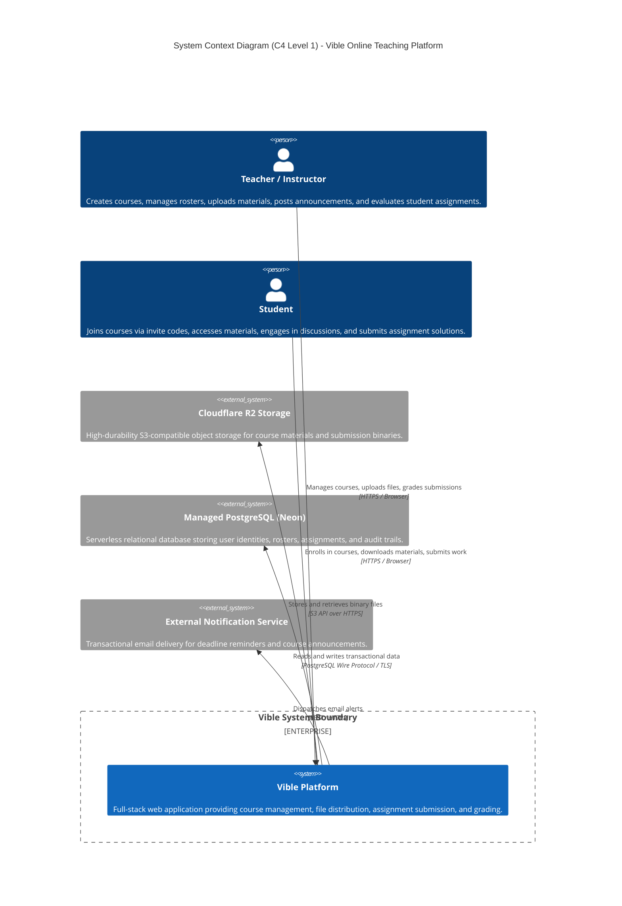

---

## 3.3 Container Diagram (C4 Level 2)

The Container diagram decomposes the Vible system into its runtime units of execution, detailing the technologies employed and communication protocols.

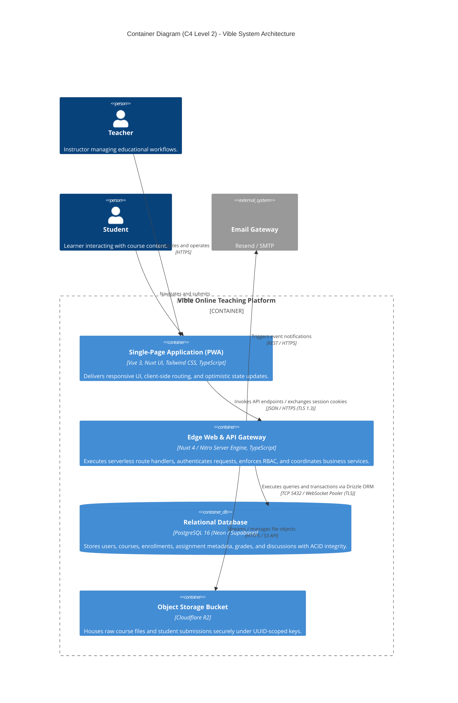

---

## 3.4 Component Diagram (C4 Level 3)

The Component diagram decomposes the primary container—**Nitro Server / Backend**—into its modular software components, highlighting separation of concerns and dependency direction.

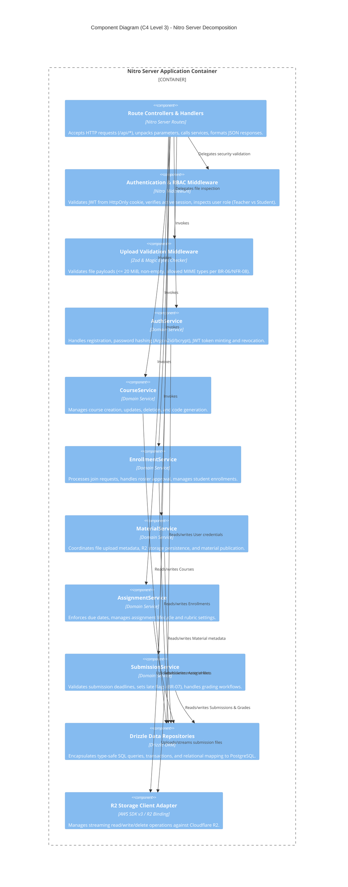

---

## 3.5 Deployment Diagram

The Deployment diagram illustrates the physical and cloud infrastructure topology where Vible runs, detailing communication protocols and network boundaries.

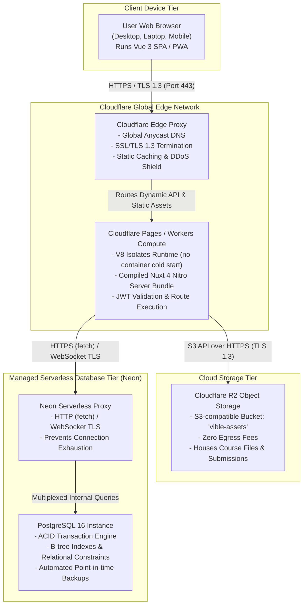

---

## 3.6 Architecture Decision Records (ADRs)

Below are the executive summaries and decision tables for the primary architectural decisions. The complete individual ADR documents are stored in `/docs/design/adr/`.

### ADR-001: Adoption of Nuxt 4 Full-Stack Framework with Nitro Engine on Cloudflare Pages
*(Detailed file: [ADR-001-nuxt-fullstack-edge-runtime.md](/docs/design/adr/ADR-001-nuxt-fullstack-edge-runtime.md))*

| ADR | ADR-001: Nuxt 4 Full-Stack Framework on Cloudflare Pages / Workers |
| :--- | :--- |
| **Status** | Accepted |
| **Context** | Need for a unified, ultra-responsive web application satisfying NFR-01 (<500ms latency) and NFR-04 (minimal cold starts) within a $0 infrastructure budget. Traditional container tiers (Render, Railway) experience 30–50s spin-down delays. |
| **Decision** | Adopt Nuxt 4 with Nitro server engine deployed to Cloudflare Pages / Workers V8 Isolates. Single codebase for Vue 3 frontend and serverless edge API endpoints. |
| **Alternatives Considered** | 1. Separate Vue 3 SPA + Node/Express on Render (rejected: cold-start latency).<br>2. Next.js on Vercel (rejected: Vercel 100 GB/month bandwidth cap and 1M invocations/month vs Cloudflare's unlimited bandwidth and ~3M invocations/month, non-commercial Hobby terms, team expertise in Vue).<br>3. SvelteKit (rejected: smaller UI component ecosystem). |
| **Consequences** | **Positive**: No container cold start on the compute tier (the Neon database can still wake up slowly after idle), unified TypeScript types, free tier with generous bandwidth and 100k requests/day.<br>**Negative**: Edge runtime cannot execute native Node C++ binary extensions; must use edge-compatible Web Crypto and WASM packages.<br>**Risks (not yet benchmarked)**: the 10 ms Free-plan CPU limit may be exceeded by password hashing and server-rendered pages (error 1102); first request after Neon idle is slower; NFR-01 not yet measured. Mitigations: measure on a deployed Worker, client-side rendering for heavy pages, lower-cost hashing, or Workers Paid. |

### ADR-002: Relational Data Persistence with PostgreSQL and Drizzle ORM
*(Detailed file: [ADR-002-postgresql-drizzle-orm.md](/docs/design/adr/ADR-002-postgresql-drizzle-orm.md))*

| ADR | ADR-002: PostgreSQL 16 Relational Persistence with Drizzle ORM |
| :--- | :--- |
| **Status** | Accepted |
| **Context** | The system models complex relational entities (Users, Courses, Rosters, Assignments, Submissions, Grades) with strict foreign keys and ACID constraints. The ORM must run at the Edge without heavy cold-start initialization. |
| **Decision** | Use PostgreSQL 16 hosted on Neon combined with Drizzle ORM and the serverless HTTP/WebSocket driver (`@neondatabase/serverless`). |
| **Alternatives Considered** | 1. Prisma ORM (rejected: Rust WASM query engine adds 50–150ms cold-start compilation overhead in V8 isolates vs Drizzle's ~40KB zero-dependency pure TypeScript builder).<br>2. MongoDB (rejected: lack of native relational foreign key integrity and 3NF compliance).<br>3. Cloudflare D1 (rejected: SQLite single-writer lock causes write contention on concurrent submissions/grading, lacks native PostgreSQL data types). |
| **Consequences** | **Positive**: Zero-runtime overhead, lightweight SQL-like syntax, full TypeScript compile-time type safety, robust relational ACID guarantees.<br>**Negative**: Explicit SQL migration scripts required; requires team understanding of relational SQL semantics. |

### ADR-003: Stateless Session and RBAC Using HS256 JWT in SameSite=Lax HttpOnly Cookies
*(Detailed file: [ADR-003-jwt-httponly-cookie-auth.md](/docs/design/adr/ADR-003-jwt-httponly-cookie-auth.md))*

| ADR | ADR-003: Stateless HS256 JWT Sessions in SameSite=Lax HttpOnly Cookies with Rotating Refresh Tokens |
| :--- | :--- |
| **Status** | Accepted (Revised) |
| **Context** | The platform enforces strict role differentiation between Teachers and Students (BR-01, NFR-02); roles are fixed at registration and there is no administrator role. Credentials must be protected from XSS/CSRF (NFR-07) on a stateless edge runtime limited to 10 ms CPU per request on the Workers Free plan. Links from email, LMS, and chat must not send logged-in users to the login screen, a stolen session must be detectable and revocable, and tokens should carry only what authorization needs. |
| **Decision** | Sign access tokens with symmetric **HS256** via the native Web Crypto API, using a 32-byte random secret; the verifier accepts only `HS256` and checks `exp`/`iss`. Store the access token in an `HttpOnly`, `Secure`, `SameSite=Lax` cookie `vible_session` (15 min), paired with an opaque 7-day refresh cookie `vible_refresh` (path `/api/auth`) whose SHA-256 hash is stored in `refresh_tokens`. Refresh tokens rotate on every use; reuse of a rotated token revokes all of the user's sessions and increments `users.token_version`, which every mutation checks inside its authorization query. Anti-CSRF middleware requires `X-Requested-With: XMLHttpRequest`, rejects any `Sec-Fetch-Site` other than `same-origin`, and requires an exact `Origin` match (falling back to `Referer`). Claims: `sub`, `role`, `v`, `iat`, `exp`, `iss`; no email. |
| **Alternatives Considered** | 1. Asymmetric RS256/Ed25519 (rejected: no other service verifies tokens, so public-key verification brings no benefit; key-pair management is extra work; RSA signing on every login/refresh costs far more than HMAC).<br>2. `SameSite=Strict` cookie policy (rejected: breaks deep links from email and LMS).<br>3. Stateful session store with Redis/KV (rejected: a network round trip on every request; KV is eventually consistent).<br>4. JWT in `localStorage` (rejected: readable by XSS, violating NFR-07).<br>5. Long-lived access token without refresh (rejected: long theft window, no reuse detection).<br>6. Profile data such as email in JWT (rejected: copies personal data into every request, goes stale).<br>7. Managed Auth like Clerk/Auth0 (rejected: MAU pricing conflicts with the $0 budget; harder local/CI testing). |
| **Consequences** | **Positive**: no database lookup to authenticate reads, deep links work even after the access token expires, layered CSRF protection, detectable and revocable token theft, minimal claims, no auth libraries.<br>**Negative**: a revoked session can still read for up to 15 minutes; each refresh costs three indexed queries; password hashing at NFR-07 strength may exceed the Free-plan CPU limit (to be measured; fallback is the Workers Paid plan); the client needs a 401 refresh-and-retry interceptor. |

### ADR-004: Server-Mediated Edge-Streaming Cloudflare R2 Object Storage for Materials and Submissions
*(Detailed file: [ADR-004-direct-r2-object-storage.md](/docs/design/adr/ADR-004-direct-r2-object-storage.md))*

| ADR | ADR-004: Cloudflare R2 Object Storage for Files |
| :--- | :--- |
| **Status** | Accepted (Revised) |
| **Context** | Educational materials and student submissions comprise binary files up to 20 MiB (BR-06). Storing files inside PostgreSQL bloats database size and backups. Uploads require server-side validation (NFR-08) without buffering full files in Worker memory, and a submission may only be reported successful once both file and record are stored (NFR-06). |
| **Decision** | Store binary files in a private Cloudflare R2 bucket. Clients send the raw file body with `Content-Length`; the server rejects empty/oversize/disallowed files from headers, sniffs magic bytes at the stream head (checking declared MIME type and extension), then streams the body into `R2_BUCKET.put()` through a `FixedLengthStream`. Metadata is committed to PostgreSQL after the R2 write; on DB failure the new object is deleted, and a separate nightly reconciliation Worker removes unreferenced objects. Keys are UUID-only (`courses/{courseId}/materials/{materialId}.bin`, `assignments/{assignmentId}/submissions/{studentId}/{submissionId}.bin`); each resubmission is a new row and object, with one `is_current` attempt per student per assignment. |
| **Alternatives Considered** | 1. Pre-signed direct R2 upload (rejected: the server cannot inspect file content before it is stored, weakening BR-06/NFR-08 enforcement).<br>2. PostgreSQL `BYTEA` (rejected: quickly exhausts DB storage limits and slows down queries).<br>3. AWS S3 (rejected: substantial ~$0.09/GB egress bandwidth fees for student downloads vs Cloudflare R2's $0 egress and native worker bindings).<br>4. Server local filesystem (rejected: serverless workers are ephemeral and stateless). |
| **Consequences** | **Positive**: Server-side BR-06/NFR-08 enforcement before storage, zero egress fees, bounded Worker memory, previous submission preserved until a new one is fully committed (NFR-06).<br>**Negative**: Every upload and download consumes a Worker request; upload CPU time must be measured against the 10 ms Free-plan limit; requires compensating deletes and a separately deployed reconciliation Worker. |

### ADR-005: Monorepo Architecture Using pnpm Workspaces and Turborepo
*(Detailed file: [ADR-005-monorepo-pnpm-workspaces.md](/docs/design/adr/ADR-005-monorepo-pnpm-workspaces.md))*

| ADR | ADR-005: Monorepo Architecture with pnpm Workspaces & Turborepo |
| :--- | :--- |
| **Status** | Accepted |
| **Context** | Multiple subsystems (Vue 3 frontend, Nitro edge server, Drizzle ORM schemas/migrations, and shared TypeScript DTOs/Zod schemas) require strict synchronization. A flat monolith leads to server dependency leakage into client builds, while a polyrepo introduces heavy multi-repo PR overhead and schema drift. |
| **Decision** | Adopt a monorepo architecture managed by **pnpm workspaces** (`apps/web`, `packages/shared`, `packages/db`, `packages/config`) orchestrated with **Turborepo** task pipelines. Internal dependencies use the `workspace:*` protocol. |
| **Alternatives Considered** | 1. Polyrepo with separate repositories (rejected: high overhead and contract drift).<br>2. Flat monolith repository (rejected: coupling, server secrets and Drizzle driver bundling risks).<br>3. npm Workspaces / Yarn (rejected: npm flat hoisting causes phantom dependencies; yarn PnP causes Vite friction; pnpm selected for strict isolation and speed).<br>4. Nx Monorepo (rejected: steep learning curve and unnecessary plugin weight). |
| **Consequences** | **Positive**: Zero-cost schema and DTO sharing, strict isolation of database drivers, fast incremental builds and tests via Turborepo caching, atomic cross-package commits.<br>**Negative**: Developers must understand workspace filtering commands (`pnpm --filter`); Cloudflare Pages CI build command must be configured with monorepo root context and build output directory `apps/web/dist` (required by the `cloudflare-pages` Nitro preset). |

---

# 4. Object-Oriented Design

## 4.1 Domain Model

The Domain Model captures the conceptual business entities, their attributes, and their semantic relationships within the Vible teaching and learning environment (without implementation methods).

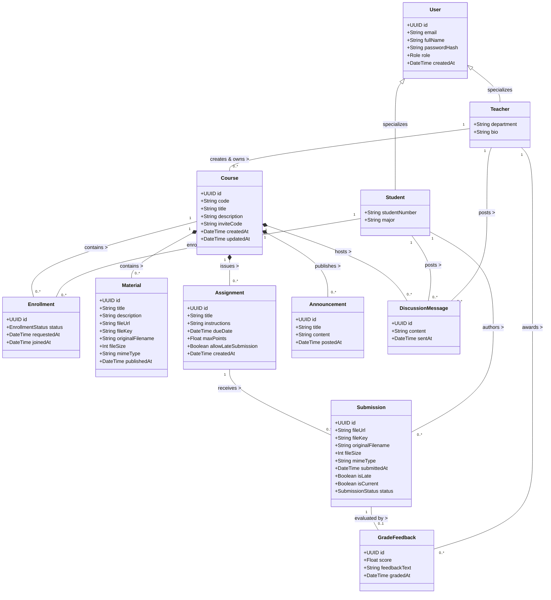

---

## 4.2 Class Diagram

The Design-Level Class Diagram organizes software elements into layered packages, complete with attribute types, visibility modifiers, and typed operation signatures.

```mermaid
classDiagram
    direction TB

    %% Presentation / Controller Package
    namespace PresentationControllers {
        class AuthController {
            +register(req: RegisterDTO): Promise~UserResponseDTO~
            +login(req: LoginDTO): Promise~AuthResultDTO~
            +logout(): Promise~void~
            +getMe(): Promise~UserProfileDTO~
        }
        class CourseController {
            +createCourse(dto: CreateCourseDTO): Promise~CourseDTO~
            +getCourses(): Promise~List~CourseDTO~~
            +getCourseDetails(courseId: UUID): Promise~CourseDetailDTO~
            +updateCourse(courseId: UUID, dto: UpdateCourseDTO): Promise~CourseDTO~
            +deleteCourse(courseId: UUID): Promise~void~
        }
        class RosterController {
            +requestJoin(dto: JoinCourseDTO): Promise~EnrollmentDTO~
            +getRoster(courseId: UUID): Promise~List~ParticipantDTO~~
            +approveStudent(courseId: UUID, studentId: UUID): Promise~EnrollmentDTO~
            +removeStudent(courseId: UUID, studentId: UUID): Promise~void~
        }
        class MaterialController {
            +uploadMaterial(courseId: UUID, form: FormData): Promise~MaterialDTO~
            +getMaterials(courseId: UUID): Promise~List~MaterialDTO~~
            +deleteMaterial(materialId: UUID): Promise~void~
        }
        class AssignmentController {
            +createAssignment(courseId: UUID, dto: CreateAssignmentDTO): Promise~AssignmentDTO~
            +getAssignments(courseId: UUID): Promise~List~AssignmentDTO~~
            +getAssignmentDetails(assignmentId: UUID): Promise~AssignmentDetailDTO~
            +submitAssignment(assignmentId: UUID, form: FormData): Promise~SubmissionDTO~
            +gradeSubmission(submissionId: UUID, dto: GradeDTO): Promise~GradeDTO~
        }
    }

    %% Domain Service Package
    namespace DomainServices {
        class AuthService {
            -userRepo: UserRepository
            +registerUser(data: RegisterData): Promise~User~
            +authenticate(credentials: Credentials): Promise~AuthTokenBundle~
            +validateSessionToken(token: String): Promise~JWTPayload~
            +hashPassword(plain: String): Promise~String~
            +verifyPassword(plain: String, hash: String): Promise~Boolean~
        }
        class CourseService {
            -courseRepo: CourseRepository
            +create(teacherId: UUID, data: CourseData): Promise~Course~
            +update(courseId: UUID, teacherId: UUID, data: PartialCourseData): Promise~Course~
            +delete(courseId: UUID, teacherId: UUID): Promise~Boolean~
            +getTeacherCourses(teacherId: UUID): Promise~List~Course~~
            +getStudentCourses(studentId: UUID): Promise~List~Course~~
        }
        class EnrollmentService {
            -enrollRepo: EnrollmentRepository
            -courseRepo: CourseRepository
            +requestEnrollment(studentId: UUID, code: String): Promise~Enrollment~
            +approveEnrollment(teacherId: UUID, enrollId: UUID): Promise~Enrollment~
            +rejectEnrollment(teacherId: UUID, enrollId: UUID): Promise~Boolean~
            +removeStudentFromCourse(teacherId: UUID, courseId: UUID, studentId: UUID): Promise~Boolean~
            +verifyEnrollment(studentId: UUID, courseId: UUID): Promise~Boolean~
        }
        class MaterialService {
            -materialRepo: MaterialRepository
            -storageService: IStorageClient
            -validator: IFileValidator
            +publishMaterial(courseId: UUID, teacherId: UUID, file: FilePayload, meta: MaterialMeta): Promise~Material~
            +getCourseMaterials(courseId: UUID, userId: UUID): Promise~List~Material~~
            +removeMaterial(materialId: UUID, teacherId: UUID): Promise~Boolean~
        }
        class AssignmentService {
            -assignRepo: AssignmentRepository
            -courseRepo: CourseRepository
            +createAssignment(courseId: UUID, teacherId: UUID, data: AssignmentData): Promise~Assignment~
            +listCourseAssignments(courseId: UUID, userId: UUID): Promise~List~Assignment~~
            +getAssignment(assignmentId: UUID, userId: UUID): Promise~Assignment~
        }
        class SubmissionService {
            -submissionRepo: SubmissionRepository
            -assignRepo: AssignmentRepository
            -storageService: IStorageClient
            -validator: IFileValidator
            +submitWork(assignmentId: UUID, studentId: UUID, file: FilePayload): Promise~Submission~
            +listSubmissionsForAssignment(assignmentId: UUID, teacherId: UUID): Promise~List~Submission~~
            +getStudentSubmission(assignmentId: UUID, studentId: UUID): Promise~Submission~
            +gradeSubmission(submissionId: UUID, teacherId: UUID, score: Float, text: String): Promise~GradeFeedback~
        }
    }

    %% Repository / Data Access Package
    namespace DataAccessRepositories {
        class UserRepository {
            +findById(id: UUID): Promise~User~
            +findByEmail(email: String): Promise~User~
            +create(user: User): Promise~User~
        }
        class CourseRepository {
            +findById(id: UUID): Promise~Course~
            +findByInviteCode(code: String): Promise~Course~
            +listByTeacherId(teacherId: UUID): Promise~List~Course~~
            +create(course: Course): Promise~Course~
            +update(id: UUID, data: Object): Promise~Course~
            +delete(id: UUID): Promise~Boolean~
        }
        class EnrollmentRepository {
            +findByStudentAndCourse(studentId: UUID, courseId: UUID): Promise~Enrollment~
            +listByCourse(courseId: UUID): Promise~List~Enrollment~~
            +listApprovedByStudent(studentId: UUID): Promise~List~Enrollment~~
            +create(enrollment: Enrollment): Promise~Enrollment~
            +updateStatus(id: UUID, status: EnrollmentStatus): Promise~Enrollment~
            +delete(id: UUID): Promise~Boolean~
        }
        class AssignmentRepository {
            +findById(id: UUID): Promise~Assignment~
            +listByCourse(courseId: UUID): Promise~List~Assignment~~
            +create(assignment: Assignment): Promise~Assignment~
        }
        class SubmissionRepository {
            +findById(id: UUID): Promise~Submission~
            +findByAssignmentAndStudent(assignmentId: UUID, studentId: UUID): Promise~Submission~
            +listByAssignment(assignmentId: UUID): Promise~List~Submission~~
            +create(submission: Submission): Promise~Submission~
            +upsertGrade(submissionId: UUID, grade: GradeFeedback): Promise~GradeFeedback~
        }
    }

    AuthController --> AuthService
    CourseController --> CourseService
    RosterController --> EnrollmentService
    MaterialController --> MaterialService
    AssignmentController --> AssignmentService
    AssignmentController --> SubmissionService

    AuthService --> UserRepository
    CourseService --> CourseRepository
    EnrollmentService --> EnrollmentRepository
    EnrollmentService --> CourseRepository
    AssignmentService --> AssignmentRepository
    SubmissionService --> SubmissionRepository
    SubmissionService --> AssignmentRepository
```

---

## 4.3 Class Specifications

Below are detailed specifications for the 8 primary classes forming the core of the Vible platform.

### 4.3.1 Class `User`
- **Superclass**: None
- **Responsibility**: Represents an authenticated identity within Vible; maintains security credentials, profile information, and role designation.

| # | Attribute | Type | Visibility | Constraint | Description |
| :- | :--- | :--- | :--- | :--- | :--- |
| 1 | `id` | `UUID` | Private | Primary Key, Not Null | Unique system-wide user identifier. |
| 2 | `email` | `String` | Private | Unique, Not Null, Valid Email | Institutional or personal email for authentication. |
| 3 | `fullName` | `String` | Private | Not Null, Length [2..100] | Display name shown on rosters and submissions. |
| 4 | `passwordHash` | `String` | Private | Not Null, Argon2/bcrypt | Cryptographically hashed password digest. |
| 5 | `role` | `RoleEnum` | Private | Not Null, `TEACHER` or `STUDENT` | Role determining system authorizations (BR-01). |
| 6 | `avatarUrl` | `String` | Private | Nullable, Valid URL | Optional profile avatar link. |
| 7 | `createdAt` | `DateTime` | Private | Not Null, Default `NOW()` | Timestamp when the user registered. |

| # | Operation | Parameters / return | Visibility | Description |
| :- | :--- | :--- | :--- | :--- |
| 1 | `isTeacher()` | `(): Boolean` | Public | Returns `true` if user role is `TEACHER`. |
| 2 | `isStudent()` | `(): Boolean` | Public | Returns `true` if user role is `STUDENT`. |
| 3 | `verifyPassword()` | `(plain: String): Boolean` | Public | Compares plain password with salted `passwordHash`. |
| 4 | `toSafeDTO()` | `(): UserProfileDTO` | Public | Exports user profile excluding sensitive password hash. |

---

### 4.3.2 Class `Course`
- **Superclass**: None
- **Responsibility**: Represents a classroom workspace; aggregates learning materials, assignments, participants, and discussions under single-teacher ownership (BR-02).

| # | Attribute | Type | Visibility | Constraint | Description |
| :- | :--- | :--- | :--- | :--- | :--- |
| 1 | `id` | `UUID` | Private | Primary Key, Not Null | Unique course identifier. |
| 2 | `title` | `String` | Private | Not Null, Length [3..120] | Name of the course (e.g., "Software Engineering"). |
| 3 | `description` | `String` | Private | Nullable, Text | Detailed course syllabus or overview. |
| 4 | `teacherId` | `UUID` | Private | Foreign Key (Users), Not Null | ID of the instructor who owns the course (BR-02). |
| 5 | `inviteCode` | `String` | Private | Unique, Length [6..10], Alphanumeric | Randomly generated code used by students to join. |
| 6 | `isArchived` | `Boolean` | Private | Not Null, Default `false` | Indicates whether the course has concluded. |
| 7 | `createdAt` | `DateTime` | Private | Not Null, Default `NOW()` | Timestamp when the course was created. |

| # | Operation | Parameters / return | Visibility | Description |
| :- | :--- | :--- | :--- | :--- |
| 1 | `generateInviteCode()` | `(): String` | Public | Regenerates a fresh unique 8-character invite code. |
| 2 | `isOwnedBy()` | `(userId: UUID): Boolean` | Public | Validates whether the given user is the owning teacher. |
| 3 | `archive()` | `(): void` | Public | Sets `isArchived = true`, preventing new submissions. |

---

### 4.3.3 Class `Enrollment`
- **Superclass**: None
- **Responsibility**: Manages the membership association between a student and a course, tracking approval state (BR-03, FR-03C).

| # | Attribute | Type | Visibility | Constraint | Description |
| :- | :--- | :--- | :--- | :--- | :--- |
| 1 | `id` | `UUID` | Private | Primary Key, Not Null | Unique enrollment record identifier. |
| 2 | `courseId` | `UUID` | Private | Foreign Key (Courses), Not Null | ID of the course being joined. |
| 3 | `studentId` | `UUID` | Private | Foreign Key (Users), Not Null | ID of the student enrolling. |
| 4 | `status` | `EnrollmentStatus` | Private | `PENDING`, `ENROLLED`, `REJECTED` | Current roster status (approval workflow). |
| 5 | `requestedAt` | `DateTime` | Private | Not Null, Default `NOW()` | Timestamp when student submitted join code. |
| 6 | `joinedAt` | `DateTime` | Private | Nullable | Timestamp when teacher approved enrollment. |

| # | Operation | Parameters / return | Visibility | Description |
| :- | :--- | :--- | :--- | :--- |
| 1 | `approve()` | `(): void` | Public | Changes status to `ENROLLED` and records `joinedAt`. |
| 2 | `reject()` | `(): void` | Public | Sets status to `REJECTED`. |
| 3 | `isActive()` | `(): Boolean` | Public | Returns `true` if status equals `ENROLLED`. |

---

### 4.3.4 Class `Material`
- **Superclass**: None
- **Responsibility**: Models teacher-published learning materials (lecture slides, readings, documents) stored in Cloudflare R2 (BR-05, BR-06).

| # | Attribute | Type | Visibility | Constraint | Description |
| :- | :--- | :--- | :--- | :--- | :--- |
| 1 | `id` | `UUID` | Private | Primary Key, Not Null | Unique material identifier. |
| 2 | `courseId` | `UUID` | Private | Foreign Key (Courses), Not Null | Course in which this material is published. |
| 3 | `title` | `String` | Private | Not Null, Length [1..150] | Title of the material. |
| 4 | `description` | `String` | Private | Nullable, Text | Supplementary notes or instructions. |
| 5 | `fileUrl` | `String` | Private | Not Null, Valid URL | Secure access or CDN URL to download the file. |
| 6 | `fileKey` | `String` | Private | Not Null, Unique | R2 storage object key identifier. |
| 7 | `originalFilename` | `String` | Private | Not Null | Original sanitized human-readable filename for downloads. |
| 8 | `fileSizeBytes` | `Int` | Private | Not Null, Range [1..20971520] | File size in bytes (max 20 MiB per BR-06). |
| 9 | `mimeType` | `String` | Private | Not Null | Validated MIME type (PDF, DOCX, ZIP, etc.). |
| 10 | `publishedAt` | `DateTime` | Private | Not Null, Default `NOW()` | Publication timestamp. |

| # | Operation | Parameters / return | Visibility | Description |
| :- | :--- | :--- | :--- | :--- |
| 1 | `getDownloadUrl()` | `(): String` | Public | Generates a temporary pre-signed secure download URL. |
| 2 | `isAccessibleBy()` | `(isEnrolled: Boolean): Boolean`| Public | Enforces that only enrolled members can access (BR-04). |

---

### 4.3.5 Class `Assignment`
- **Superclass**: None
- **Responsibility**: Defines an assessable coursework task with explicit deadline parameters, submission rules, and maximum point values (BR-07).

| # | Attribute | Type | Visibility | Constraint | Description |
| :- | :--- | :--- | :--- | :--- | :--- |
| 1 | `id` | `UUID` | Private | Primary Key, Not Null | Unique assignment identifier. |
| 2 | `courseId` | `UUID` | Private | Foreign Key (Courses), Not Null | Course under which assignment is created. |
| 3 | `title` | `String` | Private | Not Null, Length [3..150] | Title of the homework/project. |
| 4 | `instructions` | `String` | Private | Nullable, Text | Detailed markdown submission guidelines. |
| 5 | `dueDate` | `DateTime` | Private | Not Null | Strict deadline timestamp (BR-07). |
| 6 | `maxScore` | `Float` | Private | Not Null, Check (`> 0`) | Maximum achievable score (e.g., 100.0 or 10.0). |
| 7 | `allowLate` | `Boolean` | Private | Not Null, Default `true` | Determines if late submissions are accepted. |
| 8 | `createdAt` | `DateTime` | Private | Not Null, Default `NOW()` | Creation timestamp. |

| # | Operation | Parameters / return | Visibility | Description |
| :- | :--- | :--- | :--- | :--- |
| 1 | `isPastDue()` | `(currentTime: DateTime): Boolean` | Public | Checks whether current time is strictly after `dueDate`. |
| 2 | `canAcceptSubmission()`| `(currentTime: DateTime): Boolean` | Public | Evaluates if submission is permitted (`!isPastDue() || allowLate`). |

---

### 4.3.6 Class `Submission`
- **Superclass**: None
- **Responsibility**: Encapsulates a student's uploaded solution file, tracking upload timestamp and evaluating late submission status (BR-06, BR-07).

| # | Attribute | Type | Visibility | Constraint | Description |
| :- | :--- | :--- | :--- | :--- | :--- |
| 1 | `id` | `UUID` | Private | Primary Key, Not Null | Unique submission identifier. |
| 2 | `assignmentId` | `UUID` | Private | Foreign Key (Assignments), Not Null | The assignment being submitted to. |
| 3 | `studentId` | `UUID` | Private | Foreign Key (Users), Not Null | The submitting student identifier. |
| 4 | `fileUrl` | `String` | Private | Not Null, Valid URL | R2 bucket URL for the uploaded solution file. |
| 5 | `fileKey` | `String` | Private | Not Null, Unique | R2 storage object key path. |
| 6 | `originalFilename` | `String` | Private | Not Null | Original sanitized human-readable filename uploaded by student. |
| 7 | `fileSizeBytes` | `Int` | Private | Not Null, Range [1..20971520] | Validated payload size in bytes (max 20 MiB). |
| 8 | `submittedAt` | `DateTime` | Private | Not Null, Default `NOW()` | Timestamp when the submission was recorded. |
| 9 | `isLate` | `Boolean` | Private | Not Null, Derived | Automatically set to `true` if `submittedAt > dueDate`. |
| 10 | `isCurrent` | `Boolean` | Private | Not Null, Default `true` | Marks the student's latest accepted attempt; set to `false` when superseded by a resubmission. |

| # | Operation | Parameters / return | Visibility | Description |
| :- | :--- | :--- | :--- | :--- |
| 1 | `markLate()` | `(): void` | Public | Sets `isLate = true` when validated against assignment due date. |
| 2 | `hasGrade()` | `(): Boolean` | Public | Checks whether a linked `GradeFeedback` record exists. |

---

### 4.3.7 Class `GradeFeedback`
- **Superclass**: None
- **Responsibility**: Models instructor evaluation for a specific student submission, storing numeric score and qualitative feedback (BR-08, FR-06A).

| # | Attribute | Type | Visibility | Constraint | Description |
| :- | :--- | :--- | :--- | :--- | :--- |
| 1 | `id` | `UUID` | Private | Primary Key, Not Null | Unique grading record identifier. |
| 2 | `submissionId` | `UUID` | Private | Foreign Key (Submissions), Unique | ID of the evaluated submission (1:1 relation). |
| 3 | `gradedById` | `UUID` | Private | Foreign Key (Users), Not Null | Teacher who performed the evaluation (BR-08). |
| 4 | `score` | `Float` | Private | Not Null, Check (`score >= 0`) | Assigned score value. |
| 5 | `feedbackText` | `String` | Private | Nullable, Text | Written evaluation comments for the student. |
| 6 | `gradedAt` | `DateTime` | Private | Not Null, Default `NOW()` | Evaluation timestamp. |

| # | Operation | Parameters / return | Visibility | Description |
| :- | :--- | :--- | :--- | :--- |
| 1 | `updateScore()` | `(newScore: Float, text: String): void` | Public | Updates grade and feedback with timestamp audit. |
| 2 | `isValidScore()` | `(maxScore: Float): Boolean` | Public | Verifies that `0 <= score <= maxScore`. |

---

### 4.3.8 Class `Announcement`
- **Superclass**: None
- **Responsibility**: Represents instructor broadcasts directed to all enrolled course participants (BR-08, FR-07A).

| # | Attribute | Type | Visibility | Constraint | Description |
| :- | :--- | :--- | :--- | :--- | :--- |
| 1 | `id` | `UUID` | Private | Primary Key, Not Null | Unique announcement identifier. |
| 2 | `courseId` | `UUID` | Private | Foreign Key (Courses), Not Null | Target course receiving the broadcast. |
| 3 | `authorId` | `UUID` | Private | Foreign Key (Users), Not Null | Teacher authoring the broadcast (BR-08). |
| 4 | `title` | `String` | Private | Not Null, Length [3..150] | Headline of the announcement. |
| 5 | `content` | `String` | Private | Not Null, Text | Detailed announcement body. |
| 6 | `createdAt` | `DateTime` | Private | Not Null, Default `NOW()` | Timestamp when broadcasted. |

| # | Operation | Parameters / return | Visibility | Description |
| :- | :--- | :--- | :--- | :--- |
| 1 | `broadcast()` | `(): void` | Public | Triggers in-app / email notification events to roster. |

---

## 4.4 Sequence Diagrams

The sequence diagrams trace the dynamic collaborations realizing 5 key use cases, including alternative/exception flows (`alt` fragments) and message signatures corresponding directly to operations in the class specifications.

### 4.4.1 Sequence Diagram: UC-02 (User Login & Role Authorization)

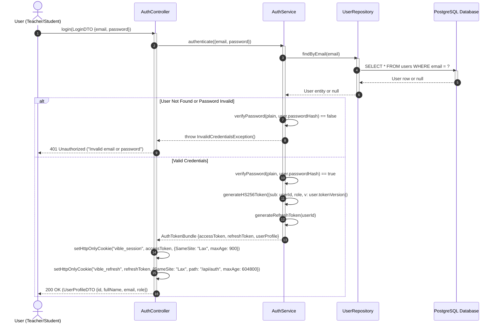

---

### 4.4.2 Sequence Diagram: UC-04 (Create Course & Assign Ownership)

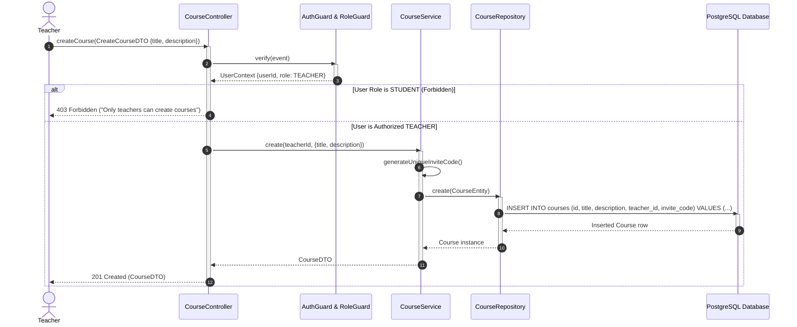

---

### 4.4.3 Sequence Diagram: UC-06 & UC-10 (Join Course via Invite Code & Teacher Approval)

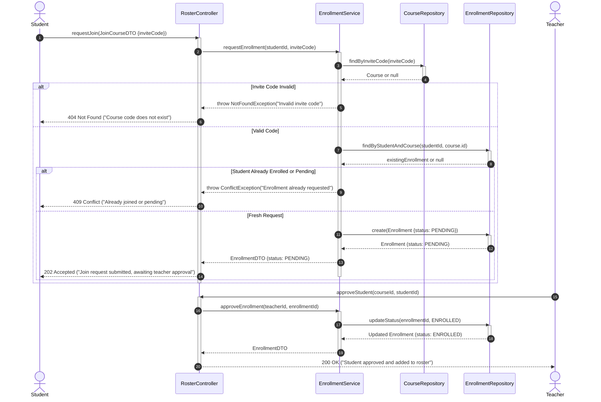

---

### 4.4.4 Sequence Diagram: UC-13 (Submit Assignment with Strict Due Date & File Validation)

```mermaid
sequenceDiagram
    autonumber
    actor Student as Student
    participant AC as AssignmentController
    participant UV as UploadValidationMiddleware
    participant SS as SubmissionService
    participant AS as AssignmentService
    participant Storage as R2StorageClient
    participant SR as SubmissionRepository
    participant DB as PostgreSQL Database

    Student ->> AC: submitAssignment(assignmentId, FormData {file})
    activate AC
    AC ->> UV: validateFile(file)
    activate UV
    
    alt File Size > 20 MiB or Empty or Disallowed MIME
        UV -->> AC: throw InvalidFileException("File exceeds 20 MiB or invalid type")
        AC -->> Student: 400 Bad Request ("Validation failed: file > 20 MiB or invalid MIME")
    else Valid File Payload
        UV -->> AC: FileValidated
        deactivate UV
        AC ->> SS: submitWork(assignmentId, studentId, file)
        activate SS
        SS ->> AS: getAssignment(assignmentId)
        activate AS
        AS -->> SS: Assignment instance {dueDate, allowLate}
        deactivate AS

        alt Submission Past Due and Late Not Allowed
            SS -->> AC: throw SubmissionClosedException("Assignment deadline has passed")
            AC -->> Student: 403 Forbidden ("Late submissions not accepted for this assignment")
        else Submission Permitted
            SS ->> SS: checkIsLate(currentTime, assignment.dueDate)
            Note over SS: If currentTime > dueDate => isLate = true, Else => isLate = false
            SS ->> Storage: streamUpload("assignments/:aid/submissions/:uid/:sid.bin", stream)
            activate Storage
            Storage -->> SS: {fileKey, fileUrl}
            deactivate Storage

            SS ->> SR: create(SubmissionEntity {fileKey, fileUrl, isLate, submittedAt})
            activate SR
            SR ->> DB: INSERT INTO submissions (...) VALUES (...)
            activate DB
            alt DB Insert Succeeded
                DB -->> SR: Inserted row
                deactivate DB
                SR -->> SS: Submission instance
                deactivate SR
                SS -->> AC: SubmissionDTO {id, isLate, submittedAt}
                deactivate SS
                AC -->> Student: 201 Created (SubmissionDTO {isLate: true/false})
            else DB Insert Failed (Compensating Rollback)
                DB -->> SR: Error (timeout / constraint failure)
                activate DB
                deactivate DB
                SR -->> SS: throw DatabaseException
                deactivate SR
                SS ->> Storage: deleteFile(fileKey)
                activate Storage
                Storage -->> SS: Object deleted (Compensating Action)
                deactivate Storage
                SS -->> AC: throw SubmissionFailedException
                AC -->> Student: 500 Internal Error ("Submission failed, storage rolled back")
            end
        end
    end
    deactivate AC
```

---

### 4.4.5 Sequence Diagram: UC-14 (Grade Submission & Provide Feedback)

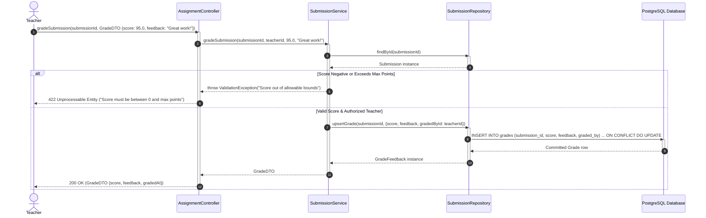

---

## 4.5 State Machine Diagrams

### 4.5.1 Enrollment Lifecycle State Machine

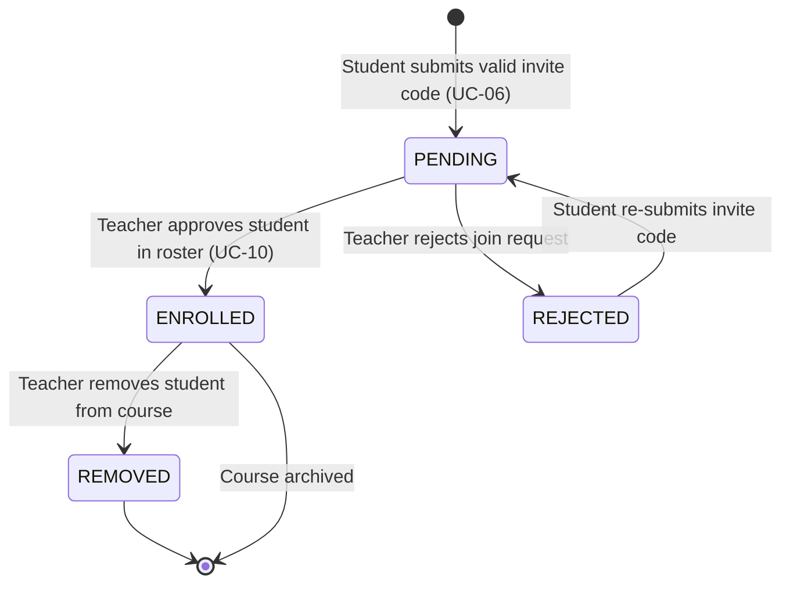

### 4.5.2 Assignment Submission Lifecycle State Machine

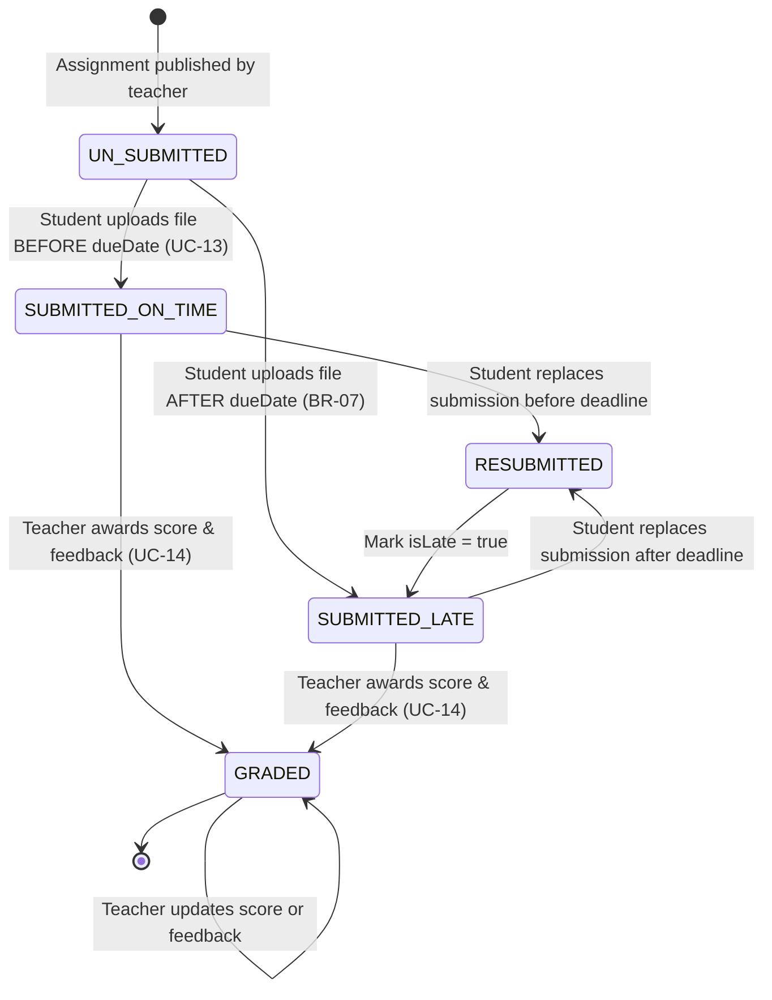

### 4.5.3 Assignment Entity Lifecycle State Machine

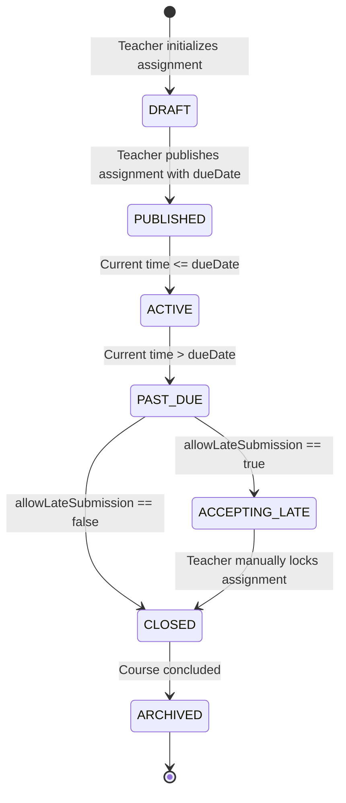

---

## 4.6 Design Principles and Patterns

| Principle / Pattern | Where It Is Applied | Why / Architectural Benefit |
| :--- | :--- | :--- |
| **Repository Pattern** | Data Access Layer (`UserRepository`, `CourseRepository`, `SubmissionRepository`) | Decouples business services from Drizzle ORM and PostgreSQL SQL specifics. Enables mocking database operations in Phase 4 unit tests without requiring a live database. |
| **Strategy Pattern** | Upload Validation Pipeline (`IFileValidator`: `PdfValidatorStrategy`, `ZipValidatorStrategy`, `ImageValidatorStrategy`) | Encapsulates different MIME inspection rules and magic-byte signatures for different file extensions, conforming to the Open/Closed Principle (OCP). |
| **Middleware / Chain of Responsibility** | Nitro Server Request Pipeline (`authGuard` -> `roleGuard` -> `uploadValidator` -> `routeHandler`) | Allows decoupled, reusable interception of incoming requests for authentication, role enforcement, and payload verification before hitting business logic. |
| **Factory Method Pattern** | Notification Dispatcher (`NotificationFactory`: returns `EmailNotificationHandler` or `InAppNotificationHandler`) | Shields business services from concrete notification delivery mechanisms, simplifying future addition of Web Push or SMS channels. |
| **Data Transfer Object (DTO) & Zod Validation** | Client-Server API Boundary (`RegisterDTO`, `CreateCourseDTO`, `SubmissionDTO`) | Enforces strict compile-time and runtime validation on HTTP payloads, preventing malformed inputs from reaching the domain services. |
| **Single Responsibility Principle (SRP)** | Segregation of `CourseService`, `MaterialService`, and `SubmissionService` | Avoids a "God object" anti-pattern by ensuring each service class has one, and only one, reason to change. |

---

# 5. Data Design

## 5.1 Data Diagram (ERD)

The Entity-Relationship Diagram defines the logical relational database schema, key constraints, and relational cardinalities implemented in PostgreSQL.

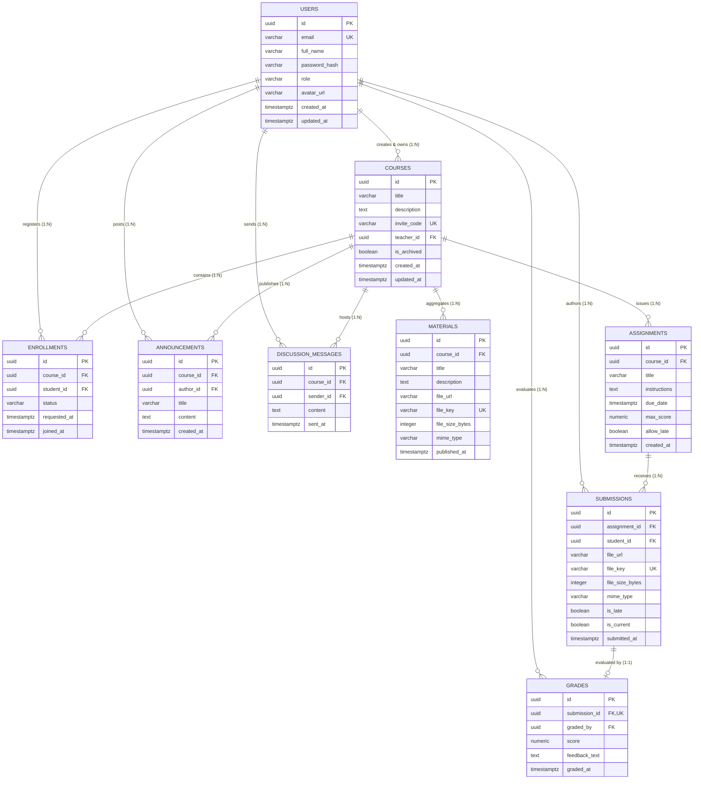

---

## 5.2 Data Specification

### 5.2.1 Table: `users`
Stores registered user credentials, profile information, and assigned roles.

| Table | Column | Data type | Constraints | Description |
| :--- | :--- | :--- | :--- | :--- |
| `users` | `id` | `UUID` | PK, NOT NULL, DEFAULT gen_random_uuid() | Unique identifier for the user. |
| `users` | `email` | `VARCHAR(255)` | UNIQUE, NOT NULL | User email address used for login. |
| `users` | `full_name` | `VARCHAR(100)` | NOT NULL | User's full display name. |
| `users` | `password_hash`| `VARCHAR(255)` | NOT NULL | Salted cryptographic password hash. |
| `users` | `role` | `VARCHAR(20)` | NOT NULL, CHECK (role IN ('TEACHER','STUDENT')) | User role enforcing RBAC (BR-01). |
| `users` | `token_version` | `INTEGER` | NOT NULL, DEFAULT 1 | Incremented atomically when reuse of a rotated refresh token is detected; every mutation checks it so revoked sessions cannot write (ADR-003). |
| `users` | `avatar_url` | `VARCHAR(512)` | NULL | Optional URL to user's profile picture. |
| `users` | `created_at` | `TIMESTAMPTZ` | NOT NULL, DEFAULT NOW() | Account registration timestamp. |
| `users` | `updated_at` | `TIMESTAMPTZ` | NOT NULL, DEFAULT NOW() | Last profile modification timestamp. |

---

### 5.2.2 Table: `courses`
Stores course information created and managed by instructors.

| Table | Column | Data type | Constraints | Description |
| :--- | :--- | :--- | :--- | :--- |
| `courses` | `id` | `UUID` | PK, NOT NULL, DEFAULT gen_random_uuid() | Unique identifier for the course. |
| `courses` | `title` | `VARCHAR(150)` | NOT NULL | Course title (e.g., "Web Development"). |
| `courses` | `description` | `TEXT` | NULL | Full description or course outline. |
| `courses` | `invite_code` | `VARCHAR(12)` | UNIQUE, NOT NULL | Alphanumeric invite code for joining. |
| `courses` | `teacher_id` | `UUID` | FK (users.id ON DELETE RESTRICT), NOT NULL | Owning teacher ID (BR-02). |
| `courses` | `is_archived` | `BOOLEAN` | NOT NULL, DEFAULT FALSE | Flag indicating if course is archived. |
| `courses` | `created_at` | `TIMESTAMPTZ` | NOT NULL, DEFAULT NOW() | Timestamp when course was created. |
| `courses` | `updated_at` | `TIMESTAMPTZ` | NOT NULL, DEFAULT NOW() | Timestamp of last course update. |

---

### 5.2.3 Table: `enrollments`
Tracks student memberships and roster approval statuses for each course.

| Table | Column | Data type | Constraints | Description |
| :--- | :--- | :--- | :--- | :--- |
| `enrollments` | `id` | `UUID` | PK, NOT NULL, DEFAULT gen_random_uuid() | Unique enrollment identifier. |
| `enrollments` | `course_id` | `UUID` | FK (courses.id ON DELETE CASCADE), NOT NULL | Course reference. |
| `enrollments` | `student_id` | `UUID` | FK (users.id ON DELETE CASCADE), NOT NULL | Enrolled student reference. |
| `enrollments` | `status` | `VARCHAR(20)` | NOT NULL, CHECK (status IN ('PENDING','ENROLLED','REJECTED')) | Approval status (BR-03, FR-03C). |
| `enrollments` | `requested_at`| `TIMESTAMPTZ` | NOT NULL, DEFAULT NOW() | When student submitted invite code. |
| `enrollments` | `joined_at` | `TIMESTAMPTZ` | NULL | When teacher approved enrollment. |
| *Composite* | `(course_id, student_id)` | *Composite* | UNIQUE | Prevents duplicate student entries (BR-03). |

---

### 5.2.4 Table: `materials`
Houses metadata and cloud storage keys for course study materials published by teachers.

| Table | Column | Data type | Constraints | Description |
| :--- | :--- | :--- | :--- | :--- |
| `materials` | `id` | `UUID` | PK, NOT NULL, DEFAULT gen_random_uuid() | Unique material identifier. |
| `materials` | `course_id` | `UUID` | FK (courses.id ON DELETE CASCADE), NOT NULL | Course where material is published. |
| `materials` | `title` | `VARCHAR(150)` | NOT NULL | Material title. |
| `materials` | `description` | `TEXT` | NULL | Optional description or notes. |
| `materials` | `file_url` | `VARCHAR(512)` | NOT NULL | Public/CDN download URL. |
| `materials` | `file_key` | `VARCHAR(255)` | UNIQUE, NOT NULL | Cloudflare R2 object key (`courses/{courseId}/materials/{materialId}.bin`). |
| `materials` | `original_filename`| `VARCHAR(255)` | NOT NULL | Original sanitized human-readable filename for downloads. |
| `materials` | `file_size_bytes`| `INTEGER` | NOT NULL, CHECK (file_size_bytes > 0 AND file_size_bytes <= 20971520) | File size (max 20 MiB per BR-06). |
| `materials` | `mime_type` | `VARCHAR(100)` | NOT NULL | Validated MIME type (PDF, ZIP, etc.). |
| `materials` | `published_at`| `TIMESTAMPTZ` | NOT NULL, DEFAULT NOW() | Material publication timestamp. |

---

### 5.2.5 Table: `assignments`
Stores assignment requirements, instructions, and due dates created by teachers.

| Table | Column | Data type | Constraints | Description |
| :--- | :--- | :--- | :--- | :--- |
| `assignments` | `id` | `UUID` | PK, NOT NULL, DEFAULT gen_random_uuid() | Unique assignment identifier. |
| `assignments` | `course_id` | `UUID` | FK (courses.id ON DELETE CASCADE), NOT NULL | Course under which assignment is issued. |
| `assignments` | `title` | `VARCHAR(150)` | NOT NULL | Assignment title. |
| `assignments` | `instructions`| `TEXT` | NULL | Full markdown instructions and rubric. |
| `assignments` | `due_date` | `TIMESTAMPTZ` | NOT NULL | Submission deadline timestamp (BR-07). |
| `assignments` | `max_score` | `NUMERIC(5,2)` | NOT NULL, CHECK (max_score > 0) | Maximum achievable points. |
| `assignments` | `allow_late` | `BOOLEAN` | NOT NULL, DEFAULT TRUE | If late submissions are accepted. |
| `assignments` | `created_at` | `TIMESTAMPTZ` | NOT NULL, DEFAULT NOW() | Timestamp of assignment creation. |

---

### 5.2.6 Table: `submissions`
Tracks student solution file uploads and logs late submission timestamps.

| Table | Column | Data type | Constraints | Description |
| :--- | :--- | :--- | :--- | :--- |
| `submissions` | `id` | `UUID` | PK, NOT NULL, DEFAULT gen_random_uuid() | Unique submission identifier. |
| `submissions` | `assignment_id`| `UUID` | FK (assignments.id ON DELETE CASCADE), NOT NULL | Related assignment. |
| `submissions` | `student_id` | `UUID` | FK (users.id ON DELETE CASCADE), NOT NULL | Submitting student. |
| `submissions` | `file_url` | `VARCHAR(512)` | NOT NULL | R2 download URL. |
| `submissions` | `file_key` | `VARCHAR(255)` | UNIQUE, NOT NULL | Cloudflare R2 object key (`assignments/{assignmentId}/submissions/{studentId}/{submissionId}.bin`). |
| `submissions` | `original_filename`| `VARCHAR(255)` | NOT NULL | Original sanitized human-readable filename for downloads. |
| `submissions` | `file_size_bytes`| `INTEGER` | NOT NULL, CHECK (file_size_bytes > 0 AND file_size_bytes <= 20971520) | File size (max 20 MiB per BR-06). |
| `submissions` | `mime_type` | `VARCHAR(100)` | NOT NULL | Validated MIME type. |
| `submissions` | `is_late` | `BOOLEAN` | NOT NULL, DEFAULT FALSE | Late flag: true if submittedAt > dueDate. |
| `submissions` | `submitted_at`| `TIMESTAMPTZ` | NOT NULL, DEFAULT NOW() | Exact submission timestamp. |
| `submissions` | `is_current` | `BOOLEAN` | NOT NULL, DEFAULT TRUE | `true` for the student's latest accepted attempt; earlier attempts are kept with `false` (ADR-004). |
| *Composite* | `(assignment_id, student_id) WHERE is_current` | *Composite* | UNIQUE (partial) | Exactly 1 current submission per student per assignment; earlier attempts are retained. |

---

### 5.2.7 Table: `grades`
Contains teacher evaluations, scores, and feedback for student submissions.

| Table | Column | Data type | Constraints | Description |
| :--- | :--- | :--- | :--- | :--- |
| `grades` | `id` | `UUID` | PK, NOT NULL, DEFAULT gen_random_uuid() | Unique grade identifier. |
| `grades` | `submission_id`| `UUID` | FK (submissions.id ON DELETE CASCADE), UNIQUE, NOT NULL | 1:1 link to submission evaluated. |
| `grades` | `graded_by` | `UUID` | FK (users.id ON DELETE RESTRICT), NOT NULL | Teacher who evaluated the work (BR-08). |
| `grades` | `score` | `NUMERIC(5,2)` | NOT NULL, CHECK (score >= 0) | Numeric points awarded. |
| `grades` | `feedback_text`| `TEXT` | NULL | Qualitative written comments. |
| `grades` | `graded_at` | `TIMESTAMPTZ` | NOT NULL, DEFAULT NOW() | Timestamp of grade entry/update. |

---

### 5.2.8 Table: `announcements`
Stores teacher announcements broadcast to course members.

| Table | Column | Data type | Constraints | Description |
| :--- | :--- | :--- | :--- | :--- |
| `announcements` | `id` | `UUID` | PK, NOT NULL, DEFAULT gen_random_uuid() | Unique announcement identifier. |
| `announcements` | `course_id` | `UUID` | FK (courses.id ON DELETE CASCADE), NOT NULL | Target course. |
| `announcements` | `author_id` | `UUID` | FK (users.id ON DELETE CASCADE), NOT NULL | Teacher author (BR-08). |
| `announcements` | `title` | `VARCHAR(150)` | NOT NULL | Announcement title. |
| `announcements` | `content` | `TEXT` | NOT NULL | Full announcement message body. |
| `announcements` | `created_at` | `TIMESTAMPTZ` | NOT NULL, DEFAULT NOW() | Broadcast timestamp. |

---

### 5.2.9 Table: `discussion_messages`
Stores interactive forum and Q&A messages exchanged within a course.

| Table | Column | Data type | Constraints | Description |
| :--- | :--- | :--- | :--- | :--- |
| `discussion_messages` | `id` | `UUID` | PK, NOT NULL, DEFAULT gen_random_uuid() | Unique message identifier. |
| `discussion_messages` | `course_id` | `UUID` | FK (courses.id ON DELETE CASCADE), NOT NULL | Course discussion channel. |
| `discussion_messages` | `sender_id` | `UUID` | FK (users.id ON DELETE CASCADE), NOT NULL | User (student or teacher) posting. |
| `discussion_messages` | `content` | `TEXT` | NOT NULL | Text message body. |
| `discussion_messages` | `sent_at` | `TIMESTAMPTZ` | NOT NULL, DEFAULT NOW() | Message timestamp. |

---

### 5.2.10 Table: `refresh_tokens`
Stores long-lived rotating refresh session tokens for silent access token renewal (ADR-003).

| Table | Column | Data type | Constraints | Description |
| :--- | :--- | :--- | :--- | :--- |
| `refresh_tokens` | `id` | `UUID` | PK, NOT NULL, DEFAULT gen_random_uuid() | Unique refresh token identifier (`jti`). |
| `refresh_tokens` | `user_id` | `UUID` | FK (users.id ON DELETE CASCADE), NOT NULL | Owning user account. |
| `refresh_tokens` | `token_hash` | `VARCHAR(255)` | UNIQUE, NOT NULL | Cryptographic SHA-256 hash of the rotating refresh token. |
| `refresh_tokens` | `expires_at` | `TIMESTAMPTZ` | NOT NULL | Expiration timestamp (7 days from issuance). |
| `refresh_tokens` | `revoked_at` | `TIMESTAMPTZ` | NULL | Timestamp when explicitly invalidated or rotated. |
| `refresh_tokens` | `created_at` | `TIMESTAMPTZ` | NOT NULL, DEFAULT NOW() | Token minting timestamp. |

---

## 5.3 Normalisation and Indexes

### 5.3.1 Normalisation Analysis
The relational schema satisfies **Third Normal Form (3NF)** and **Boyce-Codd Normal Form (BCNF)** across all tables:

1. **First Normal Form (1NF)**:
   - All columns store purely atomic values (e.g., no nested arrays or delimited strings in email, role, or title fields).
   - Each table defines a guaranteed unique primary key (`id` generated via `UUIDv4`).
2. **Second Normal Form (2NF)**:
   - Meets 1NF.
   - For all composite candidate keys (e.g., `(course_id, student_id)` in `enrollments` or `(assignment_id, student_id)` in `submissions`), every non-key attribute depends entirely on the whole key rather than any proper subset.
3. **Third Normal Form (3NF)**:
   - Meets 2NF.
   - There are no transitive functional dependencies ($X \rightarrow Y \rightarrow Z$).
   - For instance, in `submissions`, instructor feedback and score are not stored inline; rather, they are factored out into a dedicated `grades` table. This prevents transitive dependency on student submission attributes and avoids sparse NULL values for ungraded work.
4. **Boyce-Codd Normal Form (BCNF)**:
   - For every non-trivial functional dependency $X \rightarrow Y$, the determinant $X$ is a superkey (either the synthetic `UUID` or candidate unique keys such as `email` in `users` and `invite_code` in `courses`).

### 5.3.2 Query Indexing Strategy
To guarantee that 95% of queries execute in under 500 ms (NFR-01) under serverless edge conditions, explicit indexes are created for all frequent query access paths:

| Index Name | Table | Indexed Column(s) | Index Type | Query Justification |
| :--- | :--- | :--- | :--- | :--- |
| `idx_users_email` | `users` | `email` | B-tree, UNIQUE | Instant lookup during login credential verification (`UC-02`). |
| `idx_courses_teacher_id` | `courses` | `teacher_id` | B-tree | Fast filtering of courses owned by a specific teacher (`UC-03`, `UC-04`). |
| `idx_courses_invite_code` | `courses` | `invite_code` | B-tree, UNIQUE | Sub-millisecond lookup when a student joins via invite code (`UC-06`). |
| `idx_enrollments_student` | `enrollments` | `student_id, status` | B-tree | Fast retrieval of all courses where student has `ENROLLED` status (`UC-03`). |
| `idx_enrollments_course` | `enrollments` | `course_id, status` | B-tree | Accelerates roster inspection and pending applicant listings (`UC-08`, `UC-10`). |
| `idx_materials_course` | `materials` | `course_id, published_at DESC`| B-tree | Efficient chronological retrieval of course learning resources (`UC-07`). |
| `idx_assignments_course` | `assignments` | `course_id, due_date ASC` | B-tree | Lists course assignments ordered chronologically by upcoming due dates (`UC-11`). |
| `idx_submissions_assign_student` | `submissions` | `assignment_id, student_id` WHERE `is_current` | B-tree, UNIQUE (partial) | Instant lookup of a student's current submission for an assignment (`UC-13`). |
| `idx_submissions_assign` | `submissions` | `assignment_id, submitted_at` | B-tree | Enables teacher to view all submitted files sorted by submission time (`UC-14`). |
| `idx_grades_submission` | `grades` | `submission_id` | B-tree, UNIQUE | 1:1 join lookup between student submission and its evaluation (`UC-14`). |
| `idx_announcements_course` | `announcements` | `course_id, created_at DESC`| B-tree | Reverse-chronological feed of course announcements (`UC-19`). |
| `idx_discussions_course` | `discussion_messages`| `course_id, sent_at ASC` | B-tree | Fast chronological rendering of course discussion forum threads (`UC-16`). |
| `idx_refresh_tokens_user` | `refresh_tokens` | `user_id` | B-tree | Fast retrieval and batch revocation of user refresh tokens (`UC-02`, ADR-003). |
| `idx_refresh_tokens_hash` | `refresh_tokens` | `token_hash` | B-tree, UNIQUE | Sub-millisecond lookup during token renewal (`/api/auth/refresh`, ADR-003). |

---

# 6. User Interface and User Experience Design

## 6.1 Screen List and Screen Flow

### 6.1.1 Screen Flow Diagram

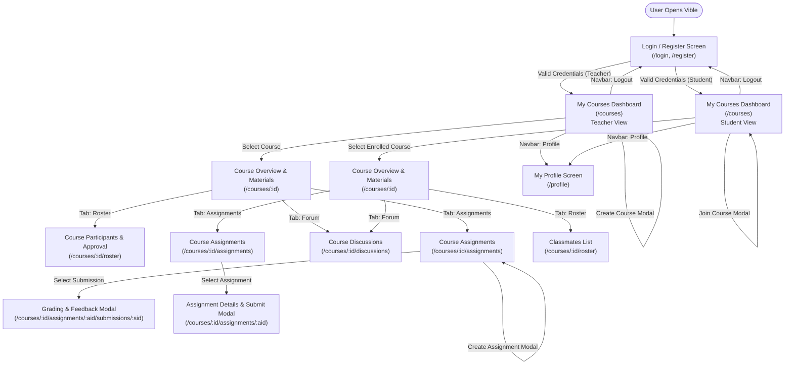

### 6.1.2 Screen List

| # | Screen | Route / View | Description | Related Use Cases |
| :--- | :--- | :--- | :--- | :--- |
| 1 | **Login & Registration** | `/login`, `/register` | Authentication portal for account creation and credential verification. | UC-01, UC-02 |
| 2 | **My Courses Dashboard** | `/courses` | Hub displaying user's courses, "Create Course" (Teacher), or "Join Course" (Student). | UC-03, UC-04, UC-06 |
| 3 | **Course Overview & Materials** | `/courses/:id` | Main course workspace: materials download/upload and announcements feed. | UC-05, UC-07, UC-15, UC-19 |
| 4 | **Course Participants & Roster** | `/courses/:id/roster` | Displays course roster; allows teacher to approve/remove students and share invite codes. | UC-08, UC-09, UC-10 |
| 5 | **Course Assignments Hub** | `/courses/:id/assignments` | Lists upcoming and past coursework tasks with due dates and submission statuses. | UC-11, UC-12, UC-13 |
| 6 | **Submission & Grading Modal** | `/courses/:id/assignments/:aid` | Modal for students to upload submissions and for teachers to review and award grades. | UC-13, UC-14 |
| 7 | **Course Discussions** | `/courses/:id/discussions` | In-course Q&A message board for teachers and students. | UC-16 |
| 8 | **My Profile** | `/profile` | Displays user details, role badge, and password change utility. | UC-17 |

---

## 6.2 Screen Specifications

### 6.2.1 Screen 1: Login & Registration (`/login`, `/register`)

```
+-------------------------------------------------------------------------------+
|                                    VIBLE                                      |
|                             Welcome to Vible LMS                              |
|                                                                               |
|   +-----------------------------------------------------------------------+   |
|   |   [ Tab: Log In ]                         [ Tab: Register ]           |   |
|   |                                                                       |   |
|   |   Email Address:                                                      |   |
|   |   [ student@hcmus.edu.vn                                            ] |   |
|   |                                                                       |   |
|   |   Password:                                                           |   |
|   |   [ ********************                                            ] |   |
|   |                                                                       |   |
|   |   Role Selection (Register only):                                     |   |
|   |   (o) Student      ( ) Teacher                                        |   |
|   |                                                                       |   |
|   |   [                LOG IN / REGISTER SUBMIT BUTTON                 ]  |   |
|   |                                                                       |   |
|   |   * Error alert banner appears here dynamically on failure            |   |
|   +-----------------------------------------------------------------------+   |
+-------------------------------------------------------------------------------+
```

| # | Control | Type | Description / Validation | Event Handling |
| :- | :--- | :--- | :--- | :--- |
| 1 | Tab Switcher | `UButton` Toggle | Switches view between Login and Register form modes. | Updates `isRegisterMode` state; resets form errors. |
| 2 | Email Input | `UInput` (Email) | Required. Must match standard email regex format. | `onBlur`: checks format; shows inline red message if invalid. |
| 3 | Password Input | `UInput` (Password)| Required. Min 8 characters, >= 1 letter, >= 1 digit. | `onInput`: verifies complexity meter. |
| 4 | Role Selector | `URadioGroup` | Required in register mode. Options: `STUDENT` or `TEACHER`. | Binds selected role to payload. |
| 5 | Submit Button | `UButton` (Primary)| Submits credentials; displays loading spinner while active. | `onClick`: validates client fields, dispatches `/api/auth/login`. |
| 6 | Alert Toast | `UAlert` | Displays backend error (e.g. "Invalid credentials"). | Auto-dismisses after 5 seconds or via close icon. |

---

### 6.2.2 Screen 2: My Courses Dashboard (`/courses`)

```
+-------------------------------------------------------------------------------+
|  VIBLE LMS      [My Courses]   [Profile]            [Teacher Mode]  [Logout]  |
+-------------------------------------------------------------------------------+
|  My Courses                                   [+ Create New Course Button]    |
|                                                                               |
|  +---------------------------+   +---------------------------+                |
|  | Software Engineering      |   | Database Systems          |                |
|  | Code: SE-2026-T06         |   | Code: DB-2026-01          |                |
|  | 45 Students Enrolled      |   | 60 Students Enrolled      |                |
|  | 3 Active Assignments      |   | 1 Active Assignment       |                |
|  | [Open Course Workspace]   |   | [Open Course Workspace]   |                |
|  +---------------------------+   +---------------------------+                |
|                                                                               |
|  * (Student View shows "[+ Join Course with Code]" button instead)           |
+-------------------------------------------------------------------------------+
```

| # | Control | Type | Description / Validation | Event Handling |
| :- | :--- | :--- | :--- | :--- |
| 1 | Action CTA Button | `UButton` | Teacher: "Create New Course"; Student: "Join Course with Code". | Opens respective modal (`CreateCourseModal` or `JoinCourseModal`). |
| 2 | Course Card Grid | `UCard` Component | Displays course title, code, student count, and assignment indicators. | `onClick`: navigates user to `/courses/:id`. |
| 3 | Create Course Modal | `UModal` Form | Input: `Course Title` (3..120 chars), `Description` (optional). | `onSubmit`: calls `/api/courses`, appends card optimistically. |
| 4 | Join Course Modal | `UModal` Form | Input: `Invite Code` (6..12 alphanumeric chars). | `onSubmit`: calls `/api/roster/join`, shows "Pending Approval" toast. |

---

### 6.2.3 Screen 3: Course Overview & Materials (`/courses/:id`)

```
+-------------------------------------------------------------------------------+
|  VIBLE LMS > Software Engineering (SE-2026)         [Roster] [Assignments]   |
+-------------------------------------------------------------------------------+
|  Course Announcement Banner:                                                  |
|  "Welcome to Software Engineering! Please review the syllabus below."         |
|  ---------------------------------------------------------------------------  |
|  Learning Materials                           [+ Upload Material (Teacher)]   |
|                                                                               |
|  [PDF] Week 01 - Software Development Lifecycles.pdf (4.2 MB)    [Download]   |
|        Published on Nov 02, 2026 by Truong Hien Long                          |
|                                                                               |
|  [PDF] Week 02 - Requirements Engineering & SRS.pdf (3.1 MB)     [Download]   |
|        Published on Nov 09, 2026 by Truong Hien Long                          |
|                                                                               |
|  [ZIP] Lab 01 - Nuxt 4 Starter Template.zip (12.8 MB)            [Download]   |
|        Published on Nov 10, 2026 by Truong Hien Long                          |
+-------------------------------------------------------------------------------+
```

| # | Control | Type | Description / Validation | Event Handling |
| :- | :--- | :--- | :--- | :--- |
| 1 | Upload Material CTA | `UButton` | Visible only to Teacher. Opens upload dialog. | Triggers `MaterialUploadModal`. |
| 2 | File Upload Input | `UInput` (File) | Enforces `<= 20 MiB`, non-empty, allowed MIME types (PDF, ZIP, DOCX).| Inspects `file.size` before upload; flags error if > 20 MiB. |
| 3 | Material Item Row | `UCard` / List Item| Displays title, size, author, publish date, and download button. | `onClick`: opens pre-signed R2 URL in new tab. |
| 4 | Delete Material Icon| `UButton` (Ghost) | Visible only to Teacher. Displays red confirmation prompt. | `onClick`: issues `DELETE /api/materials/:id`. |

---

### 6.2.4 Screen 4: Course Participants & Roster (`/courses/:id/roster`)

```
+-------------------------------------------------------------------------------+
|  Software Engineering > Participants & Roster          Invite Code: [SE-9X2A] |
+-------------------------------------------------------------------------------+
|  Pending Join Requests (2):                                                   |
|  - Nguyen Van B (24127002) [nvb@hcmus.edu.vn]               [Approve] [Reject] |
|  - Tran Thi C (24127003) [ttc@hcmus.edu.vn]                 [Approve] [Reject] |
|  ---------------------------------------------------------------------------  |
|  Enrolled Students (45):                                                      |
|  #   Student Name          Student ID    Email                  Action        |
|  1   Truong Hien Long      24127445      long@hcmus.edu.vn     [Remove]      |
|  2   Nguyen Van A          24127001      nva@hcmus.edu.vn      [Remove]      |
+-------------------------------------------------------------------------------+
```

| # | Control | Type | Description / Validation | Event Handling |
| :- | :--- | :--- | :--- | :--- |
| 1 | Invite Code Pill | `UBadge` + `UButton`| Displays alphanumeric code with 1-click clipboard copy. | `onClick`: copies link to clipboard, shows tooltip "Copied!". |
| 2 | Approve Button | `UButton` (Success)| Approves a pending student join request. | `onClick`: calls `/api/roster/approve`, moves student to enrolled list. |
| 3 | Reject Button | `UButton` (Danger) | Rejects a pending join request. | `onClick`: calls `/api/roster/reject`, removes applicant row. |
| 4 | Remove Student | `UButton` (Danger) | Removes an enrolled student from the course roster. | `onClick`: prompts confirmation, calls `/api/roster/remove`. |

---

### 6.2.5 Screen 5: Course Assignments & Submission (`/courses/:id/assignments`)

```
+-------------------------------------------------------------------------------+
|  Software Engineering > Assignments Hub        [+ Create Assignment (Teacher)]|
+-------------------------------------------------------------------------------+
|  [Assignment 1: Software Design Document (PA3)]                               |
|  Due Date: Nov 15, 2026, 23:59 (In 5 days)     Max Score: 100.0 pts           |
|  Status: [SUBMITTED - ON TIME]                Grade: Pending Evaluation       |
|                                                                               |
|  Your Submitted File: PA3_Design_Team06.pdf (8.4 MB)                          |
|  Submitted At: Nov 10, 2026, 20:15                                            |
|                                                                               |
|  [                     RESUBMIT WORK BUTTON                         ]         |
|                                                                               |
|  * (Student who has not submitted sees "[ Submit Assignment ]" dropzone)     |
+-------------------------------------------------------------------------------+
```

| # | Control | Type | Description / Validation | Event Handling |
| :- | :--- | :--- | :--- | :--- |
| 1 | Create Assignment CTA| `UButton` | Teacher only. Opens assignment creation modal. | Opens `CreateAssignmentModal`. |
| 2 | File Dropzone | Drag & Drop Area | Accepts single file <= 20 MiB (BR-06). Rejects oversize files. | `onDrop`: validates file size and extension; stages file. |
| 3 | Submit Work Button | `UButton` (Primary)| Uploads solution file and commits record. | `onClick`: streams to R2 via API; updates status badge. |
| 4 | Status Badge | `UBadge` | Displays: `NOT SUBMITTED`, `SUBMITTED`, `LATE`, or `GRADED`. | Dynamically styled (green for on-time, orange for late). |

---

### 6.2.6 Screen 6: Submission Grading & Feedback (`/courses/:id/assignments/:aid/submissions/:sid`)

```
+-------------------------------------------------------------------------------+
|  Grading: Assignment 1 (PA3) > Student: Truong Hien Long (24127445)          |
+-------------------------------------------------------------------------------+
|  Submitted File: [PA3_Design_Team06.pdf] (8.4 MB)              [View / Download]|
|  Submitted At: Nov 10, 2026, 20:15   Status: [On Time]                       |
|  ---------------------------------------------------------------------------  |
|  Score:                                                                       |
|  [ 95.0     ] / 100.0 points                                                  |
|                                                                               |
|  Teacher Feedback Comments:                                                   |
|  [ Excellent architecture diagrams and comprehensive ADR records.       ]     |
|  [ Data design thoroughly satisfies 3NF normalization.                  ]     |
|                                                                               |
|  [                    SAVE & PUBLISH GRADE BUTTON                   ]         |
+-------------------------------------------------------------------------------+
```

| # | Control | Type | Description / Validation | Event Handling |
| :- | :--- | :--- | :--- | :--- |
| 1 | Download Submission | `UButton` | Downloads the student's submitted file directly from R2. | `onClick`: opens signed URL. |
| 2 | Score Input | `UInput` (Number) | Required. Must satisfy `0.0 <= score <= maxScore`. | `onChange`: validates range; shows red error if > maxScore. |
| 3 | Feedback Textarea | `UTextarea` | Qualitative instructor comments for student. | Binds input text to payload. |
| 4 | Save Grade CTA | `UButton` (Success)| Commits evaluation to `grades` table. | `onClick`: calls `POST /api/submissions/:sid/grade`. |

---

## 6.3 Accessibility Checklist

The user interface design of Vible satisfies **WCAG 2.1 Level AA** accessibility standards through the following measures:

- [x] **Text Contrast >= 4.5:1; Colour is Not the Only Indicator**:
  - All text typography satisfies WCAG AA minimum contrast ratios (e.g., `#111827` on `#FFFFFF` gives 16:1 contrast; secondary text `#4B5563` gives 7:1 contrast).
  - Status indicators (e.g., assignment late flags) combine distinct color fills with descriptive text badges (`[LATE]`) and SVG iconography so color-blind users can distinguish states.
- [x] **Full Keyboard Navigability & Visible Focus Indicators**:
  - All interactive elements (`<button>`, `<a>`, `<input>`, `<select>`, modal close triggers) are natively focusable via `Tab` and `Shift+Tab`.
  - Visible high-contrast focus rings (`outline: 2px solid #2563EB; outline-offset: 2px`) are preserved across all components using Tailwind focus utilities.
- [x] **Accessible Form Fields, Labels, and Explanatory Error Messages**:
  - Every form input is explicitly linked to an accessible `<label>` element via matching `id` and `for` attributes.
  - In-line validation failures provide descriptive, actionable explanations (e.g., "File size exceeds 20 MiB limit. Please compress your PDF before uploading.") rather than ambiguous generic errors.
- [x] **Responsive Layout on Mobile and Desktop**:
  - Developed using mobile-first CSS media queries (`sm:`, `md:`, `lg:`).
  - Course grids reflow from 3 columns on desktop down to a single column on mobile devices (320px–480px width) without horizontal scrollbar clipping.

---

# 7. Traceability Update

The Requirements Traceability Matrix (RTM) from PA2 is extended below to link each software requirement to its realizing architectural container, component, class, database table, and UI screen.

> [!NOTE]
> Architectural components and classes are organized within our monorepo workspace structure:
> - **`apps/web (@vible/web)`**: Vue 3 presentation views, composables, Pinia stores, and Nitro edge route controllers.
> - **`packages/shared (@vible/shared)`**: Cross-cutting TypeScript DTOs, Zod validation schemas, business constants (`BR-01`..`BR-08`), and role definitions.
> - **`packages/db (@vible/db)`**: Drizzle ORM schemas, database repositories, migrations, and PostgreSQL connection poolers.
> - **`packages/config (@vible/config)`**: Shared ESLint, Prettier, and TypeScript configurations.

| Req. ID | Related UC | Realizing Screen | Architecture Component | OO Design Classes | Database Table | Test Cases (PA4) |
| :--- | :--- | :--- | :--- | :--- | :--- | :--- |
| **FR-01A** | UC-01 | Login & Register (`/register`) | `auth_service`, `data_access` | `AuthController`, `AuthService`, `UserRepository`, `User` | `users` | TC-AUTH-01, TC-AUTH-02 |
| **FR-01B** | UC-02 | Login & Register (`/login`) | `auth_service`, `auth_guard` | `AuthController`, `AuthService`, `UserRepository`, `User` | `users` | TC-AUTH-03, TC-AUTH-04 |
| **FR-01C** | All UCs | All Screens | `auth_guard`, `role_guard` | `AuthGuard`, `RoleGuardMiddleware`, `User` | `users.role` | TC-RBAC-01, TC-RBAC-02 |
| **FR-02A** | UC-03, UC-04 | My Courses (`/courses`) | `course_service`, `data_access` | `CourseController`, `CourseService`, `CourseRepository`, `Course` | `courses` | TC-CRS-01, TC-CRS-02 |
| **FR-02B** | UC-03, UC-04 | My Courses (`/courses`) | `course_service`, `data_access` | `CourseController`, `CourseService`, `CourseRepository`, `Course` | `courses` | TC-CRS-03, TC-CRS-04 |
| **FR-03A** | UC-08, UC-09, UC-10| Roster (`/courses/:id/roster`) | `enroll_service`, `data_access` | `RosterController`, `EnrollmentService`, `Course` | `courses.invite_code` | TC-RST-01, TC-RST-02 |
| **FR-03B** | UC-08, UC-10 | Roster (`/courses/:id/roster`) | `enroll_service`, `data_access` | `RosterController`, `EnrollmentService`, `EnrollmentRepository` | `enrollments` | TC-RST-03, TC-RST-04 |
| **FR-03C** | UC-06 | Join Modal (`/courses`) | `enroll_service`, `data_access` | `RosterController`, `EnrollmentService`, `Enrollment` | `enrollments` | TC-RST-05, TC-RST-06 |
| **FR-04A** | UC-05 | Course Hub (`/courses/:id`) | `material_service`, `storage_adapter` | `MaterialController`, `MaterialService`, `MaterialRepository`, `Material` | `materials` | TC-MAT-01, TC-MAT-02 |
| **FR-04B** | UC-07 | Course Hub (`/courses/:id`) | `material_service`, `storage_adapter` | `MaterialController`, `MaterialService`, `Material` | `materials` | TC-MAT-03, TC-MAT-04 |
| **FR-05A** | UC-11, UC-12 | Assignments (`/courses/:id/assignments`) | `assign_service`, `data_access` | `AssignmentController`, `AssignmentService`, `Assignment` | `assignments` | TC-ASN-01, TC-ASN-02 |
| **FR-05B** | UC-11, UC-13 | Assignments (`/courses/:id/assignments`) | `submission_service`, `storage_adapter`| `AssignmentController`, `SubmissionService`, `Submission` | `submissions` | TC-SUB-01, TC-SUB-02 |
| **FR-05C** | UC-13 | Assignments (`/courses/:id/assignments`) | `submission_service`, `data_access` | `SubmissionService`, `Submission` | `submissions.is_late` | TC-SUB-03, TC-SUB-04 |
| **FR-06A** | UC-14 | Grading Modal | `submission_service`, `data_access` | `AssignmentController`, `SubmissionService`, `GradeFeedback` | `grades` | TC-GRD-01, TC-GRD-02 |
| **FR-07A** | UC-15, UC-19 | Course Hub (`/courses/:id`) | `course_service`, `data_access` | `CourseController`, `Announcement` | `announcements` | TC-ANN-01, TC-ANN-02 |
| **FR-07B** | UC-16 | Forum (`/courses/:id/discussions`) | `course_service`, `data_access` | `CourseController`, `DiscussionMessage` | `discussion_messages` | TC-FOR-01, TC-FOR-02 |
| **FR-08A** | UC-18 | Notifications | `notification_service` | `NotificationService`, `NotificationFactory` | `notifications` | TC-NOT-01 |
| **FR-09A** | UC-17 | Profile (`/profile`) | `auth_service`, `data_access` | `AuthController`, `AuthService`, `User` | `users` | TC-PRF-01 |

---

# 8. Changes to the Requirements Since PA2

| # | Change | Reason | Affected Items |
| :- | :--- | :--- | :--- |
| 1 | **Explicit Teacher Approval State for Course Enrollments (`PENDING` -> `ENROLLED`)** | In PA2, the invite code join flow briefly implied automatic roster entry, but SRS Section 5.4 (Acceptance Criteria for F03) explicitly mandated teacher confirmation before granting access. We updated the model to explicitly incorporate `EnrollmentStatus` with `PENDING`, `ENROLLED`, and `REJECTED` states. | FR-03C, UC-06, UC-10, `enrollments` table |
| 2 | **Separation of `grades` into a Dedicated Relational Table** | In early drafts, grade score and feedback were embedded as nullable columns directly inside `submissions`. To satisfy 3NF normalization and avoid sparse columns, `grades` was split into an isolated 1:1 table with instructor auditing (`graded_by`). | FR-06A, UC-14, Class `GradeFeedback`, `grades` table |
| 3 | **Cloudflare R2 Direct-Stream Object Architecture** | Moving from an abstract file upload concept to a concrete Edge-streaming mechanism to satisfy BR-06 (max 20 MiB) and NFR-08 without running into Cloudflare V8 Isolate memory caps. | FR-04A, FR-05B, NFR-06, NFR-08, ADR-004 |
| 4 | **Formalization of Late Submission Flag (`is_late`) and Timestamp Audit** | Strengthened BR-07 enforcement: the database schema automatically records `submitted_at` via `TIMESTAMPTZ` and sets `is_late = true` if `submitted_at > due_date`, ensuring non-repudiable audit logs for teachers. | FR-05C, UC-13, BR-07, `submissions` table |
| 5 | **Monorepo Architecture Adoption via pnpm Workspaces** | Decomposed the project into modular workspace packages (`apps/web`, `packages/shared`, `packages/db`, `packages/config`) to ensure single-source-of-truth type and schema sharing between client and Nitro edge server without server driver leakage. | All FRs, System Architecture, Section 3.1.2, ADR-005 |

---

# 9. AI Usage Log

In accordance with HCMUS Course GenAI Policy, all significant uses of Generative AI tools during the Software Design phase are disclosed below:

| # | Member | Tool | Task / Purpose | How the Output was Verified and Changed |
| :- | :--- | :--- | :--- | :--- |
| 1 | **Trương Hiển Long** | Gemini 1.5 Pro | Draft C4 Container and Component diagram structure (Section 3.2–3.4) and architectural style trade-off analysis. | Refined the component boundaries within the Nitro server engine to match route handler, service, and repository layers. Corrected middleware responsibilities for RBAC. |
| 2 | **Trương Hiển Long** | ChatGPT-4o | Formulate Architecture Decision Records (ADR-001 and ADR-003) for Edge Runtime and HttpOnly JWT authentication. | Checked against the documented Cloudflare Workers limits (10 ms CPU cap on the Free plan); no benchmark was run, so the CPU and latency risks are recorded in ADR-001 as open items. Also checked against NFR-07 security requirements. Removed Node-specific dependencies in favor of Web Crypto API and standard edge-compatible libraries. |
| 3 | **Trương Hiển Long** | Claude 3.5 Sonnet | Review Requirements Traceability Matrix (RTM) update in Section 7 to ensure all PA2 functional requirements map to concrete components and classes. | Checked mappings against SRS FR-01 through FR-09; verified that invite-code approval flow and late-submission flags are traced to both backend services and frontend view screens. |
| 4 | **Trương Hiển Long** | ChatGPT-4o | Generate initial relational database schema tables and column constraints for Section 5 (Data Design) in PostgreSQL syntax. | Verified foreign key CASCADE rules against BR-02 and BR-04; adjusted `enrollments` table to support `status` (`PENDING`, `ENROLLED`, `REJECTED`) to match teacher approval workflow. |
| 5 | **Trương Hiển Long** | Claude 3.5 Sonnet | Verify 3NF and BCNF normalization proofs and brainstorm database indexing strategy for Section 5.3. | Checked functional dependencies for `submissions` and `grades`. Extracted `grades` into a dedicated table to prevent transitive dependency and avoid NULL columns for ungraded submissions. Added composite unique index on `(assignment_id, student_id)`. |
| 6 | **Trương Hiển Long** | Gemini 1.5 Pro | Draft ADR-002 comparing Drizzle ORM, Prisma, and MongoDB for Edge PostgreSQL persistence. | Validated benchmark differences on Cloudflare V8 Isolates; emphasized zero-dependency TypeScript query generation and bundle size differences. |
| 7 | **Trương Hiển Long** | Claude 3.5 Sonnet | Generate design-level class specifications and Mermaid class diagrams for Section 4 (Object-Oriented Design). | Reviewed method signatures and return types against Drizzle repository patterns and Nitro route handlers. Ensured domain model separates conceptual entities from implementation-level classes. |
| 8 | **Trương Hiển Long** | ChatGPT-4o | Draft sequence diagrams for UC-02, UC-04, UC-06, UC-13, and UC-14 including alt fragments for late submissions and validation errors. | Corrected participant names to match Class Diagram controllers and services; confirmed that message signatures correspond exactly to operations declared in Class Specifications (Section 4.3). |
| 9 | **Trương Hiển Long** | Gemini 1.5 Pro | Formulate ADR-004 on direct Cloudflare R2 object storage integration and draft state machine diagrams for Enrollment and Submission lifecycles. | Refined submission state transitions to include `DRAFT`, `SUBMITTED_ON_TIME`, `SUBMITTED_LATE`, `GRADED`, and `RESUBMITTED` states according to BR-07 and NFR-06. |
| 10 | **Trương Hiển Long** | ChatGPT-4o | Draft screen flow diagram and navigation routing structure for Section 6 (UI/UX Design). | Cross-checked screen flow against Figma wireframe prototypes; adjusted routing to ensure student views cannot access teacher course management panels or grading controls. |
| 11 | **Trương Hiển Long** | Claude 3.5 Sonnet | Specify UI controls, events, and validation rules for 6 core screens (Login, Dashboard, Course View, Roster, Assignment Submission, Grading). | Verified form field error states against SRS BR-06 (file limit 20 MiB, allowed extensions) and WCAG 2.1 AA accessibility guidelines (contrast ratios, focus rings, ARIA labels). |
| 12 | **Trương Hiển Long** | Gemini 1.5 Pro | Synthesize Section 6.3 Accessibility Checklist and review mobile responsiveness rules against Tailwind CSS breakpoints (`sm`, `md`, `lg`). | Tested viewport resizing and keyboard navigation tab orders; ensured colour is not the sole indicator for assignment submission status (added badge icons and text labels). |
| 13 | **Trương Hiển Long** | Gemini 1.5 Pro | Evaluate Monorepo tooling (pnpm workspaces vs Turborepo vs Nx) and draft ADR-005. | Verified Cloudflare Pages build compatibility (`pnpm --filter @vible/web build`) and root workspace task pipeline caching in Turborepo. |
| 14 | **Trương Hiển Long** | Claude 3.5 Sonnet | Decompose domain contracts into `@vible/shared` and isolate database schemas into `@vible/db`. | Verified compile-time Zod schema validation reuse across Vue 3 forms and Nitro edge API route handlers. |
